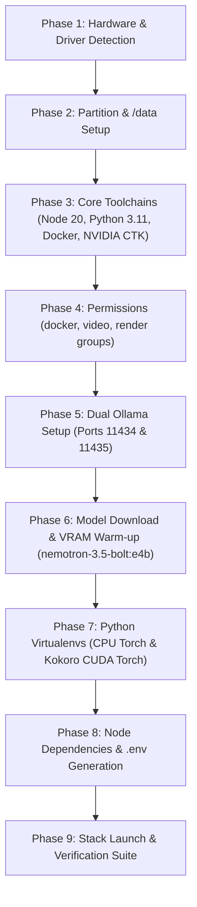

# Autonomous Setup Playbook: Linux Prerequisites & Dual-GPU Worker

> **Instructions for Antigravity Agent:**
> When the user opens this workspace on Linux (Ubuntu Server + KDE Plasma) and asks to set up, install, or run the worker:
> 1. Execute each phase sequentially using terminal commands.
> 2. Check each step's exit code and verification output before proceeding to the next.
> 3. If any prerequisite is missing, install it using the provided commands.
> 4. Ensure non-interactive execution (`export DEBIAN_FRONTEND=noninteractive`).
> 5. Do not stop until Phase 9 verification tests succeed on all ports.

---

## Hardware Target Profile

- **Machine**: Linux Server (Ubuntu 22.04 / 24.04 with KDE Plasma Desktop)
- **CPU**: AMD Ryzen 5 5500 (6 Cores / 12 Threads)
- **System RAM**: 16 GB DDR4
- **Primary GPU**: AMD Radeon RX 9060 XT (8 GB VRAM) — ROCm Backend for Port `11434`
- **Secondary GPU**: NVIDIA GeForce GTX 1060 (6 GB VRAM) — CUDA Backend for Kokoro (`6103`) & Ollama (`11435`)
- **Storage**: 200 GB SSD split into:
  - `100 GB` Primary Partition (`/`)
  - `100 GB` Secondary Partition (Mount target: `/data`)

---

## Execution Flowchart



---

## Phase 1: Hardware & Driver Detection

The agent must verify that both GPUs are detected by the Linux kernel.

### Step 1.1: Detect PCI Devices
```bash
lspci | grep -Ei "vga|3d|display"
```
*Expected: One AMD controller and one NVIDIA controller listed.*

### Step 1.2: Verify NVIDIA Drivers (GTX 1060)
```bash
if command -v nvidia-smi > /dev/null 2>&1; then
    nvidia-smi --query-gpu=name,driver_version,memory.total --format=csv,noheader
else
    echo "NVIDIA driver missing. Installing driver 535..."
    sudo apt-get update && sudo apt-get install -y nvidia-driver-535 nvidia-utils-535
fi
```

### Step 1.3: Verify AMD ROCm Device Nodes (RX 9060 XT)
```bash
if [ -e "/dev/kfd" ] && [ -d "/dev/dri" ]; then
    echo "[OK] AMD device nodes (/dev/kfd, /dev/dri) detected."
else
    echo "AMD ROCm driver nodes missing. Ensure amdgpu dkms and rocm are installed."
    sudo apt-get update && sudo apt-get install -y rocm-hip-sdk libdrm-amdgpu1
fi
```

---

## Phase 2: Partition & `/data` Mount

To prevent the 100 GB root partition (`/`) from running out of space, all Docker layers, Ollama models, and HuggingFace caches must live on `/data`.

### Step 2.1: Mount Secondary Partition
Check available block devices:
```bash
lsblk
```
If the secondary 100GB partition is not yet mounted to `/data`:
```bash
sudo mkdir -p /data
# Replace /dev/nvme0n1p3 or /dev/sda2 with your actual secondary partition identifier:
PARTITION=$(lsblk -lno NAME,SIZE,MOUNTPOINT | awk '$2 ~ /100G/ && $3 == "" {print "/dev/"$1}' | head -n 1)

if [ -n "$PARTITION" ]; then
    echo "Mounting $PARTITION to /data..."
    sudo mount "$PARTITION" /data
    UUID=$(sudo blkid -s UUID -o value "$PARTITION")
    if ! grep -q "/data" /etc/fstab; then
        echo "UUID=$UUID /data ext4 defaults,noatime 0 2" | sudo tee -a /etc/fstab
    fi
fi
```

### Step 2.2: Create Dedicated Storage Directories
```bash
sudo mkdir -p /data/docker /data/models/ollama /data/models/huggingface
sudo chown -R $USER:$USER /data/models
sudo chmod -R 775 /data/models
```

---

## Phase 3: Core Toolchains & System Packages

### Step 3.1: Essential System Packages
```bash
sudo apt-get update && sudo apt-get install -y --no-install-recommends \
    ca-certificates curl gnupg git build-essential pkg-config \
    ffmpeg sox libsox-fmt-all libgl1 libglib2.0-0 software-properties-common \
    net-tools iputils-ping jq openssl
```

### Step 3.2: Node.js 20 LTS
```bash
if ! command -v node > /dev/null 2>&1 || [ "$(node -v | cut -d'.' -f1)" != "v20" ]; then
    echo "Installing Node.js 20.x..."
    curl -fsSL https://deb.nodesource.com/setup_20.x | sudo -E bash -
    sudo apt-get install -y nodejs
fi
node -v
npm -v
```

### Step 3.3: Python 3.11 Toolchain
```bash
sudo add-apt-repository -y ppa:deadsnakes/ppa
sudo apt-get update
sudo apt-get install -y python3.11 python3.11-venv python3.11-dev python3-pip
python3.11 --version
```

### Step 3.4: Docker CE & Docker Compose
```bash
if ! command -v docker > /dev/null 2>&1; then
    sudo install -m 0755 -d /etc/apt/keyrings
    curl -fsSL https://download.docker.com/linux/ubuntu/gpg | sudo gpg --dearmor -o /etc/apt/keyrings/docker.gpg --yes
    sudo chmod a+r /etc/apt/keyrings/docker.gpg
    echo "deb [arch=$(dpkg --print-architecture) signed-by=/etc/apt/keyrings/docker.gpg] https://download.docker.com/linux/ubuntu $(lsb_release -cs) stable" | sudo tee /etc/apt/sources.list.d/docker.list > /dev/null
    sudo apt-get update
    sudo apt-get install -y docker-ce docker-ce-cli containerd.io docker-buildx-plugin docker-compose-plugin
fi
```

### Step 3.5: NVIDIA Container Toolkit & Docker Daemon Config
```bash
if ! command -v nvidia-ctk > /dev/null 2>&1; then
    curl -fsSL https://nvidia.github.io/libnvidia-container/gpgkey | sudo gpg --dearmor -o /usr/share/keyrings/nvidia-container-toolkit-keyring.gpg --yes
    curl -s -L https://nvidia.github.io/libnvidia-container/stable/deb/nvidia-container-toolkit.list | \
      sed 's#deb https://#deb [signed-by=/usr/share/keyrings/nvidia-container-toolkit-keyring.gpg] https://#g' | \
      sudo tee /etc/apt/sources.list.d/nvidia-container-toolkit.list
    sudo apt-get update && sudo apt-get install -y nvidia-container-toolkit
    sudo nvidia-ctk runtime configure --runtime=docker
fi

# Configure /etc/docker/daemon.json with /data/docker data-root:
sudo tee /etc/docker/daemon.json <<EOF
{
  "data-root": "/data/docker",
  "default-runtime": "nvidia",
  "runtimes": {
    "nvidia": {
      "path": "nvidia-container-runtime",
      "runtimeArgs": []
    }
  }
}
EOF

sudo systemctl daemon-reload
sudo systemctl restart docker
```

### Step 3.6: Cloudflared (Internet Exposure)
```bash
if ! command -v cloudflared > /dev/null 2>&1; then
    sudo curl -fsSL https://github.com/cloudflare/cloudflared/releases/latest/download/cloudflared-linux-amd64 -o /usr/local/bin/cloudflared
    sudo chmod +x /usr/local/bin/cloudflared
fi
cloudflared --version
```

---

## Phase 4: Permissions & User Groups

```bash
sudo usermod -aG docker "$USER"
sudo usermod -aG video "$USER"
sudo usermod -aG render "$USER"

# Apply active group without requiring logout in current subshell:
newgrp docker <<EONG
echo "Docker group permissions active."
EONG
```

---

## Phase 5: Dual Ollama Setup (Ports 11434 & 11435)

The worker relies on two distinct Ollama instances running concurrently:
1. **AMD Instance (`0.0.0.0:11434`)**: Bound to AMD RX 9060 XT (ROCm).
2. **NVIDIA Instance (`0.0.0.0:11435`)**: Bound to NVIDIA GTX 1060 (CUDA).

### Method A: Docker Compose (Preferred & Default)
The provided [`docker-compose.yml`](file:///d:/AI/Chatbot/worker/docker-compose.yml) handles this automatically via `network_mode: host`:
- Container `ollama-amd`: Image `ollama/ollama:rocm`, passes `/dev/kfd` and `/dev/dri`, listens on `:11434`.
- Container `ollama-nvidia`: Image `ollama/ollama:latest`, passes GPU 0, listens on `:11435`.
- Shared storage: `/data/models/ollama` is mounted to `/root/.ollama` in both containers.

### Method B: Native Systemd (Alternative to Docker)
If running without Docker, create two systemd unit files:

#### 1. `/etc/systemd/system/ollama-amd.service`
```ini
[Unit]
Description=Ollama AMD Service (ROCm)
After=network.target

[Service]
Type=simple
User=root
Environment="OLLAMA_HOST=0.0.0.0:11434"
Environment="OLLAMA_MODELS=/data/models/ollama"
Environment="ROCR_VISIBLE_DEVICES=0"
Environment="OLLAMA_ORIGINS=*"
ExecStart=/usr/local/bin/ollama serve
Restart=always
RestartSec=3

[Install]
WantedBy=multi-user.target
```

#### 2. `/etc/systemd/system/ollama-nvidia.service`
```ini
[Unit]
Description=Ollama NVIDIA Service (CUDA)
After=network.target

[Service]
Type=simple
User=root
Environment="OLLAMA_HOST=0.0.0.0:11435"
Environment="OLLAMA_MODELS=/data/models/ollama"
Environment="CUDA_VISIBLE_DEVICES=0"
Environment="OLLAMA_ORIGINS=*"
ExecStart=/usr/local/bin/ollama serve
Restart=always
RestartSec=3

[Install]
WantedBy=multi-user.target
```

---

## Phase 6: Model Download & VRAM Warm-up

Once the Ollama instances are running:

### Step 6.1: Pull and Warm Resident Model on AMD (Port 11434)
```bash
# 1. Primary Chatbot: nemotron-3.5-bolt:e4b
curl -X POST http://127.0.0.1:11434/api/pull -d '{"name": "nemotron-3.5-bolt:e4b", "stream": false}'

# Pre-warm into AMD VRAM with indefinite keep_alive:
curl -s -X POST http://127.0.0.1:11434/api/generate \
  -H "Content-Type: application/json" \
  -d '{"model": "nemotron-3.5-bolt:e4b", "prompt": "ready", "keep_alive": -1}'

# 2. Document Analysis Pipeline Model: lfm2.5:8b
curl -X POST http://127.0.0.1:11434/api/pull -d '{"name": "lfm2.5:8b", "stream": false}'

# 3. Vision Analyzer Model: qwen3-vl:4b
curl -X POST http://127.0.0.1:11434/api/pull -d '{"name": "qwen3-vl:4b", "stream": false}'
```

### Step 6.2: Pull Auxiliary Models on NVIDIA (Port 11435)
```bash
# Embeddings Model:
curl -X POST http://127.0.0.1:11435/api/pull -d '{"name": "nomic-embed-text", "stream": false}'

# Alternate Lightweight Vision:
curl -X POST http://127.0.0.1:11435/api/pull -d '{"name": "minicpm-v4.6:1b", "stream": false}'
```

---

## Phase 7: Python Virtual Environments

Three isolated Python environments exist in the worker:

```bash
cd /path/to/worker

# ── 1. python-runtime (Surya OCR, PaddleOCR, Marker PDF on CPU) ──────────
python3.11 -m venv python-runtime/.venv
python-runtime/.venv/bin/pip install --upgrade pip setuptools wheel
python-runtime/.venv/bin/pip install torch torchvision torchaudio --index-url https://download.pytorch.org/whl/cpu
python-runtime/.venv/bin/pip install paddlepaddle
python-runtime/.venv/bin/pip install -r python-runtime/python-requirements.txt

# ── 2. speech-runtime (Speech Gateway & Audio Utilities) ────────────────
python3.11 -m venv speech-runtime/.venv
speech-runtime/.venv/bin/pip install --upgrade pip setuptools wheel
speech-runtime/.venv/bin/pip install -r speech-runtime/requirements-linux.txt

# ── 3. Kokoro venv-nvidia (CUDA 12.1 for GTX 1060 on Port 6103) ────────
python3.11 -m venv speech-runtime/engines/kokoro/venv-nvidia
speech-runtime/engines/kokoro/venv-nvidia/bin/pip install --upgrade pip setuptools wheel
speech-runtime/engines/kokoro/venv-nvidia/bin/pip install torch==2.3.1 torchvision torchaudio --index-url https://download.pytorch.org/whl/cu121
speech-runtime/engines/kokoro/venv-nvidia/bin/pip install -r speech-runtime/engines/kokoro/requirements-linux.txt
```

---

## Phase 8: Node Dependencies & `.env`

```bash
cd /path/to/worker

# Install root dependencies
npm install

# Install HUD dependencies
cd hud && npm install && cd ..

# Generate .env if not present
if [ ! -f ".env" ]; then
    cp .env.example .env
    API_KEY=$(openssl rand -hex 32)
    TOKEN=$(openssl rand -hex 16)
    sed -i "s/replace_with_worker_api_key_32_chars/${API_KEY}/" .env
    sed -i "s/replace_with_hud_token_16_chars/${TOKEN}/" .env
    echo "[OK] Generated .env with unique keys."
fi
```

---

## Phase 9: Launch & Verification Suite

### Launch via Docker Compose
```bash
docker compose up --build -d
```

### Verification Checks

The agent must run these checks and confirm HTTP 200 responses:

```bash
# 1. Check container health
docker compose ps

# 2. Verify AMD Ollama (:11434) and nemotron resident model
curl -s http://127.0.0.1:11434/api/ps | jq .

# 3. Verify NVIDIA Ollama (:11435)
curl -s http://127.0.0.1:11435/api/tags | jq .

# 4. Verify Worker HTTP Ping (:3001)
curl -s http://127.0.0.1:3001/ping

# 5. Verify Worker Capabilities & Tool List (:3001)
curl -s http://127.0.0.1:3001/capabilities | jq .tools

# 6. Verify Python Tool Runtime (:8002)
curl -s http://127.0.0.1:8002/health | jq .

# 7. Verify Speech Runtime (:9000)
curl -s http://127.0.0.1:9000/health | jq .

# 8. Verify Kokoro Engine on NVIDIA CUDA (:6103)
curl -s http://127.0.0.1:6103/v1/health | jq .

# 9. Verify HUD Dashboard (:5173)
curl -s -I http://127.0.0.1:5173 | head -n 1

# 10. Test TTS Audio Synthesis end-to-end
curl -s -X POST http://127.0.0.1:9000/tts \
  -H "Content-Type: application/json" \
  -d '{"text": "n0th1ng AI worker online on Linux.", "voice": "af_heart"}' \
  --output /tmp/test_speech.wav
file /tmp/test_speech.wav
```

---

## Phase 10: Troubleshooting & Quick Remediation

| Issue | Cause | Remediation Command |
| :--- | :--- | :--- |
| **`Permission denied: /dev/kfd`** | User not in `render`/`video` group | `sudo usermod -aG render,video $USER && newgrp render` |
| **`CUDA initialization failed` in Kokoro** | Missing NVIDIA Container Toolkit | `sudo nvidia-ctk runtime configure --runtime=docker && sudo systemctl restart docker` |
| **`No space left on device`** | Root partition (`/`) full | Verify Docker `data-root` is set to `/data/docker` in `/etc/docker/daemon.json` |
| **`nemotron-3.5-bolt:e4b` evicted from VRAM** | `keep_alive` expired | Run `curl -s -X POST http://localhost:11434/api/generate -d '{"model": "nemotron-3.5-bolt:e4b", "prompt": "ping", "keep_alive": -1}'` |
| **Vite HUD returns 403 / Host forbidden** | Missing `host: true` | Verified: `hud/vite.config.ts` has `server: { host: true, port: 5173 }` |
