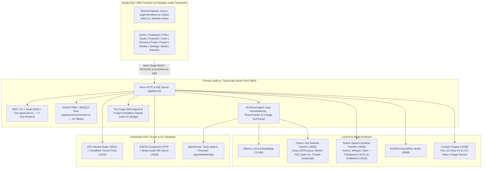
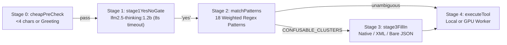

# n0th1ng AI — Complete Frontend & Backend Engineering Manual (v1.8.0)

> **Exhaustive Technical Specification, Workflows, Wire Protocols, Database Schema & Unabridged Codebase Reference**  
> **Root Path:** `d:/AI/Chatbot/app` | **Worker Path:** `d:/AI/Chatbot/worker` | **Coverage:** 100% Frontend + Backend + Database + AI Runtimes

---

## PART I — System Overview, Master Topology & Build Pipeline

### 1. Document Structure & Engineering Scope
This engineering manual provides an exhaustive, code-verified technical reference for the entire **n0th1ng AI Workstation** repository (`d:/AI/Chatbot/app` and `d:/AI/Chatbot/worker`, version `1.8.0`). Every workflow, state machine, wire protocol, database table, DOM controller, streaming parser, and AI microservice is documented down to exact file paths, line ranges, function signatures, and payload contracts.

| Part | Section Title | Technical Coverage Summary |
| :--- | :--- | :--- |
| **Part I** | [Executive Topology, Tech Stack & Build Pipeline](#part-i--system-overview-master-topology--build-pipeline) | Architecture reality (Vanilla MPA vs. legacy React scaffold), Vite + Hono SSR dev server, production esbuild bundle, multi-runtime port map. |
| **Part II** | [Frontend Infrastructure, Design System & Shared Engines](#part-ii--frontend-infrastructure-design-system--shared-engines) | Obsidian & Liquid Gold CSS tokens, 3-tier glassmorphism, fractal SVG noise, `nav.js` (400ms hover-intent), `page-transitions.js` (View Transitions + prefetch), `liquid-select.js` (`MutationObserver` + z-index climbing), `desktop-only.js` (hardware screen guard). |
| **Part III** | [Frontend Modules Deep-Dive (All 13 Workspaces)](#part-iii--all-13-frontend-workspaces-in-detail) | Complete state models, DOM hierarchies, user/data workflows, streaming parsers, and function dictionaries for Home, Chatspace, Files, Studio, FramesX, Voice, Persona Studio, Forge, ForgeX, Monitor, Settings, Model Manager, and Robotics. |
| **Part IV** | [Frontend-to-Backend Wire Protocol & API Matrix](#part-iv--frontend-to-backend-wire-protocols) | SuperJSON tRPC GET/POST envelope, NDJSON `ReadableStream` parsing, `EventSource` SSE named events, multipart `FormData` uploads, and polling fallbacks. |
| **Part V** | [Backend Core, Boot Lifecycle & 17 tRPC Routers](#part-v--backend-core-server-boot--trpc-routers) | `api/boot.ts` startup sequence, auto-DDL, seeding, embedding backfill, direct Hono REST/SSE endpoints, and every procedure across all 17 tRPC sub-routers. |
| **Part VI** | [Core AI Orchestration: Chat, RAG, Memory & Agent Loop](#part-vi--chat-hybrid-rag-memory--agent-loop) | Temporal/Memory/Rolling-Summary context builder, Hybrid `0.8*semantic + 0.2*keyword` RAG, 5-Stage Tool Router Cascade, 25-round Agent Loop, `FenceWatcher`, 3-layer recovery cascade, `PhaseTrackerService`, and all 18 Agent Tools. |
| **Part VII** | [Specialized AI Runtimes, Media, Coding Agents & Cluster](#part-vii--ai-runtimes-media-forge-agents--gpu-cluster) | Python Tool Runtime (`:8002`) & 5-node LangGraph pipeline, ComfyUI (`:8188`) 2-pass Hires Image Studio & FramesX 3-stage LTX-Video Director, Speech Runtime (`:9000`) & PersonaPlex (`:8998`), The Forge & ForgeX, GPU Worker (`:3001/:3443`), and ESP32 Companion (`:3005`). |
| **Part VIII** | [Automated Source-Verified Schema & Codebase Reference](#part-viii--source-verified-schema--codebase-index) | Complete 34-table column-by-column Drizzle/MySQL dictionary extracted from `db/schema.ts` and complete 100% unabridged file/symbol inventory across the entire codebase. |

### 1.1 End-to-End Multi-Runtime System Topology


### 2. Architectural Reality: Vanilla ES6+ MPA vs. Legacy React Scaffold
> [!IMPORTANT]
> Inspecting `d:/AI/Chatbot/app/package.json` (`#L19-L91`) reveals dependencies from an earlier React 19 + Shadcn UI + Tailwind CSS v3 + tRPC React-Query scaffold (such as `react@^19.2.0`, `@radix-ui/*`, `@tanstack/react-query`, `zustand`, `three`, `gsap`, and `lucide-react`), alongside `d:/AI/Chatbot/app/index-old.html` (`#L1-L13`) which references a removed `/src/main.tsx` entry point. **None of those React/Tailwind packages are imported or used by the active production frontend.** Instead, the entire live frontend is a **zero-framework, Vanilla HTML5 + CSS3 + ES6+ JavaScript Multi-Page Application (MPA)** served from `d:/AI/Chatbot/app/index.html` and `d:/AI/Chatbot/app/frontend/*`.

| Subsystem Layer | Technology / Package | Implementation & File Reference |
| :--- | :--- | :--- |
| **Frontend Architecture** | Vanilla HTML5 + CSS3 + ES6+ MPA | 13 self-contained module directories under `d:/AI/Chatbot/app/frontend/*` plus root `index.html`. |
| **Dev Server & Routing** | Vite `^7.2.4` + `@hono/vite-dev-server` `^0.19.0` | `d:/AI/Chatbot/app/vite.config.ts` (`#L9-L15`) mounts `api/boot.ts` on port `3000` with `exclude: [/^\/(?!api\/).*$/]` so Vite serves static HTML/CSS/JS while Hono handles `/api/*`. |
| **Production Bundler** | `vite build` + `esbuild` `^0.27.2` | `package.json` (`#L8`) outputs static frontend to `dist/public` and bundles `api/boot.ts` into `dist/boot.js` (ESM with `createRequire` banner). |
| **Production Static Server** | `@hono/node-server/serve-static` | `d:/AI/Chatbot/app/api/lib/vite.ts` (`#L6-L23`) serves `./dist/public` and falls back to `dist/public/index.html` for `text/html` requests. |
| **Frontend Markdown & Code** | `marked.js` + `highlight.js` v11.11.1 | Loaded via CDN in `d:/AI/Chatbot/app/frontend/chatspace/index.html` (`#L11-L13`) with `github-dark.min.css` theme. |
| **Typography** | Google Fonts CDN | `Inter Tight` (weights 100–600), `Inter` (300–500), and `JetBrains Mono` (300–500) loaded across all pages. |
| **Primary Backend Server** | Hono `^4.8.3` + tRPC `^11.8.1` + SuperJSON | `d:/AI/Chatbot/app/api/boot.ts` (`#L1-L2630`) and `api/router.ts` (`#L1-L47`) with Zod `^4.3.5` validation. |
| **Database & ORM** | MySQL 2 `^3.14.1` + Drizzle ORM `^0.45.1` | 34 tables in `d:/AI/Chatbot/app/db/schema.ts` (`#L1-L872`), pooled in `api/queries/connection.ts` (`#L1-L68`). |
| **Python Tool Service** | FastAPI + Uvicorn (`127.0.0.1:8002`) | `d:/AI/Chatbot/app/python-runtime/app/main.py` (`#L1-L79`) — Surya OCR/Layout, Marker PDF, Vision, 5-node LangGraph. |
| **Python Speech Service** | FastAPI + Uvicorn (`127.0.0.1:9000`) | `d:/AI/Chatbot/app/speech-runtime/main.py` (`#L1-L41`) — Kokoro, Whisper, Piper + FishSpeech (`:6101`) & Chatterbox (`:6102`). |
| **Full-Duplex Speech Server** | NVIDIA PersonaPlex / Moshi (`:8998`) | `d:/AI/Chatbot/app/api/routers/personaplex.ts` (`#L1-L400`) — `nvidia/personaplex-7b-v1` over HTTPS/WSS. |
| **Media Generation Engine** | ComfyUI HTTP + WebSocket (`:8188`) | `d:/AI/Chatbot/app/api/services/comfy.ts` (`#L1-L626`) + `framesx.ts` (`#L1-L1036`) + FFmpeg scene conditioning. |
| **Distributed Worker Node** | Hono (`:3001`) + Cloudflare Tunnel (`:3443`) | `d:/AI/Chatbot/worker/src/server.ts` (`#L1-L413`) & `exposureService.ts` (`#L1-L663`) + Electron Tray. |
| **IoT Companion Server** | Node HTTP + `ws` WebSocketServer (`:3005`) | `d:/AI/Chatbot/app/api/services/companion.ts` (`#L1-L820`) — ESP32 binary audio + Whisper + Gemma3 + Kokoro. |

---

## PART II — Frontend Infrastructure, Design System & Shared Engines

### 1. The 'Obsidian & Liquid Gold' Design System & CSS Architecture
Every module stylesheet (e.g., `d:/AI/Chatbot/app/frontend/home/styles.css` `#L1-L65`, `d:/AI/Chatbot/app/frontend/chatspace/chat.css` `#L1-L27`) implements a unified dark-first token hierarchy built on CSS Custom Properties, 3-tier `backdrop-filter` glassmorphism, and an inline SVG fractal noise overlay:
- **Core Surface & Text Tokens**: `--bg: #030303` (`#050505` in Voice Studio), `--surface: #0a0a0a`, `--text: #F5F5F7`, `--text-secondary: #86868B`, `--text-muted: #52525B`.
- **Liquid Gold Brand Tokens**: `--gold: #D4AF37`, `--gold-bright: #F5D77A`, `--gold-deep: #8A6A1F`, and `--grad-aurora: linear-gradient(135deg, #8A6A1F 0%, #D4AF37 40%, #F5D77A 70%, #F0E2B6 100%)`.
- **Module Theme Overrides**:
  - **Persona Studio (`personastudio.css` `#L9-L26`)**: Overrides accents to NVIDIA Green (`--nvidia-green: #76b900`, `.glass-nvidia`).
  - **Voice Studio (`voice.css` `#L9`, `#L44-L90` & `voice.js` `#L755`)**: Uses a live `--theme-color-rgb` variable updated at 60fps by `Visualizer.animate()` to smoothly interpolate all borders, shadows, and text glows across 6 state-driven RGB palettes (Cyan, Purple, Crimson, Gold, Emerald, Orange).
- **3-Tier Glassmorphism & Fractal Noise**:
  - `.glass`: `background: rgba(255,255,255,0.025); backdrop-filter: blur(30px) saturate(120%); border: 1px solid rgba(255,255,255,0.07)`.
  - `.glass-strong`: `background: rgba(12,12,14,0.78); backdrop-filter: blur(50px) saturate(140%)`.
  - `.glass-liquid`: Adds directional specular top/left border highlights and `linear-gradient(135deg, rgba(255,255,255,0.05) 0%, rgba(255,255,255,0.01) 100%)`.
  - `.noise::after` (`home/styles.css` `#L60-L65`): Renders a fixed fullscreen data-URI SVG `<feTurbulence type='fractalNoise' baseFrequency='0.9' numOctaves='2'/>` at `opacity: 0.03` and `mix-blend-mode: overlay` to eliminate gradient banding.

### 2. Shared Runtime Engines in `d:/AI/Chatbot/app/frontend/assets/`

#### 2.1 Global Navbar & 400ms Hover-Intent Mega-Menu (`nav.js` `#L1-L54` & `nav.css` `#L1-L80`)
- **Scroll Compression (`#L27-L37`)**: Passive scroll listener toggles `.scrolled` on `#navWrap` whenever `window.scrollY > 20`, tightening padding and increasing glass opacity.
- **Mobile Off-Canvas Drawer (`#L6-L24`)**: Binds `#burger`, `.drawer-bg`, and `[data-close]` links to toggle `.open` on `#drawer` and lock `document.body.style.overflow`.
- **Hover-Intent Grace Timer (`#L41-L53`)**: On `#ddFeatures`, `mouseenter` clears any pending timeout and adds `.open`; `mouseleave` starts a **400ms grace timer** (`closeTimer = setTimeout(..., 400)`) before removing `.open` so diagonal cursor travel from the navbar trigger into the multi-column module grid never accidentally collapses the menu.

#### 2.2 Cross-Document View Transitions & Hover Prefetcher (`page-transitions.js` `#L1-L140` & `page-transitions.css` `#L1-L113`)
- **Native MPA View Transitions (`page-transitions.css` `#L14-L50`, `#L108-L109`)**: Declares `@view-transition { navigation: auto; }`. Isolates `#navWrap` with `view-transition-name: n0-nav !important` so the navbar remains pinned in place while `::view-transition-old(root)` runs `vt-out` (`180ms` fade + `0.985` scale) and `::view-transition-new(root)` runs `vt-in` (`260ms` fade + `translateY`).
- **Top Gold Progress Bar Lifecycle (`page-transitions.js` `#L20-L104`)**: Dynamically creates `#vt-bar`. Calls `showBar()` (`#L33-L50`) on internal `<a>` clicks (`#L80-L94`) and `pageswap` (`#L68-L70`), and calls `completeBar()` (`#L53-L62`) on `pagereveal` (`#L72-L74`) and `pageshow` bfcache restores (`#L99-L104`).
- **Intelligent Desktop Hover Prefetching (`#L112-L137`)**: On desktop viewports (`matchMedia('(min-width: 901px)')`) when `navigator.connection.saveData` is false and `effectiveType` is not `2g`, hovering any same-origin `<a href>` records the URL in a deduplicating `Set` (`#L118`) and appends `<link rel='prefetch' href='...'>` to `<head>`.

#### 2.3 Reactive Glassmorphic `<select>` Engine (`liquid-select.js` `#L1-L199` & `liquid-select.css` `#L1-L188`)
- **DOM Construction (`initLiquidSelect` `#L30-L198`)**: Hides the native `<select>` via `.liquid-select-hidden` and inserts a `.liquid-select-wrapper` containing `.liquid-select-trigger` (displaying selected text + animated chevron SVG) and `.liquid-select-dropdown`.
- **Recursive Option & Optgroup Builder (`renderOptions` `#L66-L135`)**: Recursively traverses `<optgroup>` (rendered as `.liquid-select-group-title`) and `<option>` elements. Selecting an item updates `nativeSelect.value` and dispatches a synthetic `new Event('change', { bubbles: true })` (`#L118`) so module event listeners work transparently.
- **Stacking Context Elevation Fix (`toggleElevation` `#L139-L159`)**: Because CSS `backdrop-filter` creates a new stacking context on every glass card, an open dropdown inside a card would normally clip behind sibling cards. When opened, `toggleElevation(true)` walks up the DOM ancestor tree up to `<main>` or `.workspace` and sets `el.style.zIndex = '99999'`, restoring original z-indices on close.
- **Async API Synchronization via `MutationObserver` (`#L189-L192`)**: Attaches a `MutationObserver` watching `{ childList: true, subtree: true, attributes: true, attributeFilter: ['selected'] }` on the hidden `<select>`. Whenever an async `fetch()` populates models, voices, or samplers into the native select, the glass dropdown rebuilds automatically.

#### 2.4 Hardware-Level Phone Guard (`desktop-only.js` `#L1-L44` & `desktop-only.css` `#L1-L69`)
- Loaded synchronously in `<head>` on **Forge** (`frontend/forge/index.html` `#L8-L9`) and **ForgeX** (`frontend/forgex/index.html` `#L8-L9`).
- **Defeating 'Request Desktop Site' Spoofing (`isPhoneDevice` `#L18-L34`)**: Mobile browsers in desktop mode spoof `window.innerWidth` (~980px), bypassing CSS media queries. `isPhoneDevice()` inspects physical hardware dimensions via `Math.min(window.screen.width, window.screen.height) <= 540` (`PHONE_MAX_SHORT_SIDE = 540`) combined with `navigator.maxTouchPoints > 0` or `matchMedia('(pointer: coarse)')`. When true, it adds `html.n0-desktop-only` (`#L36-L38`), activating `#n0DesktopOnlyGuard` (`z-index: 2147483647`) and hiding all other `body > *` elements.

---

## PART III — All 13 Frontend Workspaces in Detail

### Module 1: Home Landing & Workstation Portal (`index.html` & `frontend/home/*`)
- **Files**: `d:/AI/Chatbot/app/index.html` (`#L1-L315`), `d:/AI/Chatbot/app/frontend/home/index.html` (`#L1-L318`), `script.js` (`#L1-L159`), `styles.css` (`#L1-L386`).
- **Hero Scroll Parallax (`script.js` `#L5-L16`)**: Computes `p = Math.min(1, window.scrollY / 600)` on scroll and applies `transform: translateY(${p * 60}px) scale(${1 - p * 0.06})` and `opacity: ${1 - p * 0.9}` to `.hero-inner`.
- **80-Node Gold Constellation Canvas (`particles()` `#L32-L83`)**: Clamps `dpr = Math.min(2, window.devicePixelRatio || 1)` (`#L35`), spawns 80 gold particles (`rgba(245,215,122,0.75)`) with random velocity vectors, bounces them off viewport edges, and draws $O(N^2)$ proximity lines (`rgba(212,175,55, (1 - dist/max) * 0.25)`) whenever two particles come within `140 * dpr` pixels.
- **Live Image Grid Poller (`imgGrid()` `#L86-L114`)**: Queries `GET /api/trpc/image.list` on boot and every `10,000ms` (`#L113`), rendering the 4 newest ComfyUI generated images into `#imgGrid` (falling back to 4 curated Unsplash URLs if the gallery is empty).
- **Sinusoidal Sparkbars & Scroll-Reveal Counters (`#L117-L159`)**: `spark()` (`#L117-L125`) populates 28 sinusoidal bars into `#spark`. An `IntersectionObserver` (`threshold: 0.15`, `#L129-L136`) adds `.in` to `.reveal` sections and triggers `animateCounters()` (`#L142-L152`), which animates `[data-count]` KPI numbers over `1800ms` using cubic ease-out $1 - (1 - p)^3$.

### Module 2: Chatspace — Core LLM Chat, RAG, Multimodal Attachments & Agent Loop (`frontend/chatspace/*`)
- **Files**: `d:/AI/Chatbot/app/frontend/chatspace/index.html` (`#L1-L265`), `chat.js` (`#L1-L1489`), `chat.css` (`#L1-L569`).
- **Module State (`chat.js` `#L1-L6`)**: `currentConversationId` (`string|null`), `currentModel` (`string|null`), `selectedKnowledgeFiles` (`Set<string>`), `attachedFiles` (`File[]`), `useRag` (`boolean`, default `true`), `agentMode` (`boolean`, default `false`).
- **Boot & Cross-Module Voice Transcript Handoff (`#L1458-L1488`)**:
  1. Checks `localStorage.getItem('voiceTranscript')` (`#L1459-L1468`) and `sessionStorage.getItem('voiceStudioTransfer')` (`#L1477-L1488` — written by Voice Studio's STT 'To Chatspace' button in `voice.js` `#L906-L912`). If present, pre-fills `#chatInput`, auto-resizes the textarea, and removes the temporary storage key.
  2. Executes `loadModels()` (`#L1203-L1238`, fetching `GET /api/trpc/model.list` and grouping models into `Open Router Models` and `Ollama Models` `<optgroup>` elements), `loadConversations()` (`#L1279-L1314`, `GET /api/trpc/conversation.list`), and `loadKnowledgeFiles()` (`#L1240-L1269`, `GET /api/trpc/file.list`).
- **Multimodal Attachment Capture (`#L1063-L1130`)**: Captures files from 3 sources: drag-and-drop onto `.chat-area` (`#L1070-L1077`), clipboard image/file paste on `#chatInput` (`#L1080-L1095`), and `#attachBtn` file input (`#L1098-L1106`). `renderAttachments()` (`#L1028`) renders removable chips in `#chatAttachments`.
- **Send Message & Streaming Lifecycle (`handleSend()` `#L200-L276`)**:
  1. Validates non-empty `text` or `attachedFiles.length > 0` (`#L203`).
  2. If `!currentConversationId`, lazily creates a conversation via `createConversation(text.slice(0, 40))` (`#L207-L209` $\rightarrow$ `POST /api/trpc/conversation.create` `#L1135-L1149`).
  3. If `attachedFiles.length > 0`, uploads files via `POST /api/chat-files/upload` using `FormData` (`conversationId` + `files`, `#L222-L259`), receiving processed attachment metadata.
  4. Renders the user bubble via `appendUserMessage(text, uploadedAttachments)` (`#L781-L814`) and persists to MySQL via `saveMessage('user', text)` (`#L1151-L1169` $\rightarrow$ `POST /api/trpc/message.create`).
  5. Branches on `agentMode` (`#L269-L275`):
     - **Branch A — Standard Streaming (`generateRealResponse()` `#L278-L442`)**: Sends `POST /api/chat/stream` (`#L294-L307`) with `{ model, prompt, selectedKnowledgeFiles, uploadedAttachments, conversationId, useRag, timezone }`. Reads NDJSON lines via `response.body.getReader()` + `TextDecoder` (`#L333-L414`):
       - `data.thinking`: Lazily creates `<details class='thinking-box' open>`, starts a `100ms` elapsed timer (`createThinkingTimer()` `#L10-L37`), and appends tokens to `#thinkingContent` (`#L350-L376`).
       - `data.status` / `data.error`: Renders inline status text (`#L378-L382`) or `.error-box` (`#L384-L389`).
       - `data.response`: Stops the thinking timer, collapses `thinkingBox.open = false`, appends tokens to `aiText`, renders HTML via `marked.parse(aiText)`, and highlights code blocks via `hljs.highlightElement(block)` (`#L391-L407`).
       - **Post-Stream**: Persists assistant message via `saveMessage('assistant', aiText, thinkingText)` (`#L428`) and queries `GET /api/chat/sources?conversationId=...` (`#L431-L436`) to populate the right-hand RAG citations drawer via `renderSourcesPanel()` (`#L943-L968`).
     - **Branch B — Multi-Round Agentic Tool Loop (`generateAgentResponse()` `#L460-L778`)**: Sends `POST /api/chat/agent-stream` (`#L483-L496`). Tracks multi-round state in `roundsData` and constructs per-round collapsible containers via `startRoundBlock(roundNum)` (`#L510-L536`):
       - `{ round }`: Finalizes previous round timer and initializes Round N block (`#L569-L579`).
       - `{ thinking }`: Streams reasoning into Round N's `<pre class='thinking-content'>` (`#L583-L591`).
       - `{ tool_call }`: Creates a `.tool-chip.running` badge with tool icon (`TOOL_ICONS` `#L445-L453`), tool name, truncated arguments (`formatToolArgs()` `#L455-L458`), and a live `100ms` execution timer (`#L595-L639`).
       - `{ tool_result }`: Transitions the matching chip from `.running` to `.done`, records elapsed seconds, and appends an expandable `<details class='tool-chip-details'>` result viewer (`#L643-L686`).
       - `{ summary_chunk }` / `{ summary_done }`: Streams a concise post-round summary into `.thinking-summary` (`#L708-L735`).
       - `{ response }`: Streams the final synthesized Markdown answer and persists the entire multi-round trace via `saveExtendedMessage()` (`#L766` $\rightarrow$ `POST /api/trpc/message.createWithToolCalls` `#L1177-L1201`).

### Module 3: Files & LangGraph Document Intelligence (`frontend/files/*`)
- **Files**: `d:/AI/Chatbot/app/frontend/files/index.html` (`#L1-L251`), `files.js` (`#L1-L871`), `files.css` (`#L1-L332`).
- **Folder & File CRUD (`files.js` `#L95-L295`, `#L368-L410`)**: Manages folders (`loadFolders` `#L95` $\rightarrow$ `file.listFolders`, `file.createFolder` `#L162`, `file.deleteFolder` `#L181`) and files (`loadFiles` `#L201` $\rightarrow$ `file.list`, `file.delete` `#L353`). Implements a `300ms` debounced search on `#fileSearch` (`#L368-L410` $\rightarrow$ `GET /api/trpc/file.search`) and Grid/List layout toggling (`#L55-L67`).
- **Upload & Automatic 5-Node LangGraph SSE Stream (`#L298-L745`)**:
  1. Dropping or selecting files triggers `uploadFile(file)` (`#L311-L343`), posting `FormData` to `POST /api/files/upload`.
  2. When `uploadResult?.fileId` returns, it automatically invokes `startDocumentAnalysis(uploadResult.fileId, file.name)` (`#L332-L335`).
  3. `startDocumentAnalysis()` (`#L591-L699`) opens a streaming SSE reader via `fetch('/api/files/${fileId}/analyze-stream')` (`#L604`) and tracks `PIPELINE_NODES = ['ingestion', 'summarizer', 'extractor', 'metadata', 'synthesizer']` (`#L544`) inside `activeAnalyses` (`Map`).
  4. `handleStreamEvent()` (`#L646-L699`) updates both the bottom-right floating progress toast (`renderToast()` `#L550-L589`) and the modal stepper (`renderAnalysisProgress()` `#L683`) on `event: progress`, streams live LLM reasoning tokens into `#modalLiveThinkingText` on `event: thinking` (`#L661-L667`), and auto-dismisses the toast `4000ms` after `event: done` (`#L676-L681`).
- **3-Tab File Preview Modal (`openPreviewModal()` `#L424-L536` & `#L797-L865`)**: Tab 1 (`preview`) renders native ``, `<video>`, `<audio>`, PDF `<iframe>`, or text snippet; Tab 2 (`extracted`) lazy-loads OCR/PDF text via `GET /api/trpc/fileContent.getByFileId` (`#L470-L530`) with copy support; Tab 3 (`analysis`) fetches `GET /api/files/${fileId}/analysis` (`#L797-L824`) and renders Executive Summary, Key Insights, Q&A Pairs, Topics & Entities tags, and Document Metadata via `buildAnalysisHTML()` (`#L740`).

### Module 4: Image Studio — ComfyUI & 2-Pass Hires Upscaling (`frontend/studio/*`)
- **Files**: `d:/AI/Chatbot/app/frontend/studio/index.html` (`#L1-L478`), `studio.js` (`#L1-L1342`), `studio.css` (`#L1-L896`).
- **Provider & ComfyUI Node Discovery (`studio.js` `#L1171-L1326`)**: `loadImageProviders()` (`#L1171-L1227`) fetches `providers.list` (`mediaType: 'image'`). Selecting a 2-pass `full-pipeline` provider reveals `#upscaleSettingsGroup` and applies defaults via `applyUpscaleDefaults()` (`#L1229-L1288`). `loadComfyOptions()` (`#L1293-L1326`) queries `providers.comfyOptions` to populate live ComfyUI samplers and upscale models.
- **GCD Aspect Ratio Calculator & Snap-to-8 (`#L124-L284`)**: Computes greatest common divisor via `gcd(a, b)` (`#L166`) and maps dimensions to `KNOWN_RATIOS` (`#L124-L134`) in `formatRatio()` (`#L170-L195`). When `#lockRatioToggle` is active, changing width or height scales the opposite dimension proportionally and snaps to multiples of 8 (`Math.round(... / 8) * 8`, `#L240-L250`).
- **SSE Live Progress, Polling Fallback & Split-Pane Comparison (`#L395-L644`)**:
  1. Clicking `#generateBtn` calls `POST /api/image/generate` (`#L417-L433`) and connects `new EventSource('/api/image/stream/${jobId}')` (`connectLiveStream` `#L448-L547`).
  2. Translates ComfyUI node IDs via `STAGE_LABELS` (`#L340-L350`: Pass 1 base generation $\rightarrow$ ESRGAN upscale $\rightarrow$ Pass 2 Hires refinement) and updates `#progressBarFill` on `comfy_progress`. If SSE drops, falls back to `1000ms` polling via `pollGeneration(jobId)` (`#L551-L580`).
  3. `loadResult(jobId)` (`#L584-L644`) inspects `result.baseImageUrl`: if present, activates the side-by-side split viewport (`#canvasSplit` with `#basePane` 'Base Pass 1' and `#finalPane` 'Upscaled Final'); otherwise displays the single image.
- **Lightbox Modal & Parameter Reuse (`#L917-L1167`)**: `openImageModal(id)` (`#L957-L979`) supports keyboard navigation (`ArrowLeft`, `ArrowRight`, `Escape` `#L1149-L1166`) and `reuseConfiguration()` (`#L988-L1081`) to restore all prompt, seed, CFG, sampler, and hires parameters into the left sidebar.

### Module 5: FramesX — Multi-Scene AI Video Studio (`frontend/framesx/*`)
- **Files**: `d:/AI/Chatbot/app/frontend/framesx/index.html` (`#L1-L464`), `framesx.js` (`#L1-L942`), `framesx.css` (`#L1-L953`).
- **Snap-to-32 Resolution & Multi-Scene Threshold (`framesx.js` `#L11`, `#L203-L344`)**: Custom dimensions snap to multiples of 32 via `snapTo32()` (`#L203-L208`). When `#durationSlider` exceeds `SINGLE_SCENE_MAX = 6` seconds (`checkSceneLogic()` `#L224-L236`), `#multiSceneNotice` and LLM scene planning model controls (`loadPlanningModels()` `#L250-L289`) activate.
- **14-Event Multi-Scene SSE Stream (`startGeneration` `#L365-L685`)**: Calls `POST /api/video/generate` and opens `EventSource('/api/video/stream/${jobId}')` (`connectLiveStream` `#L500-L598`), handling `planning_start`, `planning_token` (streams LLM scene prompt expansion tokens live into `#planningStreamText` `#L516-L523`), `planning_done` (renders per-scene cards), `scene_start`, `comfy_queued`, `comfy_node`, `comfy_progress` (updates overall + per-scene progress bar `#scene-bar-${i}`), `comfy_cached`, `scene_done`, `scene_error`, `merging_start`, `merging_done`, `done` (`showResult` `#L640` loads the merged MP4 into `#resultVideo`), and `error`.

### Module 6: Voice Studio — 3D Particle Visualizer & Full-Duplex Speech (`frontend/voice/*`)
- **Files**: `d:/AI/Chatbot/app/frontend/voice/index.html` (`#L1-L343`), `voice.js` (`#L1-L2226`), `voice.css` (`#L1-L557`).
- **9 Object-Oriented Classes in `voice.js`**:
| Class & Line Range | Technical Responsibilities & Internal Mechanics |
| :--- | :--- |
| `VoiceApi` (`#L47-L153`) | Static REST/tRPC client for `/api/speech/*` (`/health`, `/providers`, `/models`, `/voices`, `/profiles`, `/tts`, `/stt`), `/api/voice/*` (`/conversations`, `/conversation`, `/message`), `/api/chat/stream`, and `/api/trpc/model.list`. |
| `SettingsManager` (`#L158-L170`) | Holds active `ttsProvider`, `ttsModel`, `ttsVoice`, `sttProvider`, `sttModel`, `llmModel`, `speed`, `pitch`, `autoPlay`, `handsFree`, `inputDeviceId`, `outputDeviceId`. |
| `DeviceManager` (`#L175-L200`) | Enumerates hardware microphones and speakers via `navigator.mediaDevices.enumerateDevices()`. |
| `AudioEngine` (`#L205-L330`) | Singleton `AudioContext` + `AnalyserNode` (`fftSize = 1024`) + reusable `<audio>` element via `MediaElementAudioSourceNode`. Uses a monotonic `_playToken` counter (`#L213`, `#L246-L315`) so rapid segment transitions never cause uncaught `AbortError` rejections. |
| `AudioQueue` (`#L340-L415`) | Out-of-order sequence reassembly buffer (`_pending: Map<seq, base64>`, `_nextSeq`) that receives `{ audioSegment, seq }` chunks from `/api/chat/stream` and plays sentences strictly in sequential order (`0, 1, 2...`). |
| `HistoryManager` (`#L420-L512`) | Manages local TTS/STT history items and DB-backed STS voice conversations (`loadConversationsFromDB` `#L430-L448`). |
| `Visualizer` (`#L517-L767`) | Renders 500 3D-projected particles on `#voiceCanvas`. Morphs formations (`STAGE_BY_STATE` `#L34-L42`) between `SCATTERED` (idle), `SPHERE` (3D Fibonacci sphere pulsing with mic RMS energy), and `WAVE` (3D sinusoidal ribbon modulated by FFT bins). Smoothly interpolates `THEMES` RGB arrays (`#L20-L28`) and writes `--theme-color-rgb` to `document.documentElement.style` (`#L755`) on every frame. |
| `StateManager` (`#L772-L778`) | Updates `#stateText` HUD overlay and synchronizes `Visualizer.setState()`. |
| `VoiceUI` (`#L783-L1849`) & `VoiceConversation` (`#L1854-L2219`) | Orchestrates Mode 1 (TTS synthesis + voice cloning upload `POST /api/speech/profiles`), Mode 2 (`MediaRecorder` `audio/webm;codecs=opus` $\rightarrow$ `POST /api/speech/stt` + 'To Chatspace' `sessionStorage` transfer), and Mode 3 (STS Live Voice Chat via `webkitSpeechRecognition` with `1500ms` silence timer $\rightarrow$ `POST /api/chat/stream` `responseMode:'voice'` $\rightarrow$ `AudioQueue` playback $\rightarrow$ `POST /api/voice/message` persistence). |

### Module 7: Persona Studio — NVIDIA PersonaPlex Manager (`frontend/personastudio/*`)
- **Files**: `d:/AI/Chatbot/app/frontend/personastudio/index.html` (`#L1-L168`), `personastudio.js` (`#L1-L371`), `personastudio.css` (`#L1-L199`).
- **Parallel Initialization (`init()` `#L43-L65`)**: Runs `Promise.all` across `personaplex.voices`, `personaplex.personas.list`, `personaplex.setup.status`, and `personaplex.server.status`.
- **Setup & Server State Machine (`renderServerState()` `#L105-L213`)**: Handles `!setupStatus.installed` (`not_started` $\rightarrow$ 'Install PersonaPlex' calling `personaplex.setup.start`; `cloning`/`installing` $\rightarrow$ polls every `2000ms` via `startPollingIfNeeded()` `#L67-L97` and streams logs into `#activeLogConsole`; `error` $\rightarrow$ retry) and `setupStatus.installed` (`stopped` $\rightarrow$ collects HuggingFace token `#hfToken` and CPU Offload toggle `#cpuOffload` $\rightarrow$ calls `personaplex.server.start` `#L241-L256`; `starting` $\rightarrow$ `2000ms` log polling; `running` $\rightarrow$ renders Online badge + external link to `serverStatus.url` + 'Stop Server' button). Also provides Persona CRUD (`#L270-L347`).

### Module 8: The Forge — Autonomous Build Agent (`frontend/forge/*`)
- **Files**: `d:/AI/Chatbot/app/frontend/forge/index.html` (`#L1-L292`), `forge.js` (`#L1-L811`), `forge.css` (`#L1-L321`).
- **Dual Ambient Canvases (`forge.js` `#L18-L145`)**: `liquidField()` (`#L24-L85`) renders 5 pulsing molten-gold radial gradient metaballs with `globalCompositeOperation = 'lighter'`; `particles()` (`#L91-L145`) renders a 55-node gold particle network.
- **Cross-Chunk `<think>` Tag Splitter (`streamRawText()` `#L147-L275`)**: Maintains a 10-character tail buffer (`TAG_BUFFER_MAX = 10`, `#L168`) so `<think>` and `</think>` tags split across arbitrary SSE token chunks are cleanly detected, routing reasoning tokens into dim `.raw-think-text` spans (`appendThinkText` `#L257-L265`) and action JSON into bright `.raw-final-text` spans (`appendFinalText` `#L267-L275`).
- **Task Tree & 5-Event SSE Stream (`connectLiveLog` `#L456-L625`)**: `renderTaskTree()` (`#L456-L492`) computes task depth and wires `focusTask(taskId)` (`#L494-L506` $\rightarrow$ `forge.getTaskLog`). `EventSource('/api/forge/${sessionId}/stream')` listens to `iteration` (renders `[THINK]`/`[ACT]`/`[EVALUATE]` groups), `token`, `status`, `raw_activity` (inserts dashed run separators on `false -> true` transitions), and `error`. `sendFollowUp()` (`#L768-L798`) appends new tasks when status is `done`, `blocked`, or `paused`.

### Module 9: ForgeX — Local Claude Code CLI Bridge (`frontend/forgex/*`)
- **Files**: `d:/AI/Chatbot/app/frontend/forgex/index.html` (`#L1-L223`), `forgex.js` (`#L1-L360`), `forgex.css` (`#L1-L321`).
- **Workflow (`forgex.js` `#L98-L360`)**: `FORGEX_API` (`#L98-L127`) wraps `/api/trpc/forgex.*` (`list`, `listModels`, `create`, `sendInput`, `stop`). `connectLiveTerminal(sessionId)` (`#L237-L266`) subscribes to `EventSource('/api/forgex/${sessionId}/stream')` for `output` (`stdout`/`stderr`/`[SYSTEM]` lines in `#forgexTerminal`) and `status`. Because stopping a session kills only the OS child process while keeping `claudeSessionId` in MySQL, `updateFollowupBar()` (`#L213-L224`) enables resumable follow-ups (`claude -p --resume`) whenever status is `idle` or `exited`.

### Module 10: System Telemetry Monitor (`frontend/monitor/*`)
- **Files**: `d:/AI/Chatbot/app/frontend/monitor/index.html` (`#L1-L332`), `monitor.js` (`#L1-L323`), `monitor.css` (`#L1-L291`).
- **4-Rate Concurrent Polling Architecture (`monitor.js` `#L27-L323`)**: Runs 4 independent intervals: (1) `1000ms` `updateSystemStats()` (`#L66-L110` $\rightarrow$ `GET /api/system/current`) updating CPU%, GPU%, RAM%, VRAM%, CPU/GPU SVG circular `stroke-dasharray` thermal gauges, and network KB/s; (2) `3000ms` `updateProcesses()` (`#L188-L230` $\rightarrow$ `GET /api/system/processes`); (3) `5000ms` `updateServices()` (`#L138-L184` $\rightarrow$ `GET /api/system/services`); (4) `15000ms` `updateStorage()` (`#L234-L282` $\rightarrow$ `GET /api/system/storage`), plus a `2.5s` event feed capped at 8 DOM nodes (`#L297-L299`).

### Module 11: Settings & Distributed Cluster Control (`frontend/settings/*`)
- **Files**: `d:/AI/Chatbot/app/frontend/settings/index.html` (`#L1-L531`), `settings.js` (`#L1-L581`), `settings.css` (`#L1-L342`).
- **Lazy Tab Loaders (`settings.js` `#L97-L364`)**: `sectionLoaders` (`#L97-L103`) lazily fetches data on first tab visit: `sec-models` (`loadModels` `#L165-L236` $\rightarrow$ `model.list`, `model.load` with `keepAlive: -1`, `model.unload`), `sec-python` (`loadPython` `#L239-L268` $\rightarrow$ `runtime.python.{status,start,stop}`), `sec-speech` (`loadSpeech` `#L271-L324` $\rightarrow$ `speech.runtime.{status,start,stop}`), and `sec-cluster` (`loadCluster` `#L327-L364` $\rightarrow$ `cluster.workers`).
- **Cluster Worker Telemetry & SSE Log Modal (`openWorkerModal` `#L403-L562`)**: Polls `cluster.metricHistory` every `4000ms` (`#L374`, `refreshWorkerMetrics` `#L432-L460`), draws 7 dependency-free 2D `<canvas>` sparklines via `drawSparkline()` (`#L465-L503`: CPU, RAM, GPU, CPU Temp, GPU Temp, Net RX, Net TX), and streams live worker/Kokoro stdout via `new EventSource('/api/cluster/${workerId}/logs/stream?source=...')` (`startLogStream` `#L506-L546`, capped at 500 DOM nodes `#L559-L561`).

### Module 12: Model Manager (`frontend/model/*`) & Module 13: Robotics (`frontend/robotics/*`)
- **Model Manager (`model-manager.js` `#L1-L426`)**: 8-class Pub/Sub architecture: `EventManager` (`#L9-L35`), `ApiManager` (`#L51-L118`), `StateManager` (`#L123-L152`), `ComponentFactory` (`#L157-L230`, converting camelCase capabilities into Title Case badges), `FilterManager` (`#L236-L274`), `OverviewManager` (`#L276-L291`), `PackageManager` (`#L293-L317`), `ActionManager` (`#L319-L348`), and `DownloadManager` (`#L350-L398`, animating `#download-dock-root`).
- **Robotics Dashboard (`robotics.js` `#L1-L81`)**: `updateTopologyLines()` (`#L27-L47`) computes bounding-box center coordinates on resize to connect `#n-core` to 4 peripheral nodes (`ESP-ALPHA`, `ESP-BETA`, `CAM-01`, `SENS-HUB`) via animated dashed SVG `<path class='t-line'>` elements, paired with a `2500ms` environmental sensor loop (`#L58-L81`).

### Frontend Algorithmic & Mathematical Deep-Dives
#### 1. Voice Studio 3D Particle Projection & Audio-Reactive Morphing (`voice.js` `#L517-L767`)
```javascript
// 1. Fibonacci Sphere Formation (SPHERE stage — listening / thinking / processing)
const phi = Math.acos(1 - 2 * (i + 0.5) / this.particleCount);
const theta = Math.PI * (1 + Math.sqrt(5)) * i;
const r = baseRadius * (1 + rmsEnergy * 0.65);
targetX = r * Math.sin(phi) * Math.cos(theta);
targetY = r * Math.sin(phi) * Math.sin(theta);
targetZ = r * Math.cos(phi);

// 2. 3D Perspective Projection + 60fps RGB Theme Interpolation
const fov = 450;
const scale = fov / (fov + rotatedZ + 500);
const screenX = centerX + rotatedX * scale;
const screenY = centerY + rotatedY * scale;
this.currentRgb[c] += (this.targetRgb[c] - this.currentRgb[c]) * 0.05;
document.documentElement.style.setProperty('--theme-color-rgb', rgbString);
```

#### 2. Forge Cross-Chunk `<think>` Tag Splitter State Machine (`forge.js` `#L165-L275`)
```javascript
// Handles <think> and </think> tags split across arbitrary SSE token boundaries
const TAG_BUFFER_MAX = 10; // length of '</think>' is 8 chars
rawTagBuffer += incomingChunk;
while (rawTagBuffer.length > 0) {
  const targetTag = rawInThinkBlock ? '</think>' : '<think>';
  const idx = rawTagBuffer.indexOf(targetTag);
  if (idx !== -1) {
    const before = rawTagBuffer.slice(0, idx);
    if (before) (rawInThinkBlock ? appendThinkText : appendFinalText)(before);
    rawInThinkBlock = !rawInThinkBlock;
    rawTagBuffer = rawTagBuffer.slice(idx + targetTag.length);
  } else if (rawTagBuffer.length > TAG_BUFFER_MAX) {
    const flushLen = rawTagBuffer.length - TAG_BUFFER_MAX;
    (rawInThinkBlock ? appendThinkText : appendFinalText)(rawTagBuffer.slice(0, flushLen));
    rawTagBuffer = rawTagBuffer.slice(flushLen);
    break;
  } else { break; }
}
```

### Complete 13-Module DOM ID, State & Storage Key Reference Matrix
| Module & Controller | Key JS State Variables | Primary DOM Element IDs | Storage / Persistence |
| :--- | :--- | :--- | :--- |
| **Home** (`home/script.js`) | `window.scrollY`, `IntersectionObserver` | `#particles`, `#imgGrid`, `#spark`, `#stats`, `.hero-inner`, `.reveal`, `[data-count]` | None (stateless portal) |
| **Chatspace** (`chatspace/chat.js`) | `currentConversationId`, `currentModel`, `selectedKnowledgeFiles` (`Set`), `attachedFiles`, `useRag`, `agentMode` | `#chatStream`, `#chatInput`, `#sendBtn`, `#modelSelect`, `#extendedThinkingToggle`, `#ragToggle`, `#attachBtn`, `#chatAttachments`, `#conversationList`, `#knowledgeFileList`, `#sourcesPanel`, `#customModal` | `localStorage.voiceTranscript`, `sessionStorage.voiceStudioTransfer` |
| **Files** (`files/files.js`) | `activeFolderId`, `foldersCache`, `currentPreviewFile`, `activeAnalyses` (`Map`), `toastMinimized` | `#folderList`, `#newFolderBtn`, `#uploadDropzone`, `#fileInput`, `#fileGrid`, `#fileSearch`, `#viewGrid`, `#viewList`, `#previewModal`, `#analysisToast`, `#modalLiveThinkingText` | None (DB-backed via tRPC) |
| **Image Studio** (`studio/studio.js`) | `currentJobId`, `activeEventSource`, `pollTimer`, `isRatioLocked`, `lockedRatio`, `galleryItems` | `#modelSelect`, `#upscaleSettingsGroup`, `#upscaleModelSelect`, `#samplerSelect`, `#widthInput`, `#heightInput`, `#lockRatioToggle`, `#generateBtn`, `#progressBarFill`, `#canvasSplit`, `#basePane`, `#finalPane`, `#galleryGrid`, `#imageModal` | None (DB-backed via `image.list`) |
| **FramesX** (`framesx/framesx.js`) | `currentJobId`, `activeEventSource`, `durationSec`, `SINGLE_SCENE_MAX=6`, `galleryVideos` | `#videoProviderSelect`, `#planningModelSelect`, `#durationSlider`, `#multiSceneNotice`, `#planningStreamText`, `#sceneCardsContainer`, `#resultVideo`, `#videoGalleryGrid` | None (DB-backed via `/api/video/list`) |
| **Voice Studio** (`voice/voice.js`) | 9 OOP classes: `_playToken`, `_pending` (`Map`), `_nextSeq`, `currentStage`, `currentRgb`, `handsFree` | `#voiceCanvas`, `#stateText`, `#modeTtsBtn`, `#modeSttBtn`, `#modeStsBtn`, `#ttsInput`, `#sttRecordBtn`, `#stsMicBtn`, `#voiceChatStream`, `#settingsDrawer`, `#themeSelector` | `sessionStorage.voiceStudioTransfer` |
| **Persona Studio** (`personastudio.js`) | `voicesList`, `personasList`, `setupStatus`, `serverStatus`, `pollInterval` | `#serverStateContainer`, `#activeLogConsole`, `#hfToken`, `#cpuOffload`, `#personaForm`, `#personaName`, `#personaVoice`, `#personaPrompt`, `#personasGrid` | None (`personas.json` + tRPC) |
| **The Forge** (`forge/forge.js`) | `currentSessionId`, `activeEventSource`, `rawInThinkBlock`, `rawTagBuffer`, `tasksCache` | `#liquidField`, `#particles`, `#sessionList`, `#goalInput`, `#stackSelect`, `#modelSelect`, `#taskTree`, `#rawStreamBody`, `#liveLogBody`, `#followupInput`, `#pauseResumeBtn` | None (DB-backed via `forge.*`) |
| **ForgeX** (`forgex/forgex.js`) | `currentSessionId`, `activeEventSource`, `sessionsCache` | `#sessionList`, `#forgexGoal`, `#forgexModel`, `#forgexTerminal`, `#forgexFollowupInput`, `#forgexStopBtn` | None (DB-backed via `forgex.*`) |
| **Monitor** (`monitor/monitor.js`) | `uptimeSeconds`, 4 polling intervals (`1s`/`3s`/`5s`/`15s`) | `#cpuVal`, `#gpuVal`, `#ramVal`, `#vramVal`, `#cpuTemp`, `#gpuTemp`, `#netUp`, `#netDown`, `#processList`, `#serviceList`, `#storageList`, `#eventTerminal`, `#uptime` | None (real-time `/api/system/*`) |
| **Settings** (`settings/settings.js`) | `loadedSections` (`Set`), `wmCurrentWorkerId`, `wmLogEventSource`, `wmPollTimer` | `#settingsNav`, `#settingsSearch`, `#activeModelsList`, `#installedModelsList`, `#keepAliveToggle`, `#pythonStartBtn`, `#speechStartBtn`, `#clusterGrid`, `#workerModal`, `#wmLogPane` | None (lazy-loaded tRPC tabs) |
| **Model Manager** (`model-manager.js`) | `EventManager` listeners, `activeCategory`, `searchQuery`, `activeDownloads` | `#category-list`, `#overview-grid`, `#package-grid`, `#model-search`, `#download-dock-root` | In-memory `StateManager` |
| **Robotics** (`robotics/robotics.js`) | `2500ms` sensor simulation interval, resize observer | `#topologySvg`, `#n-core`, `#simTemp`, `#simHum`, `#simVoc` | None (simulation alpha) |

---

## PART IV — Frontend-to-Backend Wire Protocols

### 1. Native Fetch over tRPC v11 SuperJSON Protocol
Every frontend module invokes tRPC procedures directly over HTTP using tRPC v11's **SuperJSON wire envelope** (configured in `d:/AI/Chatbot/app/api/middleware.ts` `#L1-L10` via `initTRPC.context<TrpcContext>().create({ transformer: superjson })`):
```javascript
// 1. tRPC Query (HTTP GET) — e.g. settings.js #L22-L31 & forge.js #L287-L298
async function trpcQuery(proc, input) {
  const qs = input !== undefined
    ? '?input=' + encodeURIComponent(JSON.stringify({ json: input }))
    : '';
  const res = await fetch('/api/trpc/' + proc + qs);
  const data = await res.json();
  return data?.result?.data?.json;
}

// 2. tRPC Mutation (HTTP POST) — e.g. settings.js #L33-L45 & forge.js #L300-L309
async function trpcMutate(proc, input) {
  const res = await fetch('/api/trpc/' + proc, {
    method: 'POST',
    headers: { 'Content-Type': 'application/json' },
    body: JSON.stringify({ json: input ?? {} })
  });
  const data = await res.json();
  return data?.result?.data?.json;
}
```

### 2. Complete REST, NDJSON Streaming & SSE Endpoint Matrix
| Endpoint & Method | Protocol | Frontend Caller | Backend Handler | Behavior & Stream Events |
| :--- | :--- | :--- | :--- | :--- |
| `POST /api/chat/stream` | NDJSON Stream | `chat.js` `#L294`, `voice.js` `#L123` | `boot.ts` `#L241-L1210` | Standard chat + 5-stage tool router + RAG + memory + optional Kokoro sentence TTS. Emits `{thinking}`, `{status}`, `{response}`, `{audioSegment, seq}`, `{error}`. |
| `POST /api/chat/agent-stream` | NDJSON Stream | `chat.js` `#L544` | `boot.ts` `#L1212-L1383` | 25-round Extended Thinking agent loop. Emits `{round}`, `{thinking}`, `{tool_call}`, `{tool_result}`, `{summary_chunk}`, `{summary_done}`, `{response}`, `{error}`. |
| `GET /api/chat/sources` | REST JSON | `chat.js` `#L431` | `boot.ts` `#L2527` | Returns RAG source citations for a `conversationId`. |
| `POST /api/chat-files/upload` | Multipart `FormData` | `chat.js` `#L225` | `chatUpload.ts` `#L1-L203` | Uploads chat attachments, extracts text, chunks (1000 chars), embeds via `nomic-embed-text`, and stores in `chatAttachments`. |
| `POST /api/files/upload` | Multipart `FormData` | `files.js` `#L318` | `upload.ts` `#L1-L175` | Saves file to `uploads/`, inserts `files` row, triggers `knowledgeWorkflow(id)` for extraction + chunking + embedding. |
| `GET /api/files/:id/analyze-stream` | SSE Stream | `files.js` `#L604` | `analyzeStream.ts` `#L1-L198` | Streams 5-node LangGraph analysis (`progress`, `thinking`, `done`, `error`) from GPU worker or Python runtime (`:8002`) and upserts `documentAnalysis`. |
| `GET /api/files/:id/analysis` | REST JSON | `files.js` `#L815` | `analyzeStream.ts` `#L179-L197` | Fetches persisted LangGraph analysis report from MySQL. |
| `POST /api/image/generate` & `GET /api/image/stream/:jobId` | REST + SSE | `studio.js` `#L417`, `#L453` | `boot.ts` `#L2136-L2248` | Starts ComfyUI single-pass or 2-pass Hires job and streams `queued`, `comfy_node`, `comfy_progress`, `done`, `error`. |
| `POST /api/video/generate` & `GET /api/video/stream/:jobId` | REST + SSE | `framesx.js` `#L417`, `#L505` | `boot.ts` `#L2299-L2419` | Runs LLM scene planning + 3-stage LTX-Video / Wan2.1 ComfyUI rendering + FFmpeg concat. Emits 14 named SSE events. |
| `/api/speech/*` & `/api/voice/*` | REST + Stream | `voice.js` `#L51-L150` | `boot.ts` `#L1385-L2050` | TTS synthesis, STT transcription, voice cloning profiles, and sentence-pipelined STS voice chat. |
| `GET /api/forge/:sessionId/stream` | `EventSource` SSE | `forge.js` `#L518` | `forge/routes.ts` `#L38-L166` | Streams real-time model tokens (`token`) + 1s DB poll (`iteration`, `status`, `raw_activity`, `error`). |
| `GET /api/forgex/:sessionId/stream` | `EventSource` SSE | `forgex.js` `#L244` | `forgex/routes.ts` `#L20-L96` | Streams headless Claude Code CLI `stdout`/`stderr`/`system` output and `status` transitions. |
| `GET /api/cluster/:id/logs/stream` | `EventSource` SSE | `settings.js` `#L528` | `boot.ts` `#L2569` | Proxies live stdout/stderr ring buffer stream from remote GPU cluster worker (`:3001/logs/stream`). |

---

## PART V — Backend Core, Server Boot & 17 tRPC Routers

### 1. Server Boot Sequence & Background Daemons (`api/boot.ts` `#L1-L2630`)
When `d:/AI/Chatbot/app/api/boot.ts` boots, it executes a deterministic 7-step startup lifecycle:
1. **Environment & Hono Middleware**: Loads `.env` via `api/lib/env.ts`, initializes the Hono app, mounts body-limit & logging middleware, and attaches REST/SSE sub-routers (`upload.ts`, `chatUpload.ts`, `analyzeStream.ts`, `forge/routes.ts`, `forgex/routes.ts`).
2. **Distributed Cluster Worker Poller (`startWorkerPoller()`)**: Polls `GET {workerUrl}/capabilities` every `5,000ms` across configured worker URLs (`api/services/workerPoller.ts` `#L147`).
3. **Speech Management Subsystem (`initializeSpeechSystem()`)**: Lazily initializes `SpeechManager` (`api/speech/lazy-speech-manager.ts` `#L20-L35`), registering all 7 TTS/STT providers, voice cloning profiles, and runtime health monitors.
4. **Auto-DDL Table Creation (`ensureDatabaseTables()`)**: Executes idempotent `CREATE TABLE IF NOT EXISTS` statements for `document_analysis`, `forge_sessions`, `forge_task_nodes`, `forge_iterations`, `forgex_sessions`, and `forgex_output`.
5. **Database Seeding & Vector Backfill**: Runs `seedDatabase()` (`db/seed.ts`) if empty and triggers `backfillEmbeddings()` (`api/services/backfillEmbeddings.ts` `#L1-L67`) to generate 768-dim `nomic-embed-text` vectors for unindexed chunks.
6. **Hardware Telemetry Collector (`startTelemetryCollector()`)**: Runs every `15,000ms` (`api/services/telemetry.ts` `#L17`) querying `nvidia-smi` and `systeminformation` to persist snapshots in `systemSnapshots`.
7. **ESP32 Companion Hardware Server (`startCompanionService()`)**: Binds a dedicated HTTP + `WebSocketServer` on `0.0.0.0:3005` (`api/services/companion.ts` `#L746`).

### 2. Complete Inventory of All 17 tRPC Sub-Routers (`api/router.ts` `#L1-L47`)
| Router Key | Source File | Exposed Procedures & Technical Behavior |
| :--- | :--- | :--- |
| `model` | `api/routers/model.ts` (`#L1-L166`) | `list` (merges DB models + live Ollama `/api/tags` + `/api/ps` VRAM state + OpenRouter models), `activeMetrics`, `load` (`POST /api/generate` with `keep_alive`), `unload` (`keep_alive: 0`), `updateConfig`, `setActive`, `pull`, `delete`. |
| `conversation` | `api/routers/conversation.ts` (`#L1-L109`) | `list` (ordered by `isPinned DESC, updatedAt DESC`), `getById` (joins `messages` + `messageToolCalls` grouped by round), `create`, `update`, `delete`, `togglePin`, `clearAll`. |
| `message` | `api/routers/message.ts` (`#L1-L211`) | `listByConversation`, `create` (persists standard turn), `createWithToolCalls` (persists multi-round `thinking`, `executionSummary`, and `messageToolCalls` rows), `delete`. |
| `chat` | `api/routers/chat.ts` (`#L1-L55`) | `send` (non-streaming chat mutation with RAG context injection). |
| `file` | `api/routers/file.ts` (`#L1-L276`) | `list`, `getStats`, `create`, `delete` (removes disk file + DB cascade), `toggleStar`, `search`, `createFolder`, `listFolders`, `deleteFolder`, `moveToFolder`. |
| `fileContent` | `api/routers/fileContent.ts` (`#L1-L33`) | `getByFileId` (returns `extractedText`, `ocrText`, `visionAnalysis`, `tablesJson`, `metadata` for the Files preview modal). |
| `image` | `api/routers/image.ts` (`#L1-L340`) | `list`, `generate` (validates provider, creates job in `generationState`, launches `runGeneration`), `enhancePrompt`, `getJobStatus`, `getActiveJobs`, `delete`. |
| `video` | `api/routers/video.ts` (`#L1-L110`) | `list`, `getById`, `delete` (removes video file and DB row). |
| `providers` | `api/routers/providers.ts` (`#L1-L69`) | `list` (filters image/video providers from `services/providers.ts`), `get`, `comfyOptions` (queries live ComfyUI `/object_info` for samplers, schedulers, and upscale models). |
| `speech` | `api/speech/index.ts` (`#L1-L49`) | Nested routers: `tts`, `stt`, `providers`, `models`, `voices` (cluster-wide voice aggregation), `profiles` (voice cloning), `downloads`, `devices`, `benchmark`, `voiceChat`, `runtime`. |
| `personaplex` | `api/routers/personaplex.ts` (`#L1-L400`) | `voices` (18 Moshi embeddings), `personas.{list,create,update,delete}` (`personas.json`), `setup.{status,start}` (6-step git clone + venv + CUDA torch install), `server.{status,start,stop}` (port 8998 `moshi.server`). |
| `forge` | `api/forge/router.ts` (`#L1-L180`) | `listModels`, `listStacks` (5 stack profiles), `create` (allocates workspace & port, runs DAG planning, starts loop), `pause`, `resume`, `followUp`, `getStatus`, `getTaskTree`, `getTaskLog`, `list`. |
| `forgex` | `api/forgex/router.ts` (`#L1-L101`) | `listModels` (filters local tool-capable Ollama models), `create` (spawns `claude -p`), `sendInput` (spawns `claude -p --resume`), `stop` (kills child PID), `getStatus`, `list`. |
| `system` | `api/routers/system.ts` (`#L1-L137`) | `currentStats`, `storage`, `services`, `serviceHealth`, `processes`. |
| `runtime` | `api/routers/runtime.ts` (`#L1-L26`) | `python.status`, `python.start`, `python.stop` (controls local FastAPI Python runtime on `127.0.0.1:8002` via `services/runtime/manager.ts`). |
| `cluster` | `api/routers/cluster.ts` (`#L1-L69`) | `workers` (lists registered GPU nodes), `worker` (single worker details), `metricHistory` (180-point ring buffer from `clusterMetricsHistory.ts`), `logs` (fetches worker stdout/stderr snapshot). |
| `knowledge` / `research` / `workflow` / `activity` | `api/routers/{knowledge,research,workflow,activity}.ts` | Long-term memory CRUD, research collection queries, workflow graph CRUD & execution, and system activity audit logs. |

---

## PART VI — Core AI Orchestration: Chat, Hybrid RAG, Memory & Agent Loop

### 1. Multi-Layer Prompt Context Assembly Pipeline
- **Layer 1 — Device-Synced Temporal Context (`api/lib/temporalContext.ts` `#L38-L109`)**: `buildTemporalContext({ timezone })` formats the current date, day-of-week, and local time in the client's IANA timezone, computes the elapsed gap since the previous message, and injects `[TEMPORAL CONTEXT]`.
- **Layer 2 — Semantic Long-Term Memory Retrieval (`api/services/memorySemanticSearch.ts` `#L48-L146`)**: `searchMemories(query)` embeds the prompt via `nomic-embed-text`, scores memory chunks using cosine similarity + keyword boost (`score > 0.45`), and formats `[USER MEMORY CONTEXT]`.
- **Layer 3 — Token-Budgeted History & Rolling Summarization (`api/services/contextWindow.ts` `#L1-L209` & `conversationSummary.ts` `#L1-L105`)**: Enforces `MAX_CONTEXT_TOKENS = 150,000` (`CHARS_PER_TOKEN = 3.5`) and `MAX_CONTEXT_MESSAGES = 50`. Every 20 messages, `summarizeConversation()` summarizes the latest 25 messages via `gemma3:4b` into `conversations.summary`.
- **Layer 4 — Hybrid Semantic + Keyword RAG (`api/services/rag.ts` `#L1-L214` & `semanticSearch.ts` `#L92-L307`)**:
  - Scores chunks in `knowledgeChunks` / `chunkEmbeddings` using `finalScore = (0.8 * cosineSimilarity) + (0.2 * keywordMatchRatio)`.
  - Applies dynamic cutoff `threshold = Math.max(0.35, bestScore - 0.15)`, max 2 chunks per file, top 6 chunks total, enriched with `visionAnalysis`, `ocrText`, and `tablesJson` from `fileContents`.
- **Layer 5 — Conversation Attachment RAG (`api/services/chatAttachmentSearch.ts` `#L14-L130`)**: `searchChatAttachments(conversationId, query)` ranks chunks from `chatAttachmentChunks` / `chatAttachmentEmbeddings` (`threshold > 0.35`, top 5 chunks).

### 2. The 5-Stage Tool Router Cascade (`api/services/toolRouter.ts` `#L109-L701`)

- **Stage 0 (`cheapPreCheck` `#L109-L119`)**: Skips messages `< 4` chars or matching `GREETING_RE` when no attachments are present.
- **Stage 1 (`stage1YesNoGate` `#L150-L227`)**: Queries `ROUTER_MODEL = 'lfm2.5-thinking:1.2b'` (`temperature: 0`, `num_predict: 120`, `8,000ms` timeout) for a binary `yes`/`no` gate (fails safe to `true` on timeout).
- **Stage 2 (`matchPatterns` in `toolPattern.ts` `#L434-L467`)**: Scores regex patterns across all 18 tools. If unambiguous and outside `CONFUSABLE_CLUSTERS` (`#L356-L384`), synthesizes arguments immediately via `buildDefaultArguments()` (`#L495-L509`) with zero extra LLM calls.
- **Stage 3 (`stage3FillIn` `#L347-L529`)**: Calls `lfm2.5-thinking:1.2b` with native `tools` JSON schemas, falling back to `<tools>...</tools>` XML extraction (`extractToolsTagPayload` `#L243-L280`) or bare JSON extraction (`extractBareJsonToolCalls` `#L286-L345`).

### 3. Extended Thinking 25-Round Agent Loop (`api/services/agentLoop.ts` `#L1-L1889`)
- **Capability Verification (`modelSupportsThinking` `#L81-L123`)**: Checks Ollama `/api/show` capabilities or reasoning family prefixes (`qwen3`, `deepseek-r1`, `qwq`, `lfm2.5-thinking`, `cogito`).
- **Real-Time `FenceWatcher` Interceptor (`FenceWatcher` `#L660-L783`)**: Buffers backtick sequences in real time, suppresses ```` ```tool_call ```` blocks from the user-facing response stream, and **immediately aborts the LLM stream** once the closing ```` ``` ```` arrives.
- **3-Layer Unfenced Tool Recovery Cascade (`#L1470-L1545`)**:
  1. `tryExtractInstructionFromProse()` (`#L306-L312`) — Inline `tool_call { ... }` matcher.
  2. `tryExtractInstructionFromPlainFences()` (`#L354-L406`) — Plain ```` ```json ```` block inspector.
  3. `resolveInstructionViaSchema()` (`#L160-L214`) $\rightarrow$ `resolveAgentToolCall()` (`toolRouter.ts` `#L727-L827`) — Uses `lfm2.5:8b` with strict JSON schema enforcement.
- **Duplicate Call Guard (`executedCalls` `#L1411-L1418`)**: Blocks identical repeat `toolName::JSON.stringify(args)` calls.
- **`PhaseTrackerService` & Premature Final-Answer Gate (`api/services/phaseTracker.ts` `#L178-L536`)**: Extracts a multi-phase plan from Round 1 thinking via `lfm2.5-thinking:1.2b`, injects `[EXECUTION PLAN STATUS]` into subsequent rounds, and rejects premature final answers (up to `MAX_FINAL_ANSWER_REJECTIONS = 2` at `agentLoop.ts` `#L1557-L1585`) while phases remain unfinished.
- **Executive Post-Loop Synthesis (`synthesizeExecutionSummary` `#L1170-L1340`)**: Produces `## Executive Summary`, `### Key Findings`, and `### Detailed Breakdown` when $\ge 3$ tool calls were executed.

### 4. Complete Specification of All 18 Agent Tools (`api/services/tools.ts` & `toolExecutor.ts`)
| Tool Name | Implementation Target | Arguments Schema | Technical Execution Details |
| :--- | :--- | :--- | :--- |
| `knowledge_search` | `semanticSearch.ts` `#L92` | `{ query, limit? }` | Hybrid `0.8*semantic + 0.2*keyword` search over knowledge chunks. |
| `file_search` | `routers/file.ts` | `{ query }` | Searches `files` by filename and `extractedText` in MySQL. |
| `internet_search` | `tavily.ts` `#L1-L84` | `{ query, max_results? }` | Queries `https://api.tavily.com/search` with `search_depth:'advanced'`. |
| `research_query` | `research.ts` `#L1-L81` | `{ query }` | Runs Tavily search + scrapes full Markdown of top 3 URLs via Firecrawl. |
| `url_reader` | `firecrawl.ts` `#L1-L90` | `{ url }` | Scrapes clean Markdown from any URL via `@mendable/firecrawl-js`. |
| `local_vision_ocr` | Python `:8002` / GPU Worker | `{ image_path }` | Runs Surya OCR (`SuryaOCRProvider`) to extract text lines & bounding boxes. |
| `layout_analyzer` | Python `:8002` / GPU Worker | `{ image_path }` | Runs Surya Layout detection (`SuryaLayoutProvider`). |
| `marker_pdf_pipeline` | Python `:8002` / GPU Worker | `{ pdf_path }` | Converts complex PDFs to Markdown + extracts structured tables via Marker. |
| `local_vision_analyzer` | Python `:8002` / GPU Worker | `{ image_path, prompt }` | Runs multimodal visual Q&A via Qwen3-VL / MiniCPM-V / Florence-2 / InternVL. |
| `document_analysis` | Python `:8002` / GPU Worker | `{ text, file_id? }` | Executes the 5-node LangGraph document intelligence pipeline. |
| `memory_store` | `memory.ts` `#L21` | `{ content, category?, importance? }` | Chunks, embeds via `nomic-embed-text`, and inserts into `memories`. |
| `memory_search` | `memorySemanticSearch.ts` `#L48` | `{ query, limit? }` | Semantic vector search over long-term user memories. |
| `memory_update` | `memory.ts` `#L199` | `{ id, content, importance? }` | Updates an existing memory row and recomputes its chunk embeddings. |
| `memory_delete` | `memory.ts` `#L298` | `{ id }` | Deletes a memory row and cascades chunk embeddings. |
| `scientific_calculator` | `toolExecutor.ts` `#L165` | `{ expression }` | Evaluates math expressions safely in strict JS sandbox with `Math.*` constants. |
| `system_monitor` | `telemetry.ts` `#L1-L105` | `{}` | Returns live GPU, VRAM, CPU, RAM, disk, and temperature metrics. |
| `model_manager` / `ollama_control` | `modelManager.ts` / `ollamaControl.ts` | `{ action, model? }` | Lists, loads, or unloads models in local Ollama VRAM. |
| `sql_query` | `sqlQuery.ts` `#L1-L31` | `{ query }` | Executes read-only `SELECT` queries against the workstation MySQL database. |

---

## PART VII — Specialized AI Runtimes, Media Pipelines, Coding Agents & Cluster

### 1. Python Tool Runtime (`127.0.0.1:8002`) & 5-Node LangGraph Pipeline
- **Files**: `d:/AI/Chatbot/app/python-runtime/app/main.py` (`#L1-L79`), `runtime.py` (`#L1-L155`), `tools/document_analysis/graph.py` (`#L1-L277`), and Node bridge `d:/AI/Chatbot/app/api/services/analyzeStream.ts` (`#L1-L198`).
- **On-Demand Spawner & Cluster Offloading (`api/services/runtime/manager.ts` `#L1-L187`)**: Checks `selectWorker(toolName)` (`api/services/cluster.ts` `#L170`) first; if no remote GPU worker is available, spawns local `uvicorn app.main:app --host 127.0.0.1 --port 8002`.
- **5-Node LangGraph `StateGraph` (`graph.py` `#L114-L277`)**: Executes `ingestion_node` (`#L114`) $\rightarrow$ `summarizer_node` (`#L124`) $\rightarrow$ `extraction_node` (`#L138`) $\rightarrow$ `metadata_node` (`#L152`) $\rightarrow$ `synthesizer_node` (`#L169`) using `lfm2.5:8b` (`format: 'json'`, `stream: True`), streaming tokens via an `asyncio.Queue` (`on_token` `#L246`) and upserting the final report into `documentAnalysis` (`analyzeStream.ts` `#L140-L170`).

### 2. ComfyUI Image Studio & FramesX Multi-Scene Video Pipelines (`:8188`)
- **2-Pass Hires Image Pipeline (`api/services/comfyWorkflowFull.ts` `#L1-L264` & `backgroundGeneration.ts` `#L1-L145`)**:
  - Supports `flux1-schnell`, `flux2-klein`, `flux2-klein-full` (converts LiteGraph JSON via `convertLiteGraphToApi` and patches 2-pass `4x-UltraSharp.pth` + latent refinement via `buildFullPipelineWorkflow` `#L111`), and `flux1-krea-dev-gguf`.
- **FramesX 3-Stage Hierarchical Video Director (`api/services/framesx.ts` `#L1-L1036`)**:
  1. **LLM Scene Expansion (`planScenes` `#L141-L234`)**: Prompts `qwen2.5:7b-instruct` on Ollama to expand a user prompt into `N` sequential cinematic scene descriptions.
  2. **3-Stage LTX-Video 2B Execution (`buildLTX3StageSceneWorkflow` `#L478-L575` & `renderSceneLTX3Stage` `#L581-L708`)**: Stage 1 (Half-Res Draft `384x256`) $\rightarrow$ Stage 2 (Latent Upscale `768x512` + `LTXVAdainLatent`) $\rightarrow$ Stage 3 (Temporal Smoothing + `SaveWEBM`).
  3. **FFmpeg Last-Frame Conditioning (`#L714-L746`)**: Extracts the final frame of Scene $i$ via `ffmpeg`, uploads it to ComfyUI `POST /upload/image`, and feeds it into Scene $i+1$'s `LTXVImgToVideo` node.
  4. **FFmpeg Concatenation (`mergeScenes` `#L753-L821`)**: Concatenates all scene clips via `ffmpeg -f concat -safe 0 -i list.txt -c copy`.

### 3. Speech Subsystem (`:9000`), Cluster Voice Aggregation & PersonaPlex (`:8998`)
- **7 Providers & Distributed Voice Aggregation (`api/speech/manager/providerManager.ts` `#L272-L355`)**: Manages `kokoro`, `whisper`, `piper`, `xtts`, `fishspeech` (`:6101`), `dia`, and `chatterbox` (`:6102`). `listVoices()` merges local voices with remote worker voices (`POST {workerUrl}/speech`), deduplicating by `providerId::modelId::voiceId`.
- **2-Worker Sentence-Pipelined Voice Chat (`boot.ts` `#L1653-L2189` & `api/speech/audio/wav.ts` `#L78-L91`)**: Splits streaming LLM tokens on sentence boundaries, synthesizes sentences across a 2-worker TTS pool (`TTS_CONCURRENCY = 2`), streams ordered base64 WAV chunks, and stitches all chunks via `WavUtil.concat()` (stripping intermediate 44-byte RIFF headers).
- **NVIDIA PersonaPlex Full-Duplex Server (`api/routers/personaplex.ts` `#L1-L400`)**: Automates 6-step setup and spawns `python -m moshi.server --ssl <tempDir>` on port `8998`.

### 4. Autonomous Coding Agents: The Forge & ForgeX
| Stack Profile ID | Source Definition | Conventions & Mandatory Integration Check Behavior |
| :--- | :--- | :--- |
| `node-express` | `api/forge/stacks/nodeExpress.ts` | Node.js + Express + TypeScript/ESM REST API profile. Integration check verifies `npm install`, syntax check, server boot on `allocatedPort`, and HTTP health check. |
| `java-spring-boot` | `api/forge/stacks/javaSpringBoot.ts` | Java 17+ / Maven or Gradle Spring Boot profile. Integration check runs `mvn compile / test` and verifies application context startup. |
| `mern-stack` | `api/forge/stacks/mernStack.ts` | Full-stack MongoDB/Express/React/Node profile with coordinated backend API + frontend client build verification. |
| `python-fastapi` | `api/forge/stacks/pythonFastapi.ts` | Python FastAPI + Uvicorn + Pydantic profile. Integration check validates syntax (`py_compile`), requirements, and Uvicorn boot on `allocatedPort`. |
| `general` | `api/forge/stacks/general.ts` | Language-agnostic profile supporting arbitrary scripts, CLI tools, and static web apps with custom stack instructions. |

- **The Forge Security Sandboxing (`api/forge/execWorker.ts` `#L40-L90`)**: `resolveSafePath()` blocks path traversal outside `D:\Forge\workspaces\{sessionId}`, and `validateCommand()` blocks destructive shell commands. `run_command` is structurally restricted to the final mandatory `isIntegrationCheck: true` task (`agentLoop.ts` `#L296-L319`).
- **ForgeX Headless Claude Code Bridge (`api/forgex/processManager.ts` `#L1-L611`)**: Writes `D:\ForgeX\workspaces\{sessionId}\.claude\settings.json` redirecting `ANTHROPIC_BASE_URL` to `http://localhost:11434`, and spawns `claude -p "<goal>" --output-format stream-json --verbose --permission-mode acceptEdits` with `stdio: ['ignore', 'pipe', 'pipe']` (passing `--resume <claudeSessionId>` on follow-ups).

### 5. Distributed GPU Cluster (`:3001/:3443`) & ESP32 Companion Server (`:3005`)
| WebSocket Frame / Direction | Payload Shape | Backend Processing Pipeline (`api/services/companion.ts`) |
| :--- | :--- | :--- |
| `Client -> Server: hello` | `{ type: 'hello', deviceId, name, deviceType, capabilities, fwVersion }` | Registers device in `companion/registry.ts` (`#L1-L290`); replies with `welcome` + `ai_status` + `weather_update`. |
| `Client -> Server: ping` | `{ type: 'ping', uptimeMs?, rssi?, freeHeap? }` | Updates device `lastSeen` & telemetry; server replies with `{ type: 'pong', serverTime }`. |
| `Client -> Server: chat` | `{ type: 'chat', text, sessionId? }` | Streams LLM response via `gemma3:4b` (`COMPANION_LLM_MODEL`) emitting `chat_token` and `chat_done` frames. |
| `Client -> Server: voice_start` | `{ type: 'voice_start', format: 'pcm16'\|'wav', sampleRate: 16000 }` | Initializes per-connection audio chunks buffer in `companion.ts` (`#L650-L710`). |
| `Client -> Server: [Binary Frame]` | Raw PCM16 / WAV binary WebSocket frame | Appended to active voice buffer for the connected ESP32 or browser client. |
| `Client -> Server: voice_end` | `{ type: 'voice_end' }` | Wraps PCM in 44-byte WAV header if needed, runs Whisper STT $\rightarrow$ emits `voice_transcript` $\rightarrow$ runs `gemma3:4b` $\rightarrow$ emits `voice_response` $\rightarrow$ synthesizes Kokoro `af_sarah` WAV $\rightarrow$ streams 8KB `voice_audio_chunk` frames $\rightarrow$ emits `voice_done`. |

---

## PART VIII — Source-Verified Schema & Full-Stack Codebase Index

### 1. Complete 34-Table MySQL / Drizzle ORM Schema Dictionary (`db/schema.ts` `#L1-L872`)

#### 1.1 Table `users` (Drizzle Export: `users` — `db/schema.ts` `#L16-L23`)
| Column Property | Drizzle / SQL Type Definition | Constraints / Default Chain | Line |
| :--- | :--- | :--- | :--- |
| `id` | `serial("id")` | `.primaryKey()` | `L17` |
| `email` | `varchar("email", { length: 255 })` | `.notNull().unique()` | `L18` |
| `name` | `varchar("name", { length: 255 })` | `nullable` | `L19` |
| `avatarUrl` | `varchar("avatar_url", { length: 500 })` | `nullable` | `L20` |
| `role` | `mysqlEnum("role", ["admin", "user"])` | `.default("admin")` | `L21` |
| `createdAt` | `timestamp("created_at")` | `.defaultNow()` | `L22` |

#### 1.2 Table `folders` (Drizzle Export: `folders` — `db/schema.ts` `#L25-L30`)
| Column Property | Drizzle / SQL Type Definition | Constraints / Default Chain | Line |
| :--- | :--- | :--- | :--- |
| `id` | `serial("id")` | `.primaryKey()` | `L26` |
| `name` | `varchar("name", { length: 255 })` | `.notNull()` | `L27` |
| `userId` | `bigint("user_id", { mode: "number", unsigned: true })` | `.references(() => users.id)` | `L28` |
| `createdAt` | `timestamp("created_at")` | `.defaultNow()` | `L29` |

#### 1.3 Table `conversations` (Drizzle Export: `conversations` — `db/schema.ts` `#L32-L43`)
| Column Property | Drizzle / SQL Type Definition | Constraints / Default Chain | Line |
| :--- | :--- | :--- | :--- |
| `id` | `serial("id")` | `.primaryKey()` | `L33` |
| `title` | `varchar("title", { length: 255 })` | `nullable` | `L34` |
| `summary` | `text("summary")` | `nullable` | `L35` |
| `summarizedMessageCount` | `int("summarized_message_count")` | `.notNull().default(0)` | `L36` |
| `modelId` | `varchar("model_id", { length: 100 })` | `.notNull()` | `L37` |
| `userId` | `bigint("user_id", { mode: "number", unsigned: true })` | `.references(() => users.id)` | `L38` |
| `folderId` | `bigint("folder_id", { mode: "number", unsigned: true })` | `.references(() => folders.id)` | `L39` |
| `isPinned` | `boolean("is_pinned")` | `.default(false)` | `L40` |
| `createdAt` | `timestamp("created_at")` | `.defaultNow()` | `L41` |
| `updatedAt` | `timestamp("updated_at")` | `.defaultNow()` | `L42` |

#### 1.4 Table `messages` (Drizzle Export: `messages` — `db/schema.ts` `#L45-L78`)
| Column Property | Drizzle / SQL Type Definition | Constraints / Default Chain | Line |
| :--- | :--- | :--- | :--- |
| `id` | `serial("id")` | `.primaryKey()` | `L46` |
| `conversationId` | `bigint("conversation_id", { mode: "number", unsigned: true })` | `.references(() => conversations.id)` | `L47` |
| `role` | `mysqlEnum("role", ["user", "assistant", "system"])` | `.notNull()` | `L49` |
| `content` | `text("content")` | `.notNull()` | `L50` |
| `thinking` | `longtext("thinking")` | `nullable` | `L58` |
| `isExtended` | `boolean("is_extended")` | `.default(false)` | `L65` |
| `executionSummary` | `longtext("execution_summary")` | `nullable` | `L74` |
| `tokensUsed` | `int("tokens_used")` | `.default(0)` | `L75` |
| `responseTime` | `int("response_time")` | `nullable` | `L76` |
| `createdAt` | `timestamp("created_at")` | `.defaultNow()` | `L77` |

#### 1.5 Table `message_tool_calls` (Drizzle Export: `messageToolCalls` — `db/schema.ts` `#L91-L122`)
| Column Property | Drizzle / SQL Type Definition | Constraints / Default Chain | Line |
| :--- | :--- | :--- | :--- |
| `id` | `serial("id")` | `.primaryKey()` | `L92` |
| `messageId` | `bigint("message_id", { mode: "number", unsigned: true })` | `.notNull() .references(() => messages.id)` | `L93` |
| `round` | `int("round")` | `.notNull()` | `L100` |
| `instruction` | `text("instruction")` | `nullable` | `L105` |
| `tool` | `varchar("tool", { length: 100 })` | `.notNull()` | `L106` |
| `arguments` | `json("arguments")` | `nullable` | `L107` |
| `result` | `longtext("result")` | `nullable` | `L112` |
| `success` | `boolean("success")` | `.notNull().default(true)` | `L113` |
| `error` | `text("error")` | `nullable` | `L114` |
| `thinking` | `longtext("thinking")` | `nullable` | `L120` |
| `createdAt` | `timestamp("created_at")` | `.defaultNow()` | `L121` |

#### 1.6 Table `ai_models` (Drizzle Export: `aiModels` — `db/schema.ts` `#L124-L138`)
| Column Property | Drizzle / SQL Type Definition | Constraints / Default Chain | Line |
| :--- | :--- | :--- | :--- |
| `id` | `serial("id")` | `.primaryKey()` | `L125` |
| `name` | `varchar("name", { length: 255 })` | `.notNull()` | `L126` |
| `displayName` | `varchar("display_name", { length: 255 })` | `.notNull()` | `L127` |
| `size` | `varchar("size", { length: 50 })` | `nullable` | `L128` |
| `quantization` | `varchar("quantization", { length: 50 })` | `nullable` | `L129` |
| `contextLength` | `int("context_length")` | `nullable` | `L130` |
| `status` | `mysqlEnum("status", ["active", "idle", "loading", "error"])` | `.default("idle")` | `L131` |
| `memoryUsage` | `bigint("memory_usage", { mode: "number" })` | `.default(0)` | `L132` |
| `vramUsage` | `bigint("vram_usage", { mode: "number" })` | `.default(0)` | `L133` |
| `tokenSpeed` | `float("token_speed")` | `.default(0)` | `L134` |
| `lastUsed` | `timestamp("last_used")` | `nullable` | `L135` |
| `isInstalled` | `boolean("is_installed")` | `.default(false)` | `L136` |
| `createdAt` | `timestamp("created_at")` | `.defaultNow()` | `L137` |

#### 1.7 Table `system_snapshots` (Drizzle Export: `systemSnapshots` — `db/schema.ts` `#L140-L156`)
| Column Property | Drizzle / SQL Type Definition | Constraints / Default Chain | Line |
| :--- | :--- | :--- | :--- |
| `id` | `serial("id")` | `.primaryKey()` | `L141` |
| `cpuUsage` | `float("cpu_usage")` | `.notNull()` | `L142` |
| `cpuTemp` | `float("cpu_temp")` | `nullable` | `L143` |
| `ramUsage` | `float("ram_usage")` | `.notNull()` | `L144` |
| `ramTotal` | `bigint("ram_total", { mode: "number" })` | `nullable` | `L145` |
| `gpuUsage` | `float("gpu_usage")` | `nullable` | `L146` |
| `gpuTemp` | `float("gpu_temp")` | `nullable` | `L147` |
| `vramUsage` | `float("vram_usage")` | `nullable` | `L148` |
| `vramTotal` | `bigint("vram_total", { mode: "number" })` | `nullable` | `L149` |
| `storageUsage` | `float("storage_usage")` | `nullable` | `L150` |
| `networkRx` | `bigint("network_rx", { mode: "number" })` | `nullable` | `L151` |
| `networkTx` | `bigint("network_tx", { mode: "number" })` | `nullable` | `L152` |
| `networkRxSpeed` | `float("network_rx_speed")` | `nullable` | `L153` |
| `networkTxSpeed` | `float("network_tx_speed")` | `nullable` | `L154` |
| `createdAt` | `timestamp("created_at")` | `.defaultNow()` | `L155` |

#### 1.8 Table `services` (Drizzle Export: `services` — `db/schema.ts` `#L158-L166`)
| Column Property | Drizzle / SQL Type Definition | Constraints / Default Chain | Line |
| :--- | :--- | :--- | :--- |
| `id` | `serial("id")` | `.primaryKey()` | `L159` |
| `name` | `varchar("name", { length: 100 })` | `.notNull().unique()` | `L160` |
| `displayName` | `varchar("display_name", { length: 255 })` | `.notNull()` | `L161` |
| `status` | `mysqlEnum("status", ["running", "stopped", "error"])` | `.default("stopped")` | `L162` |
| `uptime` | `bigint("uptime", { mode: "number" })` | `nullable` | `L163` |
| `version` | `varchar("version", { length: 50 })` | `nullable` | `L164` |
| `lastChecked` | `timestamp("last_checked")` | `.defaultNow()` | `L165` |

#### 1.9 Table `generated_images` (Drizzle Export: `generatedImages` — `db/schema.ts` `#L168-L249`)
| Column Property | Drizzle / SQL Type Definition | Constraints / Default Chain | Line |
| :--- | :--- | :--- | :--- |
| `id` | `serial("id")` | `.primaryKey()` | `L169` |
| `prompt` | `text("prompt")` | `.notNull()` | `L170` |
| `provider` | `varchar( "provider", { length: 100 } )` | `nullable` | `L177` |
| `modelUsed` | `varchar( "model_used", { length: 255 } )` | `nullable` | `L181` |
| `resolution` | `varchar( "resolution", { length: 50 } )` | `nullable` | `L185` |
| `steps` | `int("steps")` | `nullable` | `L189` |
| `cfg` | `float("cfg")` | `nullable` | `L190` |
| `denoise` | `float( "denoise" )` | `nullable` | `L191` |
| `batchSize` | `int( "batch_size" )` | `nullable` | `L194` |
| `sampler` | `varchar( "sampler", { length: 100 } )` | `nullable` | `L197` |
| `scheduler` | `varchar( "scheduler", { length: 100 } )` | `nullable` | `L201` |
| `seed` | `bigint( "seed", { mode: "number", } )` | `nullable` | `L205` |
| `generationTime` | `int( "generation_time" )` | `nullable` | `L211` |
| `gpuUsage` | `float( "gpu_usage" )` | `nullable` | `L214` |
| `vramUsage` | `float( "vram_usage" )` | `nullable` | `L217` |
| `imageUrl` | `varchar( "image_url", { length: 500 } )` | `nullable` | `L220` |
| `baseImageUrl` | `varchar( "base_image_url", { length: 500 } )` | `nullable` | `L224` |
| `upscaledImageUrl` | `varchar( "upscaled_image_url", { length: 500 } )` | `nullable` | `L228` |
| `pipelineType` | `varchar( "pipeline_type", { length: 50 } )` | `nullable` | `L232` |
| `hiresSteps` | `int( "hires_steps" )` | `nullable` | `L236` |
| `hiresDenoise` | `float( "hires_denoise" )` | `nullable` | `L239` |
| `upscaleModel` | `varchar( "upscale_model", { length: 100 } )` | `nullable` | `L242` |
| `createdAt` | `timestamp( "created_at" )` | `.defaultNow()` | `L246` |

#### 1.10 Table `generated_videos` (Drizzle Export: `generatedVideos` — `db/schema.ts` `#L257-L291`)
| Column Property | Drizzle / SQL Type Definition | Constraints / Default Chain | Line |
| :--- | :--- | :--- | :--- |
| `id` | `serial("id")` | `.primaryKey()` | `L258` |
| `prompt` | `text("prompt")` | `.notNull()` | `L259` |
| `negativePrompt` | `text("negative_prompt")` | `nullable` | `L260` |
| `provider` | `varchar("provider", { length: 100 })` | `nullable` | `L264` |
| `modelUsed` | `varchar("model_used", { length: 255 })` | `nullable` | `L265` |
| `resolution` | `varchar("resolution", { length: 50 })` | `nullable` | `L266` |
| `steps` | `int("steps")` | `nullable` | `L267` |
| `cfg` | `float("cfg")` | `nullable` | `L268` |
| `sampler` | `varchar("sampler", { length: 100 })` | `nullable` | `L269` |
| `scheduler` | `varchar("scheduler", { length: 100 })` | `nullable` | `L270` |
| `seed` | `bigint("seed", { mode: "number" })` | `nullable` | `L271` |
| `frameRate` | `int("frame_rate")` | `nullable` | `L274` |
| `length` | `int("length")` | `nullable` | `L275` |
| `fps` | `int("fps")` | `nullable` | `L276` |
| `durationSeconds` | `float("duration_seconds")` | `nullable` | `L277` |
| `format` | `mysqlEnum("format", ["webp", "mp4"])` | `.default("webp")` | `L278` |
| `sceneCount` | `int("scene_count")` | `.default(1)` | `L282` |
| `scenes` | `json("scenes")` | `nullable` | `L283` |
| `planningModel` | `varchar("planning_model", { length: 100 })` | `nullable` | `L284` |
| `generationTime` | `int("generation_time")` | `nullable` | `L286` |
| `gpuUsage` | `float("gpu_usage")` | `nullable` | `L287` |
| `vramUsage` | `float("vram_usage")` | `nullable` | `L288` |
| `videoUrl` | `varchar("video_url", { length: 500 })` | `nullable` | `L289` |
| `createdAt` | `timestamp("created_at")` | `.defaultNow()` | `L290` |

#### 1.11 Table `file_folders` (Drizzle Export: `fileFolders` — `db/schema.ts` `#L293-L298`)
| Column Property | Drizzle / SQL Type Definition | Constraints / Default Chain | Line |
| :--- | :--- | :--- | :--- |
| `id` | `serial("id")` | `.primaryKey()` | `L294` |
| `name` | `varchar("name", { length: 255 })` | `.notNull()` | `L295` |
| `parentId` | `bigint("parent_id", { mode: "number", unsigned: true })` | `nullable` | `L296` |
| `createdAt` | `timestamp("created_at")` | `.defaultNow()` | `L297` |

#### 1.12 Table `files` (Drizzle Export: `files` — `db/schema.ts` `#L300-L309`)
| Column Property | Drizzle / SQL Type Definition | Constraints / Default Chain | Line |
| :--- | :--- | :--- | :--- |
| `id` | `serial("id")` | `.primaryKey()` | `L301` |
| `name` | `varchar("name", { length: 255 })` | `.notNull()` | `L302` |
| `path` | `varchar("path", { length: 500 })` | `.notNull()` | `L303` |
| `size` | `bigint("size", { mode: "number" })` | `nullable` | `L304` |
| `mimeType` | `varchar("mime_type", { length: 100 })` | `nullable` | `L305` |
| `folderId` | `bigint("folder_id", { mode: "number", unsigned: true })` | `.references(() => fileFolders.id)` | `L306` |
| `isIndexed` | `boolean("is_indexed")` | `.default(false)` | `L307` |
| `createdAt` | `timestamp("created_at")` | `.defaultNow()` | `L308` |

#### 1.13 Table `chat_attachments` (Drizzle Export: `chatAttachments` — `db/schema.ts` `#L311-L350`)
| Column Property | Drizzle / SQL Type Definition | Constraints / Default Chain | Line |
| :--- | :--- | :--- | :--- |
| `id` | `serial("id")` | `.primaryKey()` | `L312` |
| `conversationId` | `bigint("conversation_id", { mode: "number", unsigned: true, })` | `.notNull()` | `L314` |

#### 1.14 Table `research_collections` (Drizzle Export: `researchCollections` — `db/schema.ts` `#L352-L357`)
| Column Property | Drizzle / SQL Type Definition | Constraints / Default Chain | Line |
| :--- | :--- | :--- | :--- |
| `id` | `serial("id")` | `.primaryKey()` | `L353` |
| `name` | `varchar("name", { length: 255 })` | `.notNull()` | `L354` |
| `description` | `text("description")` | `nullable` | `L355` |
| `createdAt` | `timestamp("created_at")` | `.defaultNow()` | `L356` |

#### 1.15 Table `research_documents` (Drizzle Export: `researchDocuments` — `db/schema.ts` `#L359-L368`)
| Column Property | Drizzle / SQL Type Definition | Constraints / Default Chain | Line |
| :--- | :--- | :--- | :--- |
| `id` | `serial("id")` | `.primaryKey()` | `L360` |
| `title` | `varchar("title", { length: 500 })` | `.notNull()` | `L361` |
| `content` | `text("content")` | `nullable` | `L362` |
| `source` | `varchar("source", { length: 500 })` | `nullable` | `L363` |
| `collectionId` | `bigint("collection_id", { mode: "number", unsigned: true })` | `.references(() => researchCollections.id)` | `L364` |
| `isBookmarked` | `boolean("is_bookmarked")` | `.default(false)` | `L366` |
| `createdAt` | `timestamp("created_at")` | `.defaultNow()` | `L367` |

#### 1.16 Table `knowledge_entries` (Drizzle Export: `knowledgeEntries` — `db/schema.ts` `#L370-L378`)
| Column Property | Drizzle / SQL Type Definition | Constraints / Default Chain | Line |
| :--- | :--- | :--- | :--- |
| `id` | `serial("id")` | `.primaryKey()` | `L371` |
| `title` | `varchar("title", { length: 500 })` | `.notNull()` | `L372` |
| `content` | `text("content")` | `.notNull()` | `L373` |
| `sourceType` | `mysqlEnum("source_type", ["conversation", "research", "file", "manual"])` | `nullable` | `L374` |
| `tags` | `json("tags")` | `nullable` | `L375` |
| `relevanceScore` | `float("relevance_score")` | `nullable` | `L376` |
| `createdAt` | `timestamp("created_at")` | `.defaultNow()` | `L377` |

#### 1.17 Table `workflows` (Drizzle Export: `workflows` — `db/schema.ts` `#L380-L388`)
| Column Property | Drizzle / SQL Type Definition | Constraints / Default Chain | Line |
| :--- | :--- | :--- | :--- |
| `id` | `serial("id")` | `.primaryKey()` | `L381` |
| `name` | `varchar("name", { length: 255 })` | `.notNull()` | `L382` |
| `description` | `text("description")` | `nullable` | `L383` |
| `nodes` | `json("nodes")` | `.notNull()` | `L384` |
| `edges` | `json("edges")` | `.notNull()` | `L385` |
| `isTemplate` | `boolean("is_template")` | `.default(false)` | `L386` |
| `createdAt` | `timestamp("created_at")` | `.defaultNow()` | `L387` |

#### 1.18 Table `activity_logs` (Drizzle Export: `activityLogs` — `db/schema.ts` `#L390-L397`)
| Column Property | Drizzle / SQL Type Definition | Constraints / Default Chain | Line |
| :--- | :--- | :--- | :--- |
| `id` | `serial("id")` | `.primaryKey()` | `L391` |
| `action` | `varchar("action", { length: 255 })` | `.notNull()` | `L392` |
| `entityType` | `varchar("entity_type", { length: 100 })` | `nullable` | `L393` |
| `entityId` | `bigint("entity_id", { mode: "number" })` | `nullable` | `L394` |
| `metadata` | `json("metadata")` | `nullable` | `L395` |
| `createdAt` | `timestamp("created_at")` | `.defaultNow()` | `L396` |

#### 1.19 Table `chat_attachment_chunks` (Drizzle Export: `chatAttachmentChunks` — `db/schema.ts` `#L591-L613`)
| Column Property | Drizzle / SQL Type Definition | Constraints / Default Chain | Line |
| :--- | :--- | :--- | :--- |
| `id` | `serial("id")` | `.primaryKey()` | `L595` |
| `attachmentId` | `bigint("attachment_id", { mode: "number", unsigned: true, })` | `.notNull()` | `L597` |

#### 1.20 Table `chat_attachment_embeddings` (Drizzle Export: `chatAttachmentEmbeddings` — `db/schema.ts` `#L615-L631`)
| Column Property | Drizzle / SQL Type Definition | Constraints / Default Chain | Line |
| :--- | :--- | :--- | :--- |
| `id` | `serial("id")` | `.primaryKey()` | `L619` |
| `chunkId` | `bigint("chunk_id", { mode: "number", unsigned: true, })` | `.notNull()` | `L621` |

#### 1.21 Table `voice_conversations` (Drizzle Export: `voiceConversations` — `db/schema.ts` `#L633-L659`)
| Column Property | Drizzle / SQL Type Definition | Constraints / Default Chain | Line |
| :--- | :--- | :--- | :--- |
| `id` | `varchar("id", { length: 36 })` | `.primaryKey()` | `L634` |
| `title` | `varchar("title", { length: 255 })` | `nullable` | `L636` |
| `modelId` | `varchar("model_id", { length: 100 })` | `.notNull()` | `L638` |
| `mode` | `mysqlEnum("mode", [ "tts", "stt", "voice" ])` | `.notNull()` | `L640` |
| `providerId` | `varchar("provider_id", { length: 100 })` | `nullable` | `L646` |
| `speechModelId` | `varchar("speech_model_id", { length: 100 })` | `nullable` | `L648` |
| `voiceId` | `varchar("voice_id", { length: 100 })` | `nullable` | `L650` |
| `summary` | `text("summary")` | `nullable` | `L652` |
| `summarizedMessageCount` | `int("summarized_message_count")` | `.notNull().default(0)` | `L654` |
| `createdAt` | `timestamp("created_at")` | `.defaultNow()` | `L656` |
| `updatedAt` | `timestamp("updated_at")` | `.defaultNow()` | `L658` |

#### 1.22 Table `voice_messages` (Drizzle Export: `voiceMessages` — `db/schema.ts` `#L661-L747`)
| Column Property | Drizzle / SQL Type Definition | Constraints / Default Chain | Line |
| :--- | :--- | :--- | :--- |
| `id` | `varchar("id", { length: 36 })` | `.primaryKey()` | `L663` |

#### 1.23 Table `document_analysis` (Drizzle Export: `documentAnalysis` — `db/schema.ts` `#L754-L779`)
| Column Property | Drizzle / SQL Type Definition | Constraints / Default Chain | Line |
| :--- | :--- | :--- | :--- |
| `id` | `serial("id")` | `.primaryKey()` | `L755` |
| `fileId` | `bigint("file_id", { mode: "number", unsigned: true })` | `.notNull() .unique() .references(() => files.id)` | `L756` |
| `summary` | `text("summary")` | `nullable` | `L760` |
| `entities` | `json("entities")` | `nullable` | `L761` |
| `keywords` | `json("keywords")` | `nullable` | `L762` |
| `topics` | `json("topics")` | `nullable` | `L763` |
| `language` | `varchar("language", { length: 50 })` | `nullable` | `L764` |
| `documentType` | `varchar("document_type", { length: 100 })` | `nullable` | `L765` |
| `confidence` | `float("confidence")` | `nullable` | `L766` |
| `status` | `mysqlEnum("status", [ "pending", "ingesting", "summarizing", "extracting", "synthesizing", "complete", "error", ])` | `.default("pending")` | `L767` |
| `error` | `text("error")` | `nullable` | `L776` |
| `createdAt` | `timestamp("created_at")` | `.defaultNow()` | `L777` |
| `updatedAt` | `timestamp("updated_at")` | `.defaultNow()` | `L778` |

#### 1.24 Table `forge_sessions` (Drizzle Export: `forgeSessions` — `db/schema.ts` `#L782-L812`)
| Column Property | Drizzle / SQL Type Definition | Constraints / Default Chain | Line |
| :--- | :--- | :--- | :--- |
| `id` | `varchar("id", { length: 36 })` | `.primaryKey()` | `L783` |
| `goal` | `text("goal")` | `.notNull()` | `L784` |
| `stackProfileId` | `varchar("stack_profile_id", { length: 64 })` | `.notNull()` | `L785` |
| `customStack` | `text("custom_stack")` | `nullable` | `L789` |
| `modelId` | `varchar("model_id", { length: 128 })` | `.notNull()` | `L792` |
| `workspacePath` | `varchar("workspace_path", { length: 512 })` | `.notNull()` | `L793` |
| `allocatedPort` | `int("allocated_port")` | `.notNull()` | `L797` |
| `status` | `mysqlEnum("status", ["planning", "running", "paused", "blocked", "done", "failed"])` | `.notNull() .default("planning")` | `L798` |
| `sharedContracts` | `json("shared_contracts")` | `.notNull()` | `L808` |
| `iterationCount` | `int("iteration_count")` | `.notNull().default(0)` | `L809` |
| `createdAt` | `timestamp("created_at")` | `.notNull().defaultNow()` | `L810` |
| `updatedAt` | `timestamp("updated_at")` | `.notNull().defaultNow()` | `L811` |

#### 1.25 Table `forge_task_nodes` (Drizzle Export: `forgeTaskNodes` — `db/schema.ts` `#L814-L830`)
| Column Property | Drizzle / SQL Type Definition | Constraints / Default Chain | Line |
| :--- | :--- | :--- | :--- |
| `id` | `varchar("id", { length: 36 })` | `.primaryKey()` | `L815` |
| `sessionId` | `varchar("session_id", { length: 36 })` | `.notNull()` | `L816` |
| `parentId` | `varchar("parent_id", { length: 36 })` | `nullable` | `L817` |
| `description` | `text("description")` | `.notNull()` | `L818` |
| `acceptanceCriteria` | `text("acceptance_criteria")` | `.notNull()` | `L819` |
| `status` | `mysqlEnum("status", ["pending", "in_progress", "done", "failed", "blocked"])` | `.notNull() .default("pending")` | `L820` |
| `dependsOn` | `json("depends_on")` | `.notNull()` | `L825` |
| `attempts` | `int("attempts")` | `.notNull().default(0)` | `L826` |
| `lastError` | `text("last_error")` | `nullable` | `L827` |
| `isIntegrationCheck` | `boolean("is_integration_check")` | `.notNull().default(false)` | `L828` |
| `createdAt` | `timestamp("created_at")` | `.notNull().defaultNow()` | `L829` |

#### 1.26 Table `forge_iterations` (Drizzle Export: `forgeIterations` — `db/schema.ts` `#L832-L840`)
| Column Property | Drizzle / SQL Type Definition | Constraints / Default Chain | Line |
| :--- | :--- | :--- | :--- |
| `id` | `varchar("id", { length: 36 })` | `.primaryKey()` | `L833` |
| `sessionId` | `varchar("session_id", { length: 36 })` | `.notNull()` | `L834` |
| `taskId` | `varchar("task_id", { length: 36 })` | `.notNull()` | `L835` |
| `phase` | `mysqlEnum("phase", ["think", "act", "evaluate"])` | `.notNull()` | `L836` |
| `input` | `text("input")` | `.notNull()` | `L837` |
| `output` | `text("output")` | `.notNull()` | `L838` |
| `timestamp` | `timestamp("timestamp")` | `.notNull().defaultNow()` | `L839` |

#### 1.27 Table `forgex_sessions` (Drizzle Export: `forgexSessions` — `db/schema.ts` `#L848-L864`)
| Column Property | Drizzle / SQL Type Definition | Constraints / Default Chain | Line |
| :--- | :--- | :--- | :--- |
| `id` | `varchar("id", { length: 36 })` | `.primaryKey()` | `L849` |
| `goal` | `text("goal")` | `.notNull()` | `L850` |
| `modelId` | `varchar("model_id", { length: 128 })` | `.notNull()` | `L851` |
| `workspacePath` | `varchar("workspace_path", { length: 512 })` | `.notNull()` | `L852` |
| `status` | `mysqlEnum("status", ["starting", "running", "idle", "exited", "failed"])` | `.notNull() .default("starting")` | `L853` |
| `pid` | `int("pid")` | `nullable` | `L856` |
| `exitCode` | `int("exit_code")` | `nullable` | `L857` |
| `claudeSessionId` | `varchar("claude_session_id", { length: 128 })` | `nullable` | `L861` |
| `createdAt` | `timestamp("created_at")` | `.notNull().defaultNow()` | `L862` |
| `updatedAt` | `timestamp("updated_at")` | `.notNull().defaultNow()` | `L863` |

#### 1.28 Table `forgex_output` (Drizzle Export: `forgexOutput` — `db/schema.ts` `#L866-L872`)
| Column Property | Drizzle / SQL Type Definition | Constraints / Default Chain | Line |
| :--- | :--- | :--- | :--- |
| `id` | `varchar("id", { length: 36 })` | `.primaryKey()` | `L867` |
| `sessionId` | `varchar("session_id", { length: 36 })` | `.notNull()` | `L868` |
| `stream` | `mysqlEnum("stream", ["stdout", "stderr", "system"])` | `.notNull()` | `L869` |
| `text` | `text("text")` | `.notNull()` | `L870` |
| `timestamp` | `timestamp("timestamp")` | `.notNull().defaultNow()` | `L871` |

---

### 2. Complete Frontend File, Function, Class & Endpoint Inventory (`app/frontend/*`)
| Frontend File Path | Size / Lines | Functions, Classes & API Endpoints (100% Unabridged) |
| :--- | :--- | :--- |
| `frontend/assets/desktop-only.css` | 68 lines (1,431 B) | Static HTML / CSS stylesheet asset |
| `frontend/assets/desktop-only.js` | 43 lines (1,570 B) | `Sym: isPhoneDevice() (L18)`, `Sym: apply() (L36)` |
| `frontend/assets/liquid-select.css` | 187 lines (4,617 B) | Static HTML / CSS stylesheet asset |
| `frontend/assets/liquid-select.js` | 198 lines (6,809 B) | `Sym: initLiquidSelect(nativeSelect) (L30)`, `Sym: renderOptions() (L66)`, `Sym: processOption(opt) (L72)`, `Sym: toggleElevation(wrap, elevate) (L139)` |
| `frontend/assets/nav.css` | 91 lines (5,806 B) | Static HTML / CSS stylesheet asset |
| `frontend/assets/nav.js` | 53 lines (1,494 B) | `Sym: handleScroll() (L28)` |
| `frontend/assets/page-transitions.css` | 112 lines (2,845 B) | Static HTML / CSS stylesheet asset |
| `frontend/assets/page-transitions.js` | 139 lines (4,638 B) | `Sym: _clearTimers() (L26)`, `Sym: showBar() (L33)`, `Sym: completeBar() (L53)` |
| `frontend/chatspace/chat.css` | 569 lines (36,662 B) | Static HTML / CSS stylesheet asset |
| `frontend/chatspace/chat.js` | 1489 lines (51,236 B) | `Sym: createThinkingTimer(summaryEl, label = 'Thinking') (L10)`, `Sym: updateTimer() (L15)`, `Sym: isMobile() (L55)`, `Sym: checkSidebarBackdrop() (L89)`, `Sym: showCustomModal({ title, message, type, defaultValue, confirmText, isDanger }) (L111)`, `Sym: closeCustomModal(value = false) (L140)`, `Sym: handleSend() (L200)`, `Sym: generateRealResponse(prompt, uploadedAttachments = []) (L278)`, `Sym: processLine(line) (L338)`, `Sym: safeProcessLine(line) (L390)`, `Sym: generateAgentResponse(prompt, uploadedAttachments = []) (L460)`, `Sym: startRoundBlock(roundNumber) (L510)`, `Sym: processLine(line) (L560)`, `Sym: safeProcessLine(line) (L717)`, `Sym: appendUserMessage(text, files = []) (L781)`, `Sym: appendAIMessage(text, thinking = null, sources = []) (L816)`, `Sym: appendExtendedAIMessage(message) (L869)`, `Sym: renderSourcesPanel(containerId, sources) (L943)`, `Sym: scrollToBottom() (L970)`, `Sym: setActiveConversation(id) (L974)`, `Sym: escapeHTML(str) (L987)`, `Sym: formatFileSize(bytes) (L998)`, `Sym: getFileIcon(file) (L1004)`, `Sym: renderAttachments() (L1028)`, `Sym: addAttachments(files) (L1061)`, `Sym: createConversation(firstPrompt) (L1135)`, `Sym: saveMessage(role, content, thinking) (L1151)`, `Sym: saveExtendedMessage({ content, thinking, executionSummary, toolCalls }) (L1177)`, `Sym: loadModels() (L1203)`, `Sym: loadKnowledgeFiles() (L1240)`, `Sym: loadConversations() (L1279)`, `Sym: loadConversation(id) (L1342)`, `Sym: deleteConversation(id, event) (L1386)`, `Sym: renameConversation(id, currentTitle) (L1423)`, `Sym: handleNewChat() (L1451)`, `API: /api/chat/stream (L317)`, `API: /api/chat/sources (L431)`, `API: /api/chat/agent-stream (L544)`, `API: /api/chat/sources (L767)`, `API: /api/trpc/conversation.create (L1136)`, `API: /api/trpc/message.create (L1154)`, `API: /api/trpc/message.createWithToolCalls (L1181)`, `API: /api/trpc/model.list (L1205)`, `API: /api/trpc/file.list (L1242)`, `API: /api/trpc/conversation.list (L1281)`, `API: /api/trpc/conversation.delete (L1403)`, `API: /api/trpc/conversation.update (L1435)` |
| `frontend/chatspace/index.html` | 265 lines (14,479 B) | Static HTML / CSS stylesheet asset |
| `frontend/files/files.css` | 332 lines (26,041 B) | Static HTML / CSS stylesheet asset |
| `frontend/files/files.js` | 871 lines (34,526 B) | `Sym: isMobile() (L18)`, `Sym: checkSidebarBackdrop() (L37)`, `Sym: formatBytes(bytes, decimals = 2) (L61)`, `Sym: formatDate(dateStr) (L70)`, `Sym: escapeHTML(str) (L75)`, `Sym: getIconForMime(mimeType) (L86)`, `Sym: loadFolders() (L95)`, `Sym: renderFolders() (L108)`, `Sym: loadFiles(query = "") (L201)`, `Sym: renderFiles() (L234)`, `Sym: loadExtractedText(fileId) (L470)`, `Sym: analysisToastContainer() (L546)`, `Sym: renderToast(fileId, fileName, run) (L550)`, `Sym: renderAnalysisProgress(run) (L683)`, `Sym: buildAnalysisHTML(analysis) (L740)`, `Sym: displayValue(v) (L749)`, `Sym: entitySection(label, list) (L764)`, `Sym: loadAnalysisTab(fileId) (L797)`, `API: /api/trpc/file.listFolders (L97)`, `API: /api/trpc/file.createFolder (L162)`, `API: /api/trpc/file.deleteFolder (L181)`, `API: /api/files/upload (L318)`, `API: /api/trpc/file.delete (L353)`, `API: /api/trpc/fileContent.getByFileId?input=${payload} (L482)`, `API: /api/files/${fileId}/analyze-stream (L604)`, `API: /api/files/${fileId}/analysis (L815)` |
| `frontend/files/index.html` | 251 lines (13,394 B) | Static HTML / CSS stylesheet asset |
| `frontend/forge/forge.css` | 321 lines (21,039 B) | Static HTML / CSS stylesheet asset |
| `frontend/forge/forge.js` | 811 lines (31,172 B) | `Sym: resize() (L29)`, `Sym: tick() (L57)`, `Sym: resize() (L96)`, `Sym: tick() (L114)`, `Sym: resetRawActivityPanel() (L170)`, `Sym: setRawStatusDot(active, text) (L177)`, `Sym: updateRawActivityStatus(payload) (L184)`, `Sym: startNewRawStreamRun() (L198)`, `Sym: streamRawText(text) (L215)`, `Sym: appendThinkText(body, text) (L257)`, `Sym: appendFinalText(body, text) (L267)`, `Sym: refreshSessionList() (L327)`, `Sym: statusDotClass(status) (L361)`, `Sym: selectSession(sessionId) (L369)`, `Sym: updatePauseResumeButton(status) (L389)`, `Sym: updateFollowupBar(status) (L410)`, `Sym: togglePauseResume(action) (L421)`, `Sym: updateEngineStatus(status) (L437)`, `Sym: loadTaskTree(sessionId) (L445)`, `Sym: renderTaskTree(tasks) (L456)`, `Sym: focusTask(taskId) (L494)`, `Sym: connectLiveLog(sessionId) (L509)`, `Sym: summarizeOutput(output) (L630)`, `Sym: appendLogEvent(evt) (L648)`, `Sym: renderLogGroup(taskId, events, { replace, expanded }) (L652)`, `Sym: sendFollowUp() (L768)`, `Sym: escapeHtml(str) (L801)`, `API: ${this.base}/forge.${proc} (L301)` |
| `frontend/forge/index.html` | 292 lines (14,372 B) | Static HTML / CSS stylesheet asset |
| `frontend/forgex/forgex.css` | 321 lines (21,359 B) | Static HTML / CSS stylesheet asset |
| `frontend/forgex/forgex.js` | 360 lines (14,618 B) | `Sym: resize() (L23)`, `Sym: tick() (L38)`, `Sym: resize() (L67)`, `Sym: tick() (L81)`, `Sym: refreshSessionList() (L135)`, `Sym: statusDotClass(status) (L166)`, `Sym: selectSession(sessionId) (L175)`, `Sym: updateEngineStatus(status) (L192)`, `Sym: updateFollowupBar(status) (L213)`, `Sym: connectLiveTerminal(sessionId) (L237)`, `Sym: appendTerminalLine(stream, text) (L268)`, `Sym: sendFollowUp() (L332)`, `Sym: escapeHtml(str) (L352)`, `API: ${this.base}/forgex.${proc} (L112)` |
| `frontend/forgex/index.html` | 223 lines (11,038 B) | Static HTML / CSS stylesheet asset |
| `frontend/framesx/framesx.css` | 953 lines (28,691 B) | Static HTML / CSS stylesheet asset |
| `frontend/framesx/framesx.js` | 942 lines (35,689 B) | `Sym: snapTo32(value, min, max) (L203)`, `Sym: checkSceneLogic() (L224)`, `Sym: aspectToDimensions(aspect) (L235)`, `Sym: loadPlanningModels() (L250)`, `Sym: renderGroup(title, groupModels) (L265)`, `Sym: loadVideoProviders() (L295)`, `Sym: applyProvider(p) (L328)`, `Sym: startGeneration() (L365)`, `Sym: setupSceneTracker(sceneCount) (L444)`, `Sym: updateSceneDots(currentIndex, total, allDone) (L459)`, `Sym: logLine(text, tagClass) (L473)`, `Sym: logToken(token) (L486)`, `Sym: resetTokenLine() (L495)`, `Sym: connectLiveStream(jobId) (L500)`, `Sym: startStatusPolling(jobId) (L601)`, `Sym: stopStatusPolling() (L632)`, `Sym: showResult(result) (L640)`, `Sym: loadGallery() (L687)`, `Sym: buildGalleryItem(video) (L749)`, `Sym: reuseVideoSettings(video) (L815)`, `Sym: openVideoModal(video) (L903)`, `Sym: closeVideoModal() (L933)`, `API: /api/models/list (L253)`, `API: /api/video/generate (L417)`, `API: /api/video/stream/${jobId} (L505)`, `API: /api/video/status/${jobId} (L605)`, `API: /api/video/result/${jobId} (L617)`, `API: /api/video/list (L692)`, `API: /api/video/${video.id} (L789)` |
| `frontend/framesx/index.html` | 464 lines (26,143 B) | Static HTML / CSS stylesheet asset |
| `frontend/home/index.html` | 317 lines (17,030 B) | Static HTML / CSS stylesheet asset |
| `frontend/home/script.js` | 159 lines (5,286 B) | `Sym: resize() (L36)`, `Sym: tick() (L52)`, `Sym: loadImages() (L90)`, `Sym: tick(t) (L149)`, `API: /api/trpc/image.list (L92)` |
| `frontend/home/styles.css` | 386 lines (24,424 B) | Static HTML / CSS stylesheet asset |
| `frontend/model/index.html` | 122 lines (5,879 B) | Static HTML / CSS stylesheet asset |
| `frontend/model/model-manager.css` | 199 lines (12,856 B) | Static HTML / CSS stylesheet asset |
| `frontend/model/model-manager.js` | 426 lines (17,189 B) | `Sym: class EventManager (L9)`, `Sym: class ApiManager (L51)`, `Sym: class StateManager (L123)`, `Sym: class ComponentFactory (L157)`, `Sym: class FilterManager (L236)`, `Sym: class OverviewManager (L276)`, `Sym: class PackageManager (L293)`, `Sym: class ActionManager (L319)`, `Sym: class DownloadManager (L350)`, `Sym: class App (L403)` |
| `frontend/monitor/index.html` | 332 lines (15,310 B) | Static HTML / CSS stylesheet asset |
| `frontend/monitor/monitor.css` | 291 lines (16,687 B) | Static HTML / CSS stylesheet asset |
| `frontend/monitor/monitor.js` | 323 lines (8,557 B) | `Sym: initSparkline(id, bars) (L39)`, `Sym: updateSparkline(id) (L48)`, `Sym: updateSystemStats() (L66)`, `Sym: updateServices() (L138)`, `Sym: updateProcesses() (L188)`, `Sym: updateStorage() (L234)`, `Sym: addEvent() (L296)`, `API: /api/system/current (L68)`, `API: /api/system/services (L141)`, `API: /api/system/processes (L192)`, `API: /api/system/storage (L238)` |
| `frontend/personastudio/index.html` | 168 lines (8,373 B) | Static HTML / CSS stylesheet asset |
| `frontend/personastudio/personastudio.css` | 199 lines (14,643 B) | Static HTML / CSS stylesheet asset |
| `frontend/personastudio/personastudio.js` | 371 lines (13,770 B) | `Sym: trpcQuery(path, input) (L4)`, `Sym: trpcMutation(path, input) (L15)`, `Sym: init() (L43)`, `Sym: startPollingIfNeeded() (L67)`, `Sym: pollState() (L79)`, `Sym: updateBadge(text, className) (L100)`, `Sym: renderServerState() (L105)`, `Sym: renderLogConsole(logArray) (L215)`, `Sym: scrollToBottomOfLogs() (L221)`, `Sym: populateVoices() (L271)`, `Sym: renderPersonas() (L281)`, `Sym: escapeHtml(unsafe) (L349)` |
| `frontend/robotics/index.html` | 345 lines (17,391 B) | Static HTML / CSS stylesheet asset |
| `frontend/robotics/robotics.css` | 235 lines (15,697 B) | Static HTML / CSS stylesheet asset |
| `frontend/robotics/robotics.js` | 81 lines (2,985 B) | `Sym: updateTopologyLines() (L27)` |
| `frontend/settings/index.html` | 531 lines (29,182 B) | Static HTML / CSS stylesheet asset |
| `frontend/settings/settings.css` | 342 lines (20,498 B) | Static HTML / CSS stylesheet asset |
| `frontend/settings/settings.js` | 581 lines (21,978 B) | `Sym: trpcQuery(path, input) (L22)`, `Sym: trpcMutation(path, input) (L33)`, `Sym: runAction(btn, fn) (L62)`, `Sym: fmtBytes(bytes) (L85)`, `Sym: loadModels() (L165)`, `Sym: renderActiveModelCard(m) (L190)`, `Sym: renderInstalledModelRow(m) (L208)`, `Sym: wireModelButtons() (L222)`, `Sym: loadPython() (L239)`, `Sym: refreshPythonStatus() (L255)`, `Sym: loadSpeech() (L271)`, `Sym: refreshSpeechStatus() (L288)`, `Sym: loadSpeechProviders() (L307)`, `Sym: loadCluster() (L327)`, `Sym: renderWorkerCard(w) (L341)`, `Sym: wireWorkerCardClicks() (L360)`, `Sym: fmtRate(bytesPerSec) (L376)`, `Sym: closeWorkerModal() (L382)`, `Sym: openWorkerModal(workerId) (L403)`, `Sym: refreshWorkerMetrics() (L432)`, `Sym: renderMetricSeries(points) (L442)`, `Sym: drawSparkline(canvasId, values, min, max) (L465)`, `Sym: startLogStream() (L506)`, `Sym: appendLogLine(entry) (L548)`, `Sym: escapeHtml(str) (L564)` |
| `frontend/studio/index.html` | 478 lines (27,037 B) | Static HTML / CSS stylesheet asset |
| `frontend/studio/studio.css` | 896 lines (26,513 B) | Static HTML / CSS stylesheet asset |
| `frontend/studio/studio.js` | 1342 lines (42,638 B) | `Sym: isMobile() (L34)`, `Sym: checkSidebarBackdrop() (L83)`, `Sym: parseAspectRatio(str) (L152)`, `Sym: gcd(a, b) (L166)`, `Sym: formatRatio(w, h) (L170)`, `Sym: updateAspectRatioUI(w, h, ratioStr, source) (L198)`, `Sym: getSelectedResolution() (L344)`, `Sym: getGenerationConfig() (L353)`, `Sym: getUpscaleConfig() (L377)`, `Sym: connectLiveStream(jobId) (L448)`, `Sym: pollGeneration(jobId) (L551)`, `Sym: loadResult(jobId) (L584)`, `Sym: loadGallery() (L657)`, `Sym: renderGallery() (L683)`, `Sym: showImage(id) (L834)`, `Sym: updateMetadata(image) (L889)`, `Sym: updateModalUI(image) (L917)`, `Sym: openImageModal(id) (L957)`, `Sym: closeImageModal() (L975)`, `Sym: reuseConfiguration() (L988)`, `Sym: updateSliderLabels() (L1083)`, `Sym: previousImage() (L1124)`, `Sym: nextImage() (L1130)`, `Sym: downloadImage(image) (L1136)`, `Sym: copyPrompt(image) (L1143)`, `Sym: loadImageProviders() (L1171)`, `Sym: applyProviderDefaults(provider) (L1214)`, `Sym: applyUpscaleDefaults(provider) (L1229)`, `Sym: loadComfyOptions() (L1293)`, `Sym: populateSelect(id, items, currentVal) (L1301)`, `API: /api/image/generate (L417)`, `API: /api/image/stream/${jobId} (L453)`, `API: /api/image/status/${jobId} (L554)`, `API: /api/image/result/${jobId} (L586)`, `API: /api/trpc/image.list (L659)` |
| `frontend/voice/index.html` | 343 lines (19,504 B) | Static HTML / CSS stylesheet asset |
| `frontend/voice/voice.css` | 557 lines (33,601 B) | Static HTML / CSS stylesheet asset |
| `frontend/voice/voice.js` | 2226 lines (92,031 B) | `Sym: class VoiceApi (L47)`, `Sym: class SettingsManager (L158)`, `Sym: class DeviceManager (L175)`, `Sym: class AudioEngine (L205)`, `Sym: class AudioQueue (L340)`, `Sym: class HistoryManager (L420)`, `Sym: class Visualizer (L517)`, `Sym: class StateManager (L772)`, `Sym: class VoiceUI (L783)`, `Sym: openSettings() (L837)`, `Sym: closeSettings() (L841)`, `Sym: renderGroup(title, groupModels) (L1096)`, `Sym: tick() (L1163)`, `Sym: class VoiceConversation (L1854)`, `Sym: processLine(line) (L2049)`, `Sym: safeProcessLine(line) (L2112)`, `API: ${this.base}${endpoint} (L51)`, `API: ${this.base}/profiles (L66)`, `API: /api/voice/conversation (L74)`, `API: ${this.base}/tts (L104)`, `API: ${this.base}/stt (L114)`, `API: /api/chat/stream (L123)`, `API: /api/trpc/model.list (L131)`, `API: /api/voice/conversation/${id} (L150)`, `API: /api/voice/conversations (L1363)` |

---

### 3. Complete Backend TypeScript File, Export & Route Inventory (`api/`, `db/`, `contracts/`, `worker/`)
| Backend TypeScript Path | Lines | Exported Symbols, tRPC Procedures & HTTP Routes (100% Unabridged) |
| :--- | :--- | :--- |
| `app/api/boot.ts` | 2630 lines | `[Route] GET /api/system/current (L151)`, `[Route] POST /api/chat (L159)`, `[Route] POST /api/chat/stream (L241)`, `[Route] POST /api/chat/agent-stream (L1212)`, `[Route] GET /api/speech/providers (L1385)`, `[Route] GET /api/speech/models (L1398)`, `[Route] GET /api/speech/voices (L1437)`, `[Route] GET /api/speech/profiles (L1486)`, `[Route] POST /api/speech/tts (L1499)`, `[Route] POST /api/speech/stt (L1596)`, `[Route] PUT /api/speech/profiles (L1717)`, `[Route] GET /api/speech/health (L1764)`, `[Route] POST /api/voice/conversation (L1775)`, `[Route] POST /api/voice/message (L1807)`, `[Route] POST /api/voice/conversation/rename (L1864)`, `[Route] GET /api/voice/messages/:id (L1933)`, `[Route] GET /api/voice/audio/:id (L1951)`, `[Route] GET /api/voice/conversations (L1973)`, `[Route] GET /api/voice/conversation/:id (L1986)`, `[Route] GET /api/voice/messages (L2032)`, `[Route] GET /api/system/services (L2053)`, `[Route] GET /api/system/processes (L2070)`, `[Route] GET /api/system/storage (L2100)`, `[Route] GET /api/providers (L2114)`, `[Route] POST /api/image/generate (L2136)`, `[Route] GET /api/image/stream/:jobId (L2193)`, `[Route] GET /api/image/status/:jobId (L2250)`, `[Route] GET /api/image/result/:jobId (L2257)`, `[Route] POST /api/video/generate (L2299)`, `[Route] GET /api/video/status/:jobId (L2334)`, `[Route] GET /api/video/result/:jobId (L2341)`, `[Route] GET /api/video/stream/:jobId (L2358)`, `[Route] GET /api/video/list (L2421)`, `[Route] DELETE /api/video/:id (L2430)`, `[Route] GET /api/models/list (L2464)`, `[Route] GET /uploads/* (L2504)`, `[Route] GET /api/test-embedding (L2510)`, `[Route] GET /api/backfill-embeddings (L2515)`, `[Route] GET /api/search (L2520)`, `[Route] GET /api/chat/sources (L2527)`, `[Route] GET /api/test-tavily (L2531)`, `[Route] POST /api/cluster/register (L2536)`, `[Route] POST /api/cluster/heartbeat (L2545)`, `[Route] GET /api/cluster/workers (L2561)`, `[Route] GET /api/cluster/:id/logs/stream (L2569)` |
| `app/api/context.ts` | 12 lines | `[Export] type TrpcContext (L3)`, `[Export] async fn createContext (L8)` |
| `app/api/middleware.ts` | 10 lines | `[Export] const createRouter (L9)`, `[Export] const publicQuery (L10)` |
| `app/api/router.ts` | 47 lines | `[Route] tRPC query: ping (L24)`, `[Export] const appRouter (L23)`, `[Export] type AppRouter (L47)` |
| `app/api/forge/agentLoop.ts` | 581 lines | `[Export] type IterationResult (L30)`, `[Export] async fn writeTodoFile (L379)`, `[Export] async fn runIteration (L422)` |
| `app/api/forge/constants.ts` | 51 lines | `[Export] const FORGE_ROOT (L12)`, `[Export] const FORGE_MODEL (L20)`, `[Export] const OLLAMA_TAGS_URL (L29)`, `[Export] const OLLAMA_GENERATE_URL (L30)`, `[Export] const DEFAULT_COMMAND_TIMEOUT_MS (L32)`, `[Export] const INSTALL_COMMAND_TIMEOUT_MS (L36)`, `[Export] const DEFAULT_MODEL_TIMEOUT_MS (L40)`, `[Export] const MAX_ATTEMPTS_PER_TASK (L42)`, `[Export] const MAX_INTEGRATION_CHECK_ATTEMPTS (L49)`, `[Export] const MAX_CONSECUTIVE_IDENTICAL_ERRORS (L51)` |
| `app/api/forge/contracts.ts` | 70 lines | `[Export] async fn registerContract (L17)`, `[Export] async fn getContractsForTask (L32)`, `[Export] fn contractKeyForTask (L68)` |
| `app/api/forge/db.ts` | 408 lines | `[Export] fn findFreePort (L104)`, `[Export] async fn createSession (L122)`, `[Export] async fn getSession (L154)`, `[Export] async fn listSessions (L167)`, `[Export] async fn getAllSessions (L178)`, `[Export] async fn updateSessionStatus (L187)`, `[Export] async fn updateSharedContracts (L200)`, `[Export] async fn incrementSessionIterationCount (L216)`, `[Export] async fn createTaskNode (L230)`, `[Export] async fn getTask (L263)`, `[Export] async fn getTaskTree (L273)`, `[Export] async fn updateTaskStatus (L283)`, `[Export] async fn incrementTaskAttempts (L299)`, `[Export] async fn getNextActionableTask (L313)`, `[Export] async fn logIteration (L337)`, `[Export] async fn getIterationsForTask (L362)`, `[Export] async fn getIterationsSince (L388)` |
| `app/api/forge/execWorker.ts` | 237 lines | `[Export] class ForgePathViolation (L22)`, `[Export] class ForgeCommandViolation (L29)`, `[Export] fn resolveSafePath (L40)`, `[Export] fn validateCommand (L72)`, `[Export] type CommandResult (L92)`, `[Export] async fn runCommand (L102)`, `[Export] fn setActiveTask (L160)`, `[Export] async fn writeFile (L170)`, `[Export] async fn readFile (L188)`, `[Export] async fn deleteFile (L205)`, `[Export] async fn listDir (L221)` |
| `app/api/forge/modelClient.ts` | 290 lines | `[Export] class ForgeModelError (L19)`, `[Export] fn getInFlightCall (L37)`, `[Export] fn subscribeToTokens (L64)`, `[Export] fn getTokenBuffer (L72)`, `[Export] async fn callForgeModel (L98)`, `[Export] fn extractJson (L230)` |
| `app/api/forge/orchestrator.ts` | 229 lines | `[Export] async fn createSession (L19)`, `[Export] async fn pauseSession (L130)`, `[Export] async fn resumeSession (L135)`, `[Export] async fn addFollowUp (L157)`, `[Export] async fn driveSessionToCompletion (L208)` |
| `app/api/forge/router.ts` | 180 lines | `[Route] tRPC query: list (L59)`, `[Route] tRPC query: listModels (L73)`, `[Route] tRPC query: listStacks (L133)`, `[Export] const forgeRouter (L18)` |
| `app/api/forge/routes.ts` | 169 lines | `[Route] GET /:sessionId/stream (L38)` |
| `app/api/forge/schema.ts` | 92 lines | `[Export] const forgeSessions (L29)`, `[Export] const forgeTaskNodes (L62)`, `[Export] const forgeIterations (L84)` |
| `app/api/forge/taskTree.ts` | 140 lines | `[Export] async fn pickNextTask (L31)`, `[Export] async fn checkStuck (L88)`, `[Export] async fn markStuckAndContinue (L127)` |
| `app/api/forge/types.ts` | 126 lines | `[Export] type ForgeSessionStatus (L10)`, `[Export] type TaskNodeStatus (L18)`, `[Export] type ForgeIterationPhase (L25)`, `[Export] type ForgeSession (L27)`, `[Export] type TaskNode (L47)`, `[Export] type ForgeIteration (L61)`, `[Export] type AgentAction (L80)`, `[Export] type AgentActionType (L117)`, `[Export] type EvaluationResult (L123)` |
| `app/api/forge/prompts/evaluate.ts` | 65 lines | `[Export] fn buildEvaluatePrompt (L11)` |
| `app/api/forge/prompts/integrationCheck.ts` | 59 lines | `[Export] fn buildIntegrationCheckPrompt (L13)` |
| `app/api/forge/prompts/planning.ts` | 96 lines | `[Export] type PlannedTask (L13)`, `[Export] fn buildPlanningPrompt (L19)` |
| `app/api/forge/prompts/think.ts` | 113 lines | `[Export] fn buildThinkPrompt (L13)` |
| `app/api/forge/stacks/general.ts` | 118 lines | `[Export] const general (L23)` |
| `app/api/forge/stacks/javaSpringBoot.ts` | 111 lines | `[Export] const javaSpringBoot (L11)` |
| `app/api/forge/stacks/mernStack.ts` | 133 lines | `[Export] const mernStack (L13)` |
| `app/api/forge/stacks/nodeExpress.ts` | 156 lines | `[Export] const nodeExpress (L13)` |
| `app/api/forge/stacks/pythonFastapi.ts` | 162 lines | `[Export] const pythonFastapi (L11)` |
| `app/api/forge/stacks/registry.ts` | 36 lines | `[Export] fn getStackProfile (L24)`, `[Export] fn listStackProfiles (L34)` |
| `app/api/forge/stacks/types.ts` | 30 lines | `[Export] type TaskTemplate (L10)`, `[Export] type StackProfile (L20)` |
| `app/api/forgex/constants.ts` | 58 lines | `[Export] const FORGEX_ROOT (L18)`, `[Export] const OLLAMA_ANTHROPIC_BASE_URL (L26)`, `[Export] const OLLAMA_TAGS_URL (L27)`, `[Export] const CLAUDE_CODE_BIN (L33)`, `[Export] const RECOMMENDED_MIN_CONTEXT_TOKENS (L41)`, `[Export] const PROCESS_STARTUP_TIMEOUT_MS (L49)`, `[Export] const OUTPUT_BUFFER_MAX_LINES (L54)`, `[Export] fn workspacePathFor (L56)` |
| `app/api/forgex/db.ts` | 142 lines | `[Export] async fn createSession (L40)`, `[Export] async fn getSession (L66)`, `[Export] async fn listSessions (L76)`, `[Export] async fn updateSessionStatus (L85)`, `[Export] async fn logOutputLine (L103)`, `[Export] async fn getOutputSince (L122)` |
| `app/api/forgex/processManager.ts` | 611 lines | `[Export] fn subscribeToOutput (L84)`, `[Export] fn getBufferedOutput (L92)`, `[Export] fn isRunning (L99)`, `[Export] fn subscribeToStatus (L111)`, `[Export] async fn startSession (L548)`, `[Export] async fn sendInput (L566)`, `[Export] async fn stopSession (L596)` |
| `app/api/forgex/router.ts` | 101 lines | `[Route] tRPC query: listModels (L38)`, `[Route] tRPC query: list (L64)`, `[Export] const forgexRouter (L14)` |
| `app/api/forgex/routes.ts` | 99 lines | `[Route] GET /:sessionId/stream (L20)` |
| `app/api/forgex/schema.ts` | 43 lines | `[Export] const forgexSessions (L19)`, `[Export] const forgexOutput (L37)` |
| `app/api/forgex/types.ts` | 46 lines | `[Export] type ForgeXSessionStatus (L5)`, `[Export] type ForgeXSession (L12)`, `[Export] type ForgeXOutputLine (L32)`, `[Export] type ForgeXInputMessage (L43)` |
| `app/api/lib/env.ts` | 22 lines | `[Export] const env (L11)` |
| `app/api/lib/http.ts` | 77 lines | `[Export] class HttpClient (L7)` |
| `app/api/lib/temporalContext.ts` | 110 lines | `[Export] interface TemporalContextInput (L25)`, `[Export] fn buildTemporalContext (L38)` |
| `app/api/lib/vite.ts` | 23 lines | `[Export] fn serveStaticFiles (L9)` |
| `app/api/queries/connection.ts` | 67 lines | `[Export] fn getDb (L51)`, `[Export] async fn getDbAsync (L65)` |
| `app/api/queries/conversation.ts` | 83 lines | `[Export] async fn getConversationSummary (L5)`, `[Export] async fn updateConversationSummary (L21)`, `[Export] async fn getConversationSummarizedCount (L44)`, `[Export] async fn updateConversationSummaryWithCount (L63)` |
| `app/api/routers/activity.ts` | 35 lines | `[Export] const activityRouter (L7)` |
| `app/api/routers/chat.ts` | 55 lines | `[Export] const chatRouter (L8)` |
| `app/api/routers/cluster.ts` | 69 lines | `[Route] tRPC query: workers (L13)`, `[Export] const clusterRouter (L12)` |
| `app/api/routers/conversation.ts` | 109 lines | `[Route] tRPC query: list (L8)`, `[Export] const conversationRouter (L7)` |
| `app/api/routers/file.ts` | 276 lines | `[Export] const fileRouter (L14)` |
| `app/api/routers/fileContent.ts` | 33 lines | `[Export] const fileContentRouter (L7)` |
| `app/api/routers/image.ts` | 340 lines | `[Route] tRPC query: list (L13)`, `[Export] const imageRouter (L12)` |
| `app/api/routers/knowledge.ts` | 60 lines | `[Export] const knowledgeRouter (L7)` |
| `app/api/routers/message.ts` | 211 lines | `[Export] const messageRouter (L33)` |
| `app/api/routers/model.ts` | 166 lines | `[Route] tRPC query: list (L10)`, `[Route] tRPC query: activeMetrics (L61)`, `[Export] const modelRouter (L9)` |
| `app/api/routers/personaplex.ts` | 400 lines | `[Route] tRPC query: voices (L314)`, `[Route] tRPC query: list (L317)`, `[Route] tRPC query: status (L353)`, `[Route] tRPC mutation: start (L363)`, `[Route] tRPC query: status (L375)`, `[Route] tRPC mutation: stop (L395)`, `[Export] const PERSONAPLEX_VOICES (L43)`, `[Export] type Persona (L64)`, `[Export] const personaplexRouter (L312)` |
| `app/api/routers/providers.ts` | 69 lines | `[Route] tRPC query: comfyOptions (L33)`, `[Export] const providersRouter (L13)` |
| `app/api/routers/research.ts` | 53 lines | `[Route] tRPC query: listCollections (L8)`, `[Export] const researchRouter (L7)` |
| `app/api/routers/runtime.ts` | 26 lines | `[Route] tRPC query: status (L12)`, `[Route] tRPC mutation: start (L16)`, `[Route] tRPC mutation: stop (L21)`, `[Export] const runtimeRouter (L10)` |
| `app/api/routers/system.ts` | 137 lines | `[Route] tRPC query: currentStats (L11)`, `[Route] tRPC query: storage (L34)`, `[Route] tRPC query: services (L47)`, `[Route] tRPC query: serviceHealth (L51)`, `[Route] tRPC query: processes (L94)`, `[Export] const systemRouter (L10)` |
| `app/api/routers/video.ts` | 110 lines | `[Route] tRPC query: list (L11)`, `[Export] const videoRouter (L10)` |
| `app/api/routers/workflow.ts` | 66 lines | `[Route] tRPC query: list (L8)`, `[Export] const workflowRouter (L7)` |
| `app/api/services/agentLoop.ts` | 1889 lines | `[Export] type AgentEvent (L218)`, `[Export] type AgentEventSink (L237)`, `[Export] async fn synthesizeExecutionSummary (L1170)`, `[Export] interface AgentLoopParams (L1344)`, `[Export] async fn runAgentLoop (L1354)` |
| `app/api/services/analyzeStream.ts` | 198 lines | Internal module / implementation file |
| `app/api/services/backfillEmbeddings.ts` | 67 lines | Internal module / implementation file |
| `app/api/services/backgroundGeneration.ts` | 145 lines | `[Export] async fn runGeneration (L10)` |
| `app/api/services/chatAttachmentSearch.ts` | 130 lines | `[Export] async fn searchChatAttachments (L14)` |
| `app/api/services/chatUpload.ts` | 203 lines | Internal module / implementation file |
| `app/api/services/chunker.ts` | 19 lines | `[Export] fn createChunks (L1)` |
| `app/api/services/cluster.ts` | 282 lines | `[Export] interface Worker (L10)`, `[Export] fn registerWorker (L69)`, `[Export] fn heartbeat (L119)`, `[Export] fn removeOfflineWorkers (L135)`, `[Export] fn getWorkers (L158)`, `[Export] fn getWorker (L164)`, `[Export] fn selectWorker (L170)`, `[Export] async fn executeClusterTool (L210)` |
| `app/api/services/clusterMetricsHistory.ts` | 65 lines | `[Export] interface MetricPoint (L10)`, `[Export] fn recordMetricPoint (L27)`, `[Export] fn getMetricHistory (L57)`, `[Export] fn clearMetricHistory (L63)` |
| `app/api/services/comfy.ts` | 626 lines | `[Export] type ImageGenEvent (L36)`, `[Export] type ImageEmit (L44)`, `[Export] async fn generateFluxImage (L67)`, `[Export] async fn generateLtxVideoPipeline (L467)` |
| `app/api/services/comfyWorkflow.ts` | 125 lines | `[Export] interface GenerationConfig (L5)`, `[Export] fn buildWorkflow (L37)` |
| `app/api/services/comfyWorkflowFull.ts` | 264 lines | `[Export] interface FullPipelineConfig (L17)`, `[Export] fn buildFullPipelineWorkflow (L111)` |
| `app/api/services/companion.ts` | 820 lines | `[Export] fn startCompanionService (L746)`, `[Export] fn stopCompanionService (L810)` |
| `app/api/services/contextWindow.ts` | 209 lines | `[Export] type ConversationMessageLike (L35)`, `[Export] const MAX_CONTEXT_TOKENS (L44)`, `[Export] const MAX_CONTEXT_MESSAGES (L47)`, `[Export] fn estimateTokens (L54)`, `[Export] type ContextWindow (L65)`, `[Export] fn computeContextWindow (L82)`, `[Export] type BuiltConversationContext (L118)`, `[Export] async fn buildConversationContext (L144)` |
| `app/api/services/conversationMemory.ts` | 45 lines | `[Export] async fn getConversationMemory (L3)`, `[Export] async fn getConversationMessages (L34)` |
| `app/api/services/conversationSummary.ts` | 105 lines | `[Export] async fn summarizeConversation (L8)` |
| `app/api/services/documentProcessor.ts` | 76 lines | `[Export] interface ProcessedDocument (L5)`, `[Export] async fn processDocument (L35)` |
| `app/api/services/embeddingService.ts` | 37 lines | `[Export] async fn generateEmbedding (L1)` |
| `app/api/services/fileProcessor.ts` | 130 lines | `[Export] async fn extractText (L14)` |
| `app/api/services/firecrawl.ts` | 90 lines | `[Export] fn formatPageContent (L31)` |
| `app/api/services/framesx.ts` | 1036 lines | `[Export] type FramesXEvent (L83)`, `[Export] interface VideoGenerationInput (L103)`, `[Export] async fn generateFramesXVideo (L825)`, `[Export] async fn runFramesXGeneration (L978)` |
| `app/api/services/generationState.ts` | 62 lines | `[Export] type GenerationJob (L3)`, `[Export] const generationJobs (L37)`, `[Export] fn createJob (L40)` |
| `app/api/services/knowledgeWorkflow.ts` | 143 lines | `[Export] interface DocumentAnalysisResult (L6)`, `[Export] interface KnowledgeWorkflowResult (L24)`, `[Export] async fn knowledgeWorkflow (L66)` |
| `app/api/services/memory.ts` | 312 lines | `[Export] async fn memoryStore (L21)`, `[Export] async fn memorySearch (L177)`, `[Export] async fn getAllMemories (L188)`, `[Export] async fn memoryUpdate (L199)`, `[Export] async fn memoryDelete (L298)` |
| `app/api/services/memoryContext.ts` | 37 lines | `[Export] async fn buildMemoryContext (L3)` |
| `app/api/services/memorySemanticSearch.ts` | 146 lines | `[Export] async fn searchMemories (L48)` |
| `app/api/services/modelManager.ts` | 14 lines | Internal module / implementation file |
| `app/api/services/ollamaControl.ts` | 11 lines | Internal module / implementation file |
| `app/api/services/openRouter.ts` | 257 lines | `[Export] const OPENROUTER_MODELS (L25)`, `[Export] const OPENROUTER_PREFIX (L73)`, `[Export] fn isOpenRouterModel (L76)`, `[Export] fn toOpenRouterId (L84)`, `[Export] fn listOpenRouterModels (L91)`, `[Export] interface OpenRouterMessage (L110)`, `[Export] async fn chatWithOpenRouter (L119)`, `[Export] type OpenRouterToken (L152)`, `[Export] async fn generateWithOpenRouter (L247)` |
| `app/api/services/phaseTracker.ts` | 542 lines | `[Export] type PhaseStatus (L26)`, `[Export] type CompletionEvent (L27)`, `[Export] interface ExecutionPhase (L29)`, `[Export] interface ExecutionState (L47)`, `[Export] class PhaseTrackerService (L178)` |
| `app/api/services/providers.ts` | 144 lines | `[Export] type MediaType (L14)`, `[Export] type Executor (L15)`, `[Export] interface UpscaleDefaults (L17)`, `[Export] interface ProviderDefinition (L26)`, `[Export] const PROVIDERS (L54)`, `[Export] fn getProvider (L129)`, `[Export] fn listProviders (L133)`, `[Export] fn getDefaultProvider (L138)` |
| `app/api/services/pythonTools.ts` | 17 lines | `[Export] const PYTHON_TOOLS (L1)` |
| `app/api/services/rag.ts` | 214 lines | `[Export] async fn buildRagPrompt (L5)` |
| `app/api/services/research.ts` | 81 lines | Internal module / implementation file |
| `app/api/services/semanticSearch.ts` | 307 lines | `[Export] async fn searchKnowledge (L92)` |
| `app/api/services/sqlQuery.ts` | 31 lines | Internal module / implementation file |
| `app/api/services/tavily.ts` | 84 lines | `[Export] async fn searchInternet (L3)` |
| `app/api/services/telemetry.ts` | 105 lines | `[Export] fn startTelemetryCollector (L17)` |
| `app/api/services/toolExecutor.ts` | 301 lines | `[Export] interface ExecutionResult (L35)`, `[Export] async fn executeTool (L64)` |
| `app/api/services/toolPattern.ts` | 509 lines | `[Export] interface PatternMatch (L31)`, `[Export] type PatternResolution (L37)`, `[Export] fn matchPatterns (L434)`, `[Export] fn buildDefaultArguments (L495)` |
| `app/api/services/toolPipeline.ts` | 267 lines | `[Export] interface ToolHistoryEntry (L96)`, `[Export] interface PipelineResult (L101)`, `[Export] async fn processTools (L174)` |
| `app/api/services/toolRouter.ts` | 827 lines | `[Export] type ToolDecision (L50)`, `[Export] const ROUTER_MODEL (L71)`, `[Export] async fn shouldUseTools (L586)`, `[Export] async fn resolveAgentToolCall (L727)` |
| `app/api/services/toolSelector.ts` | 18 lines | `[Export] interface ToolCall (L15)` |
| `app/api/services/tools.ts` | 507 lines | `[Export] interface ToolDef (L11)`, `[Export] const availableTools (L21)`, `[Export] fn getToolDef (L333)`, `[Export] fn toolsForPrompt (L338)`, `[Export] fn toolsForRouterPrompt (L349)`, `[Export] interface OllamaToolSchema (L402)`, `[Export] fn toolsForNativeSchema (L479)` |
| `app/api/services/upload.ts` | 175 lines | Internal module / implementation file |
| `app/api/services/vectorSearch.ts` | 39 lines | `[Export] fn cosineSimilarity (L1)` |
| `app/api/services/videoGenerationState.ts` | 85 lines | `[Export] type SceneStatus (L3)`, `[Export] type VideoJob (L20)`, `[Export] const videoJobs (L51)`, `[Export] fn createVideoJob (L53)`, `[Export] fn recomputeOverallProgress (L74)` |
| `app/api/services/videoWorkflow.ts` | 406 lines | `[Export] interface SceneConfig (L5)`, `[Export] fn buildVideoWorkflow (L136)`, `[Export] interface Stage1Config (L230)`, `[Export] interface Stage2Config (L243)`, `[Export] interface Stage3Config (L259)`, `[Export] fn buildStage1Workflow (L320)`, `[Export] fn buildStage2Workflow (L354)`, `[Export] fn buildStage3Workflow (L384)` |
| `app/api/services/voiceConversationMemory.ts` | 125 lines | `[Export] async fn getVoiceConversationMemory (L5)`, `[Export] async fn getVoiceConversationMessages (L41)`, `[Export] async fn getVoiceConversationSummary (L63)`, `[Export] async fn getVoiceConversationSummarizedCount (L83)`, `[Export] async fn updateVoiceConversationSummary (L102)` |
| `app/api/services/workerClient.ts` | 227 lines | `[Export] async fn executeRemote (L123)`, `[Export] async fn pingWorker (L202)` |
| `app/api/services/workerPoller.ts` | 169 lines | `[Export] fn startWorkerPoller (L147)` |
| `app/api/services/companion/registry.ts` | 290 lines | `[Export] type DeviceType (L14)`, `[Export] type ConnectionState (L23)`, `[Export] interface DeviceEvent (L25)`, `[Export] interface RuntimeDevice (L31)`, `[Export] interface RegisterInput (L85)`, `[Export] const deviceRegistry (L285)` |
| `app/api/services/python-runtime/client.ts` | 128 lines | `[Export] class PythonRuntimeClient (L6)`, `[Export] const pythonRuntimeClient (L127)` |
| `app/api/services/python-runtime/index.ts` | 3 lines | Internal module / implementation file |
| `app/api/services/python-runtime/manager.ts` | 36 lines | `[Export] class PythonRuntimeManager (L3)`, `[Export] const pythonRuntimeManager (L35)` |
| `app/api/services/python-runtime/types.ts` | 28 lines | `[Export] interface PythonRuntimeInfo (L1)`, `[Export] interface PythonExecuteRequest (L19)`, `[Export] interface PythonExecuteResponse (L24)` |
| `app/api/services/runtime/freePort.ts` | 79 lines | `[Export] fn freePort (L23)` |
| `app/api/services/runtime/health.ts` | 48 lines | `[Export] async fn waitForHealth (L1)` |
| `app/api/services/runtime/manager.ts` | 187 lines | `[Export] const runtimeManager (L155)` |
| `app/api/services/runtime/process.ts` | 70 lines | `[Export] interface RuntimeProcess (L3)`, `[Export] fn startProcess (L13)`, `[Export] fn stopProcess (L56)`, `[Export] fn isRunning (L64)` |
| `app/api/services/runtime/python.ts` | 41 lines | `[Export] const PYTHON_PORT (L8)`, `[Export] fn startPythonRuntime (L10)` |
| `app/api/services/runtime/speech.ts` | 40 lines | `[Export] const SPEECH_PORT (L8)`, `[Export] fn startSpeechRuntime (L10)` |
| `app/api/speech/index.ts` | 49 lines | `[Export] async fn initializeSpeechSystem (L27)`, `[Export] const speechRouter (L35)` |
| `app/api/speech/lazy-speech-manager.ts` | 36 lines | `[Export] async fn getSpeechManager (L20)`, `[Export] async fn initializeLazySpeechManager (L32)` |
| `app/api/speech/types.ts` | 440 lines | `[Export] type ProviderId (L4)`, `[Export] type ProviderType (L5)`, `[Export] type ModelId (L6)`, `[Export] type VoiceId (L7)`, `[Export] type ProfileId (L8)`, `[Export] type RuntimeId (L9)`, `[Export] type DownloadId (L10)`, `[Export] type DeviceId (L11)`, `[Export] type RequestId (L12)`, `[Export] enum ModelStatus (L15)`, `[Export] enum RuntimeStatus (L22)`, `[Export] enum DownloadStatus (L30)`, `[Export] interface ProviderManifest (L40)`, `[Export] interface ModelManifest (L53)`, `[Export] interface VoiceManifest (L69)`, `[Export] interface VoiceProfile (L82)`, `[Export] interface TTSRequest (L101)`, `[Export] interface TTSResponse (L117)`, `[Export] interface STTRequest (L127)`, `[Export] interface STTResponse (L137)`, `[Export] interface TranscriptionSegment (L146)`, `[Export] interface VoiceChatRequest (L154)`, `[Export] interface VoiceChatResponse (L163)`, `[Export] interface RuntimeConfig (L169)`, `[Export] interface RuntimeHealth (L183)`, `[Export] interface DownloadTask (L195)`, `[Export] interface AudioDevice (L212)`, `[Export] interface BenchmarkResult (L223)`, `[Export] interface BenchmarkConfig (L237)`, `[Export] interface HealthReport (L248)`, `[Export] interface ProviderHealth (L257)`, `[Export] interface ModelHealth (L264)`, `[Export] interface DeviceHealth (L272)`, `[Export] interface IBaseProvider (L280)`, `[Export] interface ITTSProvider (L291)`, `[Export] interface ISTTProvider (L295)`, `[Export] interface IHybridProvider (L299)`, `[Export] interface SpeechEventMap (L302)`, `[Export] interface AudioFormat (L328)`, `[Export] interface AudioBuffer (L335)`, `[Export] interface IProviderStorage (L342)`, `[Export] interface IModelStorage (L349)`, `[Export] interface IProfileStorage (L357)`, `[Export] interface IRuntimeStorage (L366)`, `[Export] interface SpeechHistoryEntry (L374)`, `[Export] interface IHistoryStorage (L385)`, `[Export] interface ISettingsStorage (L392)`, `[Export] class SpeechError (L400)`, `[Export] class TypedEventEmitter (L414)` |
| `app/api/speech/api/benchmark.ts` | 43 lines | `[Export] const benchmarkRouter (L5)` |
| `app/api/speech/api/devices.ts` | 68 lines | `[Export] const devicesRouter (L5)` |
| `app/api/speech/api/downloads.ts` | 154 lines | `[Export] const downloadsRouter (L5)` |
| `app/api/speech/api/models.ts` | 92 lines | `[Export] const modelsRouter (L5)` |
| `app/api/speech/api/profiles.ts` | 120 lines | `[Export] const profilesRouter (L5)` |
| `app/api/speech/api/providers.ts` | 120 lines | `[Export] const providersRouter (L5)` |
| `app/api/speech/api/runtime.ts` | 66 lines | `[Route] tRPC query: status (L13)`, `[Route] tRPC mutation: stop (L60)`, `[Export] const runtimeRouter (L12)` |
| `app/api/speech/api/stt.ts` | 42 lines | `[Export] const sttRouter (L5)` |
| `app/api/speech/api/tts.ts` | 60 lines | `[Export] const ttsRouter (L5)` |
| `app/api/speech/api/voiceChat.ts` | 46 lines | `[Export] const voiceChatRouter (L5)` |
| `app/api/speech/api/voices.ts` | 120 lines | `[Export] const voicesRouter (L5)` |
| `app/api/speech/audio/converter.ts` | 32 lines | `[Export] class AudioConverter (L5)` |
| `app/api/speech/audio/mp3.ts` | 69 lines | `[Export] interface MP3FrameInfo (L4)`, `[Export] class Mp3Util (L12)` |
| `app/api/speech/audio/normalizer.ts` | 53 lines | `[Export] type NormalizationMethod (L4)`, `[Export] class AudioNormalizer (L7)` |
| `app/api/speech/audio/player.ts` | 33 lines | `[Export] class AudioPlayer (L5)` |
| `app/api/speech/audio/recorder.ts` | 77 lines | `[Export] interface RecorderConfig (L6)`, `[Export] class AudioRecorder (L15)` |
| `app/api/speech/audio/resampler.ts` | 51 lines | `[Export] class Resampler (L4)` |
| `app/api/speech/audio/silenceDetection.ts` | 81 lines | `[Export] interface SilenceConfig (L4)`, `[Export] interface SilenceResult (L11)`, `[Export] class SilenceDetector (L19)` |
| `app/api/speech/audio/stream.ts` | 32 lines | `[Export] class AudioStream (L5)` |
| `app/api/speech/audio/wav.ts` | 92 lines | `[Export] class WavUtil (L4)` |
| `app/api/speech/events/downloadEvents.ts` | 27 lines | `[Export] fn emitDownloadStarted (L5)`, `[Export] fn emitDownloadProgress (L10)`, `[Export] fn emitDownloadCompleted (L15)`, `[Export] fn emitDownloadCancelled (L20)`, `[Export] fn emitDownloadError (L25)` |
| `app/api/speech/events/emitter.ts` | 21 lines | `[Export] class SpeechEventEmitter (L4)`, `[Export] const speechEvents (L21)` |
| `app/api/speech/events/providerEvents.ts` | 22 lines | `[Export] fn emitProviderInstalled (L5)`, `[Export] fn emitProviderRemoved (L10)`, `[Export] fn emitProviderEnabled (L15)`, `[Export] fn emitProviderDisabled (L20)` |
| `app/api/speech/events/runtimeEvents.ts` | 17 lines | `[Export] fn emitRuntimeStarted (L5)`, `[Export] fn emitRuntimeStopped (L10)`, `[Export] fn emitRuntimeError (L15)` |
| `app/api/speech/events/speechEvents.ts` | 34 lines | `[Export] fn emitSpeechGenerated (L5)`, `[Export] fn emitSpeechFailed (L10)`, `[Export] fn emitBenchmarkCompleted (L15)`, `[Export] fn emitBenchmarkFailed (L20)`, `[Export] fn emitTranscriptionCompleted (L25)`, `[Export] fn emitTranscriptionFailed (L30)` |
| `app/api/speech/manager/benchmarkManager.ts` | 69 lines | `[Export] class BenchmarkManager (L14)` |
| `app/api/speech/manager/deviceManager.ts` | 110 lines | `[Export] class DeviceManager (L10)` |
| `app/api/speech/manager/downloadManager.ts` | 179 lines | `[Export] class DownloadManager (L18)` |
| `app/api/speech/manager/healthManager.ts` | 115 lines | `[Export] class HealthManager (L15)` |
| `app/api/speech/manager/modelManager.ts` | 144 lines | `[Export] class ModelManager (L12)` |
| `app/api/speech/manager/profileManager.ts` | 180 lines | `[Export] class ProfileManager (L15)` |
| `app/api/speech/manager/providerManager.ts` | 435 lines | `[Export] interface WorkerRef (L54)`, `[Export] interface AggregatedVoiceManifest (L61)`, `[Export] class ProviderManager (L154)` |
| `app/api/speech/manager/providerRegistry.ts` | 100 lines | Internal module / implementation file |
| `app/api/speech/manager/runtimeManager.ts` | 152 lines | `[Export] class RuntimeManager (L23)` |
| `app/api/speech/manager/runtimeRegistry.ts` | 32 lines | `[Export] class RuntimeRegistry (L6)` |
| `app/api/speech/manager/speechManager.ts` | 268 lines | `[Export] class SpeechManager (L39)`, `[Export] const speechManager (L268)` |
| `app/api/speech/profiles/assistant.ts` | 20 lines | `[Export] const assistantProfile (L4)` |
| `app/api/speech/profiles/corporate.ts` | 20 lines | `[Export] const corporateProfile (L4)` |
| `app/api/speech/profiles/custom.ts` | 27 lines | `[Export] fn createCustomProfile (L4)` |
| `app/api/speech/profiles/friendly.ts` | 20 lines | `[Export] const friendlyProfile (L4)` |
| `app/api/speech/profiles/index.ts` | 6 lines | Internal module / implementation file |
| `app/api/speech/profiles/narrator.ts` | 20 lines | `[Export] const narratorProfile (L4)` |
| `app/api/speech/profiles/robotic.ts` | 20 lines | `[Export] const roboticProfile (L4)` |
| `app/api/speech/providers/index.ts` | 146 lines | `[Export] async fn registerSpeechProviders (L41)` |
| `app/api/speech/providers/base/hybridProvider.ts` | 9 lines | Internal module / implementation file |
| `app/api/speech/providers/base/provider.ts` | 48 lines | Internal module / implementation file |
| `app/api/speech/providers/base/sttProvider.ts` | 8 lines | Internal module / implementation file |
| `app/api/speech/providers/base/ttsProvider.ts` | 8 lines | Internal module / implementation file |
| `app/api/speech/providers/chatterbox/config.ts` | 20 lines | `[Export] interface ChatterboxConfig (L4)`, `[Export] const defaultChatterboxConfig (L13)` |
| `app/api/speech/providers/chatterbox/manifest.ts` | 136 lines | `[Export] const chatterboxManifest (L5)`, `[Export] fn getChatterboxManifest (L134)` |
| `app/api/speech/providers/chatterbox/provider.ts` | 208 lines | `[Export] class ChatterboxProvider (L24)` |
| `app/api/speech/providers/dia/config.ts` | 20 lines | `[Export] interface DiaConfig (L4)`, `[Export] const defaultDiaConfig (L13)` |
| `app/api/speech/providers/dia/manifest.ts` | 124 lines | `[Export] fn getDiaManifest (L4)` |
| `app/api/speech/providers/dia/provider.ts` | 133 lines | `[Export] class DiaProvider (L21)` |
| `app/api/speech/providers/fishspeech/config.ts` | 20 lines | `[Export] interface FishSpeechConfig (L4)`, `[Export] const defaultFishSpeechConfig (L13)` |
| `app/api/speech/providers/fishspeech/manifest.ts` | 106 lines | `[Export] const fishSpeechManifest (L5)`, `[Export] fn getFishSpeechManifest (L104)` |
| `app/api/speech/providers/fishspeech/provider.ts` | 132 lines | `[Export] class FishSpeechProvider (L21)` |
| `app/api/speech/providers/kokoro/config.ts` | 20 lines | `[Export] interface KokoroConfig (L4)`, `[Export] const defaultKokoroConfig (L13)` |
| `app/api/speech/providers/kokoro/manifest.ts` | 151 lines | `[Export] const kokoroManifest (L5)`, `[Export] fn getKokoroManifest (L149)` |
| `app/api/speech/providers/kokoro/provider.ts` | 163 lines | `[Export] class KokoroProvider (L21)` |
| `app/api/speech/providers/piper/config.ts` | 20 lines | `[Export] interface PiperConfig (L4)`, `[Export] const defaultPiperConfig (L13)` |
| `app/api/speech/providers/piper/manifest.ts` | 171 lines | `[Export] const piperManifest (L5)`, `[Export] fn getPiperManifest (L169)` |
| `app/api/speech/providers/piper/provider.ts` | 133 lines | `[Export] class PiperProvider (L21)` |
| `app/api/speech/providers/whisper/config.ts` | 16 lines | `[Export] interface WhisperConfig (L4)`, `[Export] const defaultWhisperConfig (L11)` |
| `app/api/speech/providers/whisper/manifest.ts` | 106 lines | `[Export] const whisperManifest (L5)`, `[Export] fn getWhisperManifest (L104)` |
| `app/api/speech/providers/whisper/provider.ts` | 130 lines | `[Export] class WhisperProvider (L21)` |
| `app/api/speech/providers/xtts/config.ts` | 22 lines | `[Export] interface XTTSConfig (L4)`, `[Export] const defaultXTTSConfig (L14)` |
| `app/api/speech/providers/xtts/manifest.ts` | 106 lines | `[Export] const xttsManifest (L5)`, `[Export] fn getXTTSManifest (L104)` |
| `app/api/speech/providers/xtts/provider.ts` | 133 lines | `[Export] class XTTSProvider (L21)` |
| `app/api/speech/runtimes/clusterHttpClient.ts` | 191 lines | `[Export] class ClusterHttpClient (L28)` |
| `app/api/speech/runtimes/config.ts` | 53 lines | `[Export] fn createDefaultRuntimeConfig (L10)` |
| `app/api/speech/runtimes/health.ts` | 37 lines | `[Export] class RuntimeHealthChecker (L4)` |
| `app/api/speech/runtimes/httpClient.ts` | 63 lines | `[Export] class HttpClient (L5)` |
| `app/api/speech/runtimes/logger.ts` | 40 lines | `[Export] interface RuntimeLogEntry (L4)`, `[Export] class RuntimeLogger (L12)` |
| `app/api/speech/runtimes/processManager.ts` | 127 lines | `[Export] class ProcessManager (L8)` |
| `app/api/speech/runtimes/pythonRuntime.ts` | 132 lines | `[Export] class PythonRuntime (L42)` |
| `app/api/speech/runtimes/runtime.ts` | 58 lines | Internal module / implementation file |
| `app/api/speech/runtimes/runtimeFactory.ts` | 18 lines | `[Export] class RuntimeFactory (L7)` |
| `app/api/speech/runtimes/sharedRuntime.ts` | 88 lines | `[Export] class SharedRuntime (L21)` |
| `app/api/speech/runtimes/websocket.ts` | 75 lines | `[Export] interface WSMessage (L5)`, `[Export] class WebSocketClient (L11)` |
| `app/api/speech/services/clusterSpeech.ts` | 107 lines | `[Export] async fn executeClusterSpeech (L6)` |
| `app/api/speech/storage/historyStorage.ts` | 72 lines | `[Export] class HistoryStorage (L10)` |
| `app/api/speech/storage/modelStorage.ts` | 63 lines | `[Export] class ModelStorage (L7)` |
| `app/api/speech/storage/profileStorage.ts` | 64 lines | `[Export] class ProfileStorage (L6)` |
| `app/api/speech/storage/providerStorage.ts` | 49 lines | `[Export] class ProviderStorage (L7)` |
| `app/api/speech/storage/runtimeStorage.ts` | 58 lines | `[Export] class RuntimeStorage (L6)` |
| `app/api/speech/storage/settingsStorage.ts` | 51 lines | `[Export] class SettingsStorage (L6)` |
| `app/api/speech/utils/checksum.ts` | 30 lines | `[Export] fn checksumBuffer (L6)`, `[Export] fn checksumFile (L11)`, `[Export] fn verifyBufferChecksum (L22)`, `[Export] async fn verifyFileChecksum (L27)` |
| `app/api/speech/utils/constants.ts` | 33 lines | `[Export] const DEFAULT_SAMPLE_RATE (L2)`, `[Export] const DEFAULT_CHANNELS (L3)`, `[Export] const DEFAULT_BIT_DEPTH (L4)`, `[Export] const DEFAULT_AUDIO_FORMAT (L5)`, `[Export] const DEFAULT_SPEED (L7)`, `[Export] const DEFAULT_PITCH (L8)`, `[Export] const DEFAULT_TEMPERATURE (L9)`, `[Export] const DEFAULT_VOLUME (L10)`, `[Export] const DEFAULT_EMOTION (L11)`, `[Export] const MAX_TEXT_LENGTH (L13)`, `[Export] const MAX_AUDIO_DURATION (L14)`, `[Export] const MAX_DOWNLOAD_RETRIES (L15)`, `[Export] const DOWNLOAD_CHUNK_SIZE (L16)`, `[Export] const DOWNLOAD_TIMEOUT (L17)`, `[Export] const RUNTIME_START_TIMEOUT (L19)`, `[Export] const RUNTIME_STOP_TIMEOUT (L20)`, `[Export] const RUNTIME_HEARTBEAT_INTERVAL (L21)`, `[Export] const RUNTIME_MAX_RETRIES (L22)`, `[Export] const BENCHMARK_WARMUP_ITERATIONS (L24)`, `[Export] const BENCHMARK_DEFAULT_ITERATIONS (L25)`, `[Export] const PROVIDER_IDS (L27)`, `[Export] const SUPPORTED_LANGUAGES (L29)`, `[Export] const AUDIO_FORMATS (L33)` |
| `app/api/speech/utils/downloader.ts` | 121 lines | `[Export] class HttpDownloader (L17)` |
| `app/api/speech/utils/fileUtils.ts` | 102 lines | `[Export] async fn ensureDir (L6)`, `[Export] async fn writeFileAtomic (L15)`, `[Export] async fn readJsonFile (L28)`, `[Export] async fn writeJsonFile (L38)`, `[Export] async fn fileExists (L43)`, `[Export] async fn getFileSize (L53)`, `[Export] async fn removePath (L63)`, `[Export] async fn listFiles (L72)`, `[Export] async fn appendFile (L82)` |
| `app/api/speech/utils/helpers.ts` | 79 lines | `[Export] fn generateId (L4)`, `[Export] fn generateRequestId (L13)`, `[Export] fn formatBytes (L18)`, `[Export] fn formatDuration (L27)`, `[Export] fn calculateETA (L34)`, `[Export] fn deepClone (L41)`, `[Export] fn isPlainObject (L46)`, `[Export] fn sleep (L51)`, `[Export] async fn withRetry (L56)`, `[Export] fn normalizeProviderId (L76)` |
| `app/api/speech/utils/httpClient.ts` | 102 lines | `[Export] interface SpeechHttpRequest (L4)`, `[Export] const speechHttpClient (L101)` |
| `app/api/speech/utils/pathUtils.ts` | 102 lines | `[Export] fn getSpeechBasePath (L5)`, `[Export] fn getGeneratedAudioDir (L21)`, `[Export] fn getGeneratedAudioPath (L28)`, `[Export] fn getAudioCacheDir (L35)`, `[Export] fn getAudioCachePath (L39)`, `[Export] fn getAudioTempDir (L46)`, `[Export] fn getAudioTempPath (L50)`, `[Export] fn getProviderPath (L55)`, `[Export] fn getModelPath (L60)`, `[Export] fn getProfileStoragePath (L65)`, `[Export] fn getRuntimeStoragePath (L70)`, `[Export] fn getDownloadTempPath (L75)`, `[Export] fn getSettingsPath (L80)`, `[Export] fn getHistoryPath (L85)`, `[Export] fn sanitizeFilename (L90)`, `[Export] fn validatePathWithinBase (L95)` |
| `app/api/speech/utils/validation.ts` | 104 lines | `[Export] fn validateTTSRequest (L13)`, `[Export] fn validateSTTRequest (L27)`, `[Export] fn validateVoiceProfile (L44)`, `[Export] fn sanitizeProfileValues (L79)`, `[Export] fn validateProviderId (L91)`, `[Export] fn validateModelId (L99)` |
| `app/db/relations.ts` | 23 lines | `[Export] const messagesRelations (L14)`, `[Export] const messageToolCallsRelations (L18)` |
| `app/db/schema.ts` | 872 lines | `[Export] const users (L16)`, `[Export] const folders (L25)`, `[Export] const conversations (L32)`, `[Export] const messages (L45)`, `[Export] const messageToolCalls (L91)`, `[Export] const aiModels (L124)`, `[Export] const systemSnapshots (L140)`, `[Export] const services (L158)`, `[Export] const generatedImages (L168)`, `[Export] const generatedVideos (L257)`, `[Export] const fileFolders (L293)`, `[Export] const files (L300)`, `[Export] const chatAttachments (L311)`, `[Export] const researchCollections (L352)`, `[Export] const researchDocuments (L359)`, `[Export] const knowledgeEntries (L370)`, `[Export] const workflows (L380)`, `[Export] const activityLogs (L390)`, `[Export] const fileContents (L399)`, `[Export] const knowledgeChunks (L427)`, `[Export] const chunkEmbeddings (L463)`, `[Export] const memories (L490)`, `[Export] const memoryChunks (L537)`, `[Export] const memoryChunkEmbeddings (L566)`, `[Export] const chatAttachmentChunks (L591)`, `[Export] const chatAttachmentEmbeddings (L615)`, `[Export] const voiceConversations (L633)`, `[Export] const voiceMessages (L661)`, `[Export] const documentAnalysis (L754)`, `[Export] const forgeSessions (L782)`, `[Export] const forgeTaskNodes (L814)`, `[Export] const forgeIterations (L832)`, `[Export] const forgexSessions (L848)`, `[Export] const forgexOutput (L866)` |
| `app/db/seed.ts` | 490 lines | Internal module / implementation file |
| `app/contracts/errors.ts` | 15 lines | `[Export] const Errors (L7)` |
| `app/contracts/types.ts` | 1 lines | Internal module / implementation file |
| `worker/src/capabilities.ts` | 78 lines | `[Export] async fn getCapabilities (L11)` |
| `worker/src/connectionState.ts` | 40 lines | `[Export] const connectionState (L40)` |
| `worker/src/executor.ts` | 91 lines | `[Export] interface ExecutionResult (L9)`, `[Export] async fn executeTool (L15)` |
| `worker/src/exposureService.ts` | 662 lines | `[Route] GET /internal/status (L319)`, `[Route] POST /internal/toggle (L357)`, `[Route] GET /internal/metrics (L372)`, `[Route] GET /internal/tunnel-url (L391)`, `[Route] GET /ping (L401)`, `[Route] GET /health (L417)` |
| `worker/src/jobs.ts` | 63 lines | `[Export] interface WorkerJob (L1)`, `[Export] fn startJob (L15)`, `[Export] fn finishJob (L33)`, `[Export] fn currentJobs (L53)`, `[Export] fn runningJobs (L59)` |
| `worker/src/pythonTools.ts` | 17 lines | `[Export] const PYTHON_TOOLS (L1)` |
| `worker/src/runtimeStatus.ts` | 9 lines | `[Export] async fn getRuntimeStatus (L2)` |
| `worker/src/server.ts` | 413 lines | `[Route] GET /capabilities (L92)`, `[Route] GET /ping (L114)`, `[Route] GET /logs (L128)`, `[Route] GET /logs/stream (L142)`, `[Route] POST /execute (L179)`, `[Route] POST /analyze-stream (L228)`, `[Route] POST /speech (L230)`, `[Route] POST /tool (L298)` |
| `worker/src/speechGateway.ts` | 199 lines | `[Export] interface SpeechHttpRequest (L10)`, `[Export] async fn forwardSpeech (L149)` |
| `worker/src/toolGateway.ts` | 47 lines | `[Export] interface ToolHttpRequest (L3)`, `[Export] async fn forwardTool (L15)` |
| `worker/src/toolRegistry.ts` | 28 lines | `[Export] const NATIVE_TOOLS (L3)`, `[Export] const ALL_TOOLS (L22)` |
| `worker/src/db/index.ts` | 119 lines | `[Export] const db (L15)`, `[Export] async fn initDb (L21)`, `[Export] async fn getConfig (L96)`, `[Export] async fn setConfig (L109)` |
| `worker/src/db/schema.ts` | 61 lines | `[Export] const workerConfig (L16)`, `[Export] const accessLog (L23)`, `[Export] const toolHistory (L37)`, `[Export] const metricsSnapshots (L49)` |
| `worker/src/runtime/health.ts` | 67 lines | `[Export] async fn waitForHealth (L1)` |
| `worker/src/runtime/logBuffer.ts` | 82 lines | `[Export] interface LogLine (L11)`, `[Export] const logBuffer (L69)`, `[Export] fn splitLines (L77)` |
| `worker/src/runtime/manager.ts` | 123 lines | `[Export] const runtimeManager (L123)` |
| `worker/src/runtime/process.ts` | 118 lines | `[Export] interface RuntimeProcess (L4)`, `[Export] fn startProcess (L14)`, `[Export] fn stopProcess (L104)`, `[Export] fn isRunning (L112)` |
| `worker/src/runtime/python.ts` | 43 lines | `[Export] const PYTHON_PORT (L8)`, `[Export] fn startPythonRuntime (L10)` |
| `worker/src/runtime/speech.ts` | 42 lines | `[Export] const SPEECH_PORT (L8)`, `[Export] fn startSpeechRuntime (L10)` |
| `worker/src/services/analyzeGateway.ts` | 127 lines | `[Export] async fn handleAnalyzeStream (L25)` |
| `worker/src/services/python-runtime/client.ts` | 38 lines | `[Export] class PythonRuntimeClient (L3)`, `[Export] const pythonRuntimeClient (L37)` |
| `worker/src/services/python-runtime/index.ts` | 3 lines | Internal module / implementation file |
| `worker/src/services/python-runtime/manager.ts` | 72 lines | `[Export] class PythonRuntimeManager (L5)`, `[Export] const pythonRuntimeManager (L71)` |
| `worker/src/services/python-runtime/types.ts` | 28 lines | `[Export] interface PythonRuntimeInfo (L1)`, `[Export] interface PythonExecuteRequest (L19)`, `[Export] interface PythonExecuteResponse (L24)` |
| `worker/src/tools/embeddings.ts` | 0 lines | Internal module / implementation file |
| `worker/src/tools/fileSearch.ts` | 0 lines | Internal module / implementation file |
| `worker/src/tools/firecrawl.ts` | 90 lines | `[Export] fn formatPageContent (L31)` |
| `worker/src/tools/internetSearch.ts` | 35 lines | `[Export] async fn internetSearch (L8)` |
| `worker/src/tools/research.ts` | 81 lines | Internal module / implementation file |
| `worker/src/tools/researchQuery.ts` | 35 lines | `[Export] async fn researchQuery (L4)` |
| `worker/src/tools/scientificCalculator.ts` | 40 lines | `[Export] async fn scientificCalculator (L3)` |
| `worker/src/tools/semanticSearch.ts` | 307 lines | `[Export] async fn searchKnowledge (L92)` |
| `worker/src/tools/tavily.ts` | 84 lines | `[Export] async fn searchInternet (L3)` |
| `worker/src/tools/urlReader.ts` | 43 lines | `[Export] async fn urlReader (L4)` |

---

### 4. Complete Python AI Runtimes Symbol & Endpoint Inventory (`:8002` & `:9000`)
| Python Runtime File Path | Lines | FastAPI Routes, Classes & Functions (100% Unabridged) |
| :--- | :--- | :--- |
| `app/python-runtime/app/__init__.py` | 0 lines | Module init / configuration constants |
| `app/python-runtime/app/config.py` | 9 lines | Module init / configuration constants |
| `app/python-runtime/app/health.py` | 9 lines | `def health() (L3)` |
| `app/python-runtime/app/main.py` | 79 lines | `def _ensure_port_free() (L13)`, `async def lifespan() (L50)` |
| `app/python-runtime/app/runtime.py` | 155 lines | `class Runtime (L35)`, `def __init__() (L37)`, `def info() (L40)`, `async def initialize() (L46)`, `async def shutdown() (L142)` |
| `app/python-runtime/app/utils.py` | 0 lines | Module init / configuration constants |
| `app/python-runtime/app/core/registry.py` | 16 lines | `class Registry (L1)`, `def __init__() (L3)`, `def register() (L6)`, `def get() (L9)`, `def list() (L12)`, `def values() (L15)` |
| `app/python-runtime/app/managers/base.py` | 14 lines | `class Manager (L4)`, `async def initialize() (L9)`, `async def shutdown() (L13)` |
| `app/python-runtime/app/managers/layout_manager.py` | 54 lines | `class LayoutManager (L7)`, `def __init__() (L11)`, `async def initialize() (L17)`, `def info() (L20)`, `async def register() (L26)`, `def current() (L41)`, `async def shutdown() (L47)` |
| `app/python-runtime/app/managers/ocr_manager.py` | 53 lines | `class OCRManager (L6)`, `def __init__() (L10)`, `async def initialize() (L15)`, `def info() (L18)`, `async def register() (L24)`, `def current() (L33)`, `def list() (L37)`, `def set_provider() (L41)`, `async def shutdown() (L48)` |
| `app/python-runtime/app/managers/pdf_manager.py` | 53 lines | `class PDFManager (L6)`, `def __init__() (L10)`, `async def initialize() (L15)`, `def info() (L18)`, `async def register() (L24)`, `def current() (L33)`, `def list() (L37)`, `def set_provider() (L41)`, `async def shutdown() (L48)` |
| `app/python-runtime/app/managers/runtime_manager.py` | 20 lines | `class RuntimeManager (L1)`, `def __init__() (L3)`, `def register() (L7)`, `def get() (L11)`, `def list() (L15)` |
| `app/python-runtime/app/managers/tool_manager.py` | 47 lines | `class ToolManager (L7)`, `def __init__() (L11)`, `async def initialize() (L14)`, `async def register() (L17)`, `def get() (L26)`, `def list() (L30)`, `def info() (L34)`, `async def shutdown() (L41)` |
| `app/python-runtime/app/managers/vision_manager.py` | 57 lines | `class VISIONManager (L7)`, `def __init__() (L11)`, `async def initialize() (L16)`, `def models() (L19)`, `def info() (L22)`, `async def register() (L28)`, `def current() (L37)`, `def list() (L41)`, `def set_provider() (L45)`, `async def shutdown() (L52)` |
| `app/python-runtime/app/models/ocr.py` | 6 lines | `class OCRRequest (L4)` |
| `app/python-runtime/app/models/request.py` | 8 lines | `class ToolRequest (L4)` |
| `app/python-runtime/app/models/response.py` | 10 lines | `class ToolResponse (L4)` |
| `app/python-runtime/app/processors/layout/parser.py` | 14 lines | `class LayoutParser (L1)`, `def parse() (L4)` |
| `app/python-runtime/app/processors/layout/postprocessor.py` | 25 lines | `class LayoutPostProcessor (L1)`, `def cleanup() (L4)`, `def sort_key() (L8)` |
| `app/python-runtime/app/processors/layout/preprocessor.py` | 13 lines | `class LayoutPreprocessor (L4)`, `def prepare() (L7)` |
| `app/python-runtime/app/processors/ocr/__init__.py` | 0 lines | Module init / configuration constants |
| `app/python-runtime/app/processors/ocr/parser.py` | 46 lines | `class OCRParser (L1)`, `def parse() (L4)` |
| `app/python-runtime/app/processors/ocr/postprocessor.py` | 14 lines | `class OCRPostProcessor (L1)`, `def cleanup() (L4)` |
| `app/python-runtime/app/processors/ocr/preprocessor.py` | 81 lines | `class OCRPreprocessor (L4)`, `def load() (L7)`, `def grayscale() (L18)`, `def resize() (L27)`, `def denoise() (L43)`, `def threshold() (L48)`, `def blur() (L60)`, `def sharpen() (L69)` |
| `app/python-runtime/app/providers/base.py` | 15 lines | `class Provider (L4)`, `async def initialize() (L10)`, `async def shutdown() (L14)` |
| `app/python-runtime/app/providers/layout/base.py` | 10 lines | `class LayoutProvider (L6)`, `async def analyze() (L9)` |
| `app/python-runtime/app/providers/layout/doclayout.py` | 0 lines | Module init / configuration constants |
| `app/python-runtime/app/providers/layout/registry.py` | 8 lines | Module init / configuration constants |
| `app/python-runtime/app/providers/layout/surya.py` | 47 lines | `class SuryaLayoutProvider (L9)`, `def __init__() (L13)`, `async def initialize() (L18)`, `async def analyze() (L30)`, `async def shutdown() (L42)` |
| `app/python-runtime/app/providers/ocr/base.py` | 10 lines | `class OCRProvider (L6)`, `async def recognize() (L9)` |
| `app/python-runtime/app/providers/ocr/easyocr.py` | 0 lines | Module init / configuration constants |
| `app/python-runtime/app/providers/ocr/paddle.py` | 52 lines | `class PaddleOCRProvider (L6)`, `def __init__() (L10)`, `async def initialize() (L13)`, `async def recognize() (L24)`, `async def shutdown() (L48)` |
| `app/python-runtime/app/providers/ocr/registry.py` | 9 lines | Module init / configuration constants |
| `app/python-runtime/app/providers/ocr/surya.py` | 61 lines | `class SuryaOCRProvider (L10)`, `def __init__() (L14)`, `async def initialize() (L20)`, `async def recognize() (L38)`, `async def shutdown() (L55)` |
| `app/python-runtime/app/providers/ocr/tesseract.py` | 0 lines | Module init / configuration constants |
| `app/python-runtime/app/providers/pdf/base.py` | 10 lines | `class PDFProvider (L6)`, `async def parse() (L9)` |
| `app/python-runtime/app/providers/pdf/marker.py` | 61 lines | `class MarkerPDFProvider (L7)`, `def __init__() (L11)`, `async def initialize() (L16)`, `async def parse() (L32)`, `async def shutdown() (L56)` |
| `app/python-runtime/app/providers/pdf/registry.py` | 7 lines | Module init / configuration constants |
| `app/python-runtime/app/providers/vision/analyze.py` | 60 lines | `class VisionAnalyzeTool (L7)`, `async def initialize() (L11)`, `async def execute() (L15)`, `async def shutdown() (L58)` |
| `app/python-runtime/app/providers/vision/base.py` | 18 lines | `class VisionProvider (L8)`, `async def analyze() (L13)` |
| `app/python-runtime/app/providers/vision/florence2.py` | 65 lines | `class Florence2Provider (L9)`, `def __init__() (L13)`, `async def initialize() (L19)`, `async def analyze() (L34)`, `async def shutdown() (L62)` |
| `app/python-runtime/app/providers/vision/internvl.py` | 71 lines | `class InternVLProvider (L9)`, `def __init__() (L13)`, `async def initialize() (L19)`, `async def analyze() (L43)`, `async def shutdown() (L68)` |
| `app/python-runtime/app/providers/vision/minicpm.py` | 75 lines | `class MiniCPMVProvider (L7)`, `def __init__() (L11)`, `async def initialize() (L17)`, `async def analyze() (L21)`, `async def shutdown() (L73)` |
| `app/python-runtime/app/providers/vision/models.py` | 79 lines | Module init / configuration constants |
| `app/python-runtime/app/providers/vision/qwen3vl.py` | 76 lines | `class Qwen3VLProvider (L7)`, `def __init__() (L11)`, `async def initialize() (L17)`, `async def analyze() (L21)`, `async def shutdown() (L74)` |
| `app/python-runtime/app/providers/vision/registry.py` | 17 lines | Module init / configuration constants |
| `app/python-runtime/app/routes/__init__.py` | 21 lines | Module init / configuration constants |
| `app/python-runtime/app/routes/analyze.py` | 139 lines | `class AnalyzeRequest (L15)`, `def _sse() (L20)`, `def _attribute_failure() (L36)`, `HTTP POST /analyze (L43)`, `async def analyze_stream() (L44)`, `async def event_generator() (L68)` |
| `app/python-runtime/app/routes/diagnostics.py` | 33 lines | `HTTP GET /diagnostics (L13)`, `async def diagnostics() (L15)` |
| `app/python-runtime/app/routes/execute.py` | 55 lines | `async def execute_tool() (L15)` |
| `app/python-runtime/app/routes/health.py` | 10 lines | `HTTP GET /health (L8)`, `async def runtime_health() (L9)` |
| `app/python-runtime/app/routes/info.py` | 26 lines | `HTTP GET /info (L10)`, `async def info() (L11)` |
| `app/python-runtime/app/routes/models.py` | 50 lines | `HTTP GET /models (L11)`, `async def models() (L12)` |
| `app/python-runtime/app/routes/ocr.py` | 22 lines | `HTTP POST /ocr (L9)`, `async def run_ocr() (L10)` |
| `app/python-runtime/app/routes/providers.py` | 69 lines | `class ProviderRequest (L13)`, `HTTP GET /providers (L18)`, `async def providers() (L19)`, `HTTP POST /providers/{category} (L36)`, `async def switch_provider() (L37)` |
| `app/python-runtime/app/routes/runtime.py` | 36 lines | `HTTP GET /runtime (L13)`, `async def runtime_info() (L14)` |
| `app/python-runtime/app/tools/base.py` | 19 lines | `class BaseTool (L4)`, `async def initialize() (L10)`, `async def execute() (L14)`, `async def shutdown() (L18)` |
| `app/python-runtime/app/tools/document_analysis/__init__.py` | 5 lines | Module init / configuration constants |
| `app/python-runtime/app/tools/document_analysis/graph.py` | 277 lines | `def _preview() (L35)`, `def _extract_json() (L40)`, `async def _call_ollama_streaming() (L59)`, `async def ingestion_node() (L114)`, `async def summarizer_node() (L124)`, `async def extraction_node() (L138)`, `async def metadata_node() (L152)`, `async def synthesizer_node() (L169)`, `def build_graph() (L195)`, `def get_graph() (L217)`, `async def stream_analysis() (L233)`, `async def on_token() (L246)`, `async def run_graph() (L252)` |
| `app/python-runtime/app/tools/document_analysis/prompts.py` | 88 lines | Module init / configuration constants |
| `app/python-runtime/app/tools/document_analysis/state.py` | 23 lines | `class DocumentAnalysisState (L4)` |
| `app/python-runtime/app/tools/document_analysis/tool.py` | 53 lines | `class DocumentAnalysisTool (L11)`, `def __init__() (L15)`, `async def initialize() (L18)`, `async def execute() (L21)`, `async def shutdown() (L52)` |
| `app/python-runtime/app/tools/layout/analyzer.py` | 80 lines | `class LayoutAnalyzerTool (L10)`, `async def initialize() (L14)`, `async def execute() (L18)`, `async def shutdown() (L78)` |
| `app/python-runtime/app/tools/layout/models.py` | 6 lines | `class LayoutRequest (L4)` |
| `app/python-runtime/app/tools/pdf/marker.py` | 54 lines | `class MarkerPDFTool (L7)`, `async def initialize() (L11)`, `async def execute() (L15)`, `async def shutdown() (L52)` |
| `app/python-runtime/app/tools/pdf/parser.py` | 0 lines | Module init / configuration constants |
| `app/python-runtime/app/tools/vision/__init__.py` | 0 lines | Module init / configuration constants |
| `app/python-runtime/app/tools/vision/analyze.py` | 75 lines | `class VisionAnalyzeTool (L10)`, `async def initialize() (L14)`, `async def execute() (L18)`, `async def shutdown() (L73)` |
| `app/python-runtime/app/tools/vision/caption.py` | 0 lines | Module init / configuration constants |
| `app/python-runtime/app/tools/vision/describe.py` | 0 lines | Module init / configuration constants |
| `app/python-runtime/app/tools/vision/models.py` | 25 lines | `class VisionObject (L4)`, `class VisionResponse (L13)` |
| `app/python-runtime/app/tools/vision/ocr.py` | 90 lines | `class VisionOCRTool (L13)`, `async def initialize() (L17)`, `async def execute() (L21)`, `async def shutdown() (L88)` |
| `app/python-runtime/app/tools/vision/question_answer.py` | 0 lines | Module init / configuration constants |
| `app/python-runtime/app/tools/vision/routes.py` | 0 lines | Module init / configuration constants |
| `app/speech-runtime/config.py` | 55 lines | `class RuntimeConfig (L10)` |
| `app/speech-runtime/install.py` | 61 lines | `def check_python() (L11)`, `def create_directories() (L19)`, `def install_dependencies() (L28)`, `def verify_environment() (L39)`, `def main() (L50)` |
| `app/speech-runtime/launcher.py` | 49 lines | `def check_python_version() (L12)`, `def parse_args() (L19)`, `def apply_args() (L30)`, `def launch() (L39)` |
| `app/speech-runtime/main.py` | 40 lines | `async def lifespan() (L17)`, `def main() (L26)` |
| `app/speech-runtime/api/benchmark.py` | 34 lines | `async def run_benchmark() (L6)`, `async def get_benchmarks() (L31)` |
| `app/speech-runtime/api/downloads.py` | 34 lines | `async def start_download() (L6)`, `async def list_downloads() (L21)` |
| `app/speech-runtime/api/health.py` | 9 lines | `async def get_health() (L6)` |
| `app/speech-runtime/api/models.py` | 9 lines | `async def list_models() (L6)` |
| `app/speech-runtime/api/profiles.py` | 9 lines | `async def list_profiles() (L6)` |
| `app/speech-runtime/api/providers.py` | 20 lines | `async def list_providers() (L6)` |
| `app/speech-runtime/api/stt.py` | 13 lines | `async def transcribe() (L6)` |
| `app/speech-runtime/api/tts.py` | 13 lines | `async def synthesize() (L6)` |
| `app/speech-runtime/api/voice_chat.py` | 13 lines | `async def voice_chat() (L6)` |
| `app/speech-runtime/api/voices.py` | 34 lines | `async def list_voices() (L6)` |
| `app/speech-runtime/audio/converter.py` | 102 lines | `class AudioConverter (L11)`, `def convert() (L15)`, `def to_numpy() (L82)` |
| `app/speech-runtime/audio/ffmpeg.py` | 64 lines | `class FFmpegUtil (L9)`, `def available() (L12)`, `def decode() (L16)` |
| `app/speech-runtime/audio/mp3.py` | 46 lines | `class Mp3Util (L8)`, `def decode() (L12)`, `def encode() (L31)` |
| `app/speech-runtime/audio/normalizer.py` | 36 lines | `class AudioNormalizer (L7)`, `def normalize_peak() (L11)`, `def normalize_rms() (L20)`, `def normalize() (L29)` |
| `app/speech-runtime/audio/player.py` | 46 lines | `class AudioPlayer (L11)`, `def __init__() (L14)`, `def set_callback() (L18)`, `async def play() (L22)`, `async def stop() (L39)`, `def is_playing() (L44)` |
| `app/speech-runtime/audio/recorder.py` | 66 lines | `class RecordingConfig (L13)`, `class AudioRecorder (L22)`, `def __init__() (L25)`, `def set_callback() (L31)`, `async def start() (L35)`, `async def stop() (L43)`, `def feed() (L53)`, `def is_recording() (L64)` |
| `app/speech-runtime/audio/resampler.py` | 32 lines | `class Resampler (L7)`, `def resample() (L11)`, `def resample_pcm() (L24)` |
| `app/speech-runtime/audio/silence.py` | 65 lines | `class SilenceResult (L10)`, `class SilenceDetector (L18)`, `def __init__() (L21)`, `def detect() (L26)` |
| `app/speech-runtime/audio/stream.py` | 48 lines | `class AudioStreamBuffer (L11)`, `def __init__() (L14)`, `async def put() (L19)`, `async def get() (L24)`, `async def iter_chunks() (L33)`, `def close() (L42)`, `def __aiter__() (L47)` |
| `app/speech-runtime/audio/vad.py` | 54 lines | `class VADSegment (L10)`, `class VoiceActivityDetector (L17)`, `def __init__() (L20)`, `def detect() (L25)` |
| `app/speech-runtime/audio/wav.py` | 85 lines | `class WavUtil (L10)`, `def parse_header() (L14)`, `def extract_pcm() (L26)`, `def build_wav() (L39)`, `def pcm_to_numpy() (L64)`, `def numpy_to_pcm() (L76)` |
| `app/speech-runtime/inference/batching.py` | 75 lines | `class BatchTTSItem (L13)`, `class BatchSTTItem (L21)`, `class BatchTTS (L28)`, `def __init__() (L31)`, `async def process() (L34)`, `class BatchSTT (L53)`, `def __init__() (L56)`, `async def process() (L59)` |
| `app/speech-runtime/inference/streaming.py` | 65 lines | `class StreamingTTS (L13)`, `def __init__() (L16)`, `async def stream() (L20)`, `class StreamingSTT (L38)`, `def __init__() (L41)`, `async def feed_audio() (L45)`, `async def transcribe_stream() (L49)` |
| `app/speech-runtime/inference/stt.py` | 73 lines | `class STTInference (L15)`, `def __init__() (L18)`, `async def transcribe() (L22)` |
| `app/speech-runtime/inference/tts.py` | 75 lines | `class TTSInference (L16)`, `def __init__() (L19)`, `async def synthesize() (L24)` |
| `app/speech-runtime/inference/voice_chat.py` | 47 lines | `class VoiceChatInference (L13)`, `def __init__() (L16)`, `async def process() (L20)` |
| `app/speech-runtime/models/cache.py` | 55 lines | `class ModelCache (L11)`, `def __init__() (L14)`, `async def get() (L19)`, `async def put() (L27)`, `async def remove() (L40)`, `async def clear() (L47)`, `def keys() (L53)` |
| `app/speech-runtime/models/downloader.py` | 121 lines | `class DownloadTask (L19)`, `class ModelDownloader (L35)`, `def __init__() (L38)`, `async def download() (L43)`, `def progress_callback() (L72)`, `def get_task() (L102)`, `def list_active() (L106)`, `async def cancel() (L110)`, `async def close() (L119)` |
| `app/speech-runtime/models/loader.py` | 55 lines | `class ModelLoader (L13)`, `def __init__() (L16)`, `async def load() (L20)`, `async def unload() (L33)`, `def is_loaded() (L41)`, `def get() (L46)`, `async def clear() (L51)` |
| `app/speech-runtime/models/manager.py` | 99 lines | `class ModelManager (L18)`, `def __init__() (L21)`, `async def register_model() (L28)`, `async def get_model() (L36)`, `async def list_models() (L40)`, `async def list_by_provider() (L44)`, `async def delete_model() (L48)`, `async def download_model() (L58)`, `async def load_model() (L72)`, `async def unload_model() (L82)`, `async def is_loaded() (L87)`, `async def get_loaded_models() (L91)`, `async def shutdown() (L95)` |
| `app/speech-runtime/models/validator.py` | 37 lines | `class ModelValidator (L12)`, `def validate_file() (L16)`, `def validate_metadata() (L30)` |
| `app/speech-runtime/providers/base.py` | 322 lines | `class ProviderManifest (L9)`, `def __init__() (L33)`, `def type() (L76)`, `class ModelInfo (L82)`, `class VoiceInfo (L101)`, `class TTSRequest (L114)`, `class TTSResponse (L139)`, `class STTRequest (L150)`, `class STTResponse (L161)`, `class BenchmarkConfig (L171)`, `class BenchmarkResult (L183)`, `class ProviderStats (L193)`, `class BaseProvider (L202)`, `def __init__() (L205)`, `def id() (L215)`, `def manifest() (L221)`, `def is_initialized() (L226)`, `async def initialize() (L231)`, `async def shutdown() (L236)`, `async def health() (L241)`, `async def list_models() (L246)`, `async def get_model() (L250)`, `async def list_voices() (L259)`, `async def get_voice() (L263)`, `async def install_model() (L271)`, `async def install_voice() (L275)`, `async def uninstall_voice() (L279)`, `async def load_model() (L284)`, `async def unload_model() (L289)`, `async def synthesize() (L294)`, `async def transcribe() (L299)`, `async def stats() (L303)`, `async def benchmark() (L315)`, `def _ensure_initialized() (L319)` |
| `app/speech-runtime/providers/chatterbox.py` | 505 lines | `class ChatterboxProvider (L58)`, `def __init__() (L62)`, `def id() (L77)`, `def manifest() (L81)`, `async def initialize() (L105)`, `async def shutdown() (L159)`, `async def health() (L165)`, `async def list_models() (L182)`, `async def list_voices() (L228)`, `async def load_model() (L296)`, `async def unload_model() (L306)`, `async def synthesize() (L320)`, `async def transcribe() (L441)`, `async def benchmark() (L448)` |
| `app/speech-runtime/providers/dia.py` | 207 lines | `class DiaProvider (L23)`, `def id() (L30)`, `def manifest() (L34)`, `async def initialize() (L47)`, `async def shutdown() (L53)`, `async def health() (L61)`, `async def list_models() (L69)`, `async def list_voices() (L82)`, `def _load_model() (L90)`, `async def load_model() (L120)`, `async def unload_model() (L125)`, `def _build_dia_text() (L132)`, `async def synthesize() (L143)`, `async def transcribe() (L195)`, `async def benchmark() (L198)` |
| `app/speech-runtime/providers/fishspeech.py` | 346 lines | `class FishSpeechProvider (L32)`, `def __init__() (L34)`, `def id() (L51)`, `def manifest() (L55)`, `async def initialize() (L85)`, `async def shutdown() (L106)`, `async def health() (L112)`, `async def list_models() (L129)`, `async def list_voices() (L156)`, `async def load_model() (L197)`, `async def unload_model() (L201)`, `async def synthesize() (L205)`, `async def transcribe() (L317)`, `async def benchmark() (L327)` |
| `app/speech-runtime/providers/kokoro.py` | 296 lines | `def _normalize_text_for_tts() (L59)`, `class KokoroProvider (L108)`, `def __init__() (L112)`, `def id() (L125)`, `def manifest() (L129)`, `async def initialize() (L147)`, `async def shutdown() (L187)`, `async def health() (L191)`, `async def list_models() (L202)`, `async def list_voices() (L215)`, `async def load_model() (L226)`, `async def unload_model() (L232)`, `async def synthesize() (L235)`, `async def transcribe() (L284)`, `async def benchmark() (L287)` |
| `app/speech-runtime/providers/piper.py` | 178 lines | `class PiperProvider (L37)`, `def id() (L44)`, `def manifest() (L48)`, `async def initialize() (L61)`, `async def shutdown() (L67)`, `async def health() (L73)`, `async def list_models() (L80)`, `async def list_voices() (L88)`, `def _get_model_path() (L100)`, `def _load_voice() (L107)`, `async def load_model() (L126)`, `async def unload_model() (L129)`, `async def synthesize() (L134)`, `async def transcribe() (L166)`, `async def benchmark() (L169)` |
| `app/speech-runtime/providers/registry.py` | 110 lines | `class ProviderRegistry (L17)`, `def __init__() (L20)`, `def discover() (L26)`, `async def register() (L58)`, `async def unregister() (L69)`, `async def reload() (L78)`, `def get() (L86)`, `def list_all() (L90)`, `def list_ids() (L94)`, `async def initialize_all() (L98)`, `async def shutdown_all() (L107)` |
| `app/speech-runtime/providers/whisper.py` | 141 lines | `class WhisperProvider (L21)`, `def id() (L25)`, `def manifest() (L29)`, `async def initialize() (L42)`, `async def shutdown() (L48)`, `async def health() (L53)`, `async def list_models() (L56)`, `async def list_voices() (L62)`, `async def load_model() (L65)`, `async def unload_model() (L93)`, `async def synthesize() (L97)`, `async def transcribe() (L100)`, `async def benchmark() (L138)` |
| `app/speech-runtime/providers/xtts.py` | 188 lines | `class XTTSProvider (L27)`, `def id() (L34)`, `def manifest() (L38)`, `async def initialize() (L51)`, `async def shutdown() (L57)`, `async def health() (L65)`, `async def list_models() (L73)`, `async def list_voices() (L79)`, `def _load_tts() (L88)`, `async def load_model() (L106)`, `async def unload_model() (L111)`, `async def synthesize() (L118)`, `async def transcribe() (L176)`, `async def benchmark() (L179)` |
| `app/speech-runtime/runtime/app.py` | 44 lines | `def create_app() (L15)`, `async def default_lifespan() (L32)` |
| `app/speech-runtime/runtime/benchmark.py` | 127 lines | `class BenchmarkResult (L16)`, `def to_dict() (L31)`, `class BenchmarkRunner (L35)`, `def __init__() (L38)`, `async def run_tts_benchmark() (L42)`, `async def run_stt_benchmark() (L88)` |
| `app/speech-runtime/runtime/config.py` | 70 lines | `class RuntimeServerConfig (L6)`, `class AudioConfig (L16)`, `class InferenceConfig (L24)`, `class CacheConfig (L32)`, `class WebSocketConfig (L39)`, `class EngineConfig (L47)`, `class RuntimeConfig (L62)` |
| `app/speech-runtime/runtime/engine_manager.py` | 146 lines | `class EngineManager (L16)`, `def __init__() (L19)`, `def _engine_dir() (L26)`, `def _python() (L29)`, `def _launcher() (L37)`, `def _port() (L40)`, `def base_url() (L43)`, `def get_url() (L46)`, `def is_running() (L49)`, `def health() (L57)`, `def start() (L69)`, `def stop() (L116)`, `def restart() (L132)`, `def get_engine_manager() (L140)` |
| `app/speech-runtime/runtime/events.py` | 69 lines | `class Event (L13)`, `class EventBus (L23)`, `def __init__() (L26)`, `def subscribe() (L31)`, `def unsubscribe() (L38)`, `async def emit() (L43)`, `async def _safe_call() (L54)`, `def get_history() (L61)` |
| `app/speech-runtime/runtime/exceptions.py` | 59 lines | `class SpeechRuntimeError (L4)`, `def __init__() (L6)`, `class ProviderError (L12)`, `def __init__() (L14)`, `class ModelError (L19)`, `def __init__() (L21)`, `class InferenceError (L26)`, `def __init__() (L28)`, `class AudioError (L32)`, `def __init__() (L34)`, `class ValidationError (L38)`, `def __init__() (L40)`, `class DownloadError (L44)`, `def __init__() (L46)`, `class NotFoundError (L50)`, `def __init__() (L52)`, `class NotSupportedError (L56)`, `def __init__() (L58)` |
| `app/speech-runtime/runtime/health.py` | 124 lines | `class ProviderHealth (L15)`, `class ModelHealth (L24)`, `class DeviceHealth (L34)`, `class HealthReport (L43)`, `def to_dict() (L58)`, `class HealthMonitor (L63)`, `def __init__() (L66)`, `def add_error() (L71)`, `def add_warning() (L76)`, `def get_report() (L81)`, `def clear() (L121)` |
| `app/speech-runtime/runtime/logger.py` | 43 lines | `def setup_logging() (L16)`, `def get_logger() (L39)` |
| `app/speech-runtime/runtime/provider_loader.py` | 96 lines | `class ProviderLoader (L13)`, `def __init__() (L16)`, `def _discover_and_index() (L25)`, `def get_class() (L48)`, `async def load_inprocess() (L57)`, `async def load_all() (L83)`, `async def reload() (L94)` |
| `app/speech-runtime/runtime/registration.py` | 124 lines | `class ProviderRegistration (L35)`, `class HeartbeatPayload (L44)`, `class RegistrationManager (L55)`, `def __init__() (L58)`, `def record_heartbeat() (L68)`, `def untrack() (L73)`, `def start() (L77)`, `def stop() (L83)`, `async def _watchdog() (L94)` |
| `app/speech-runtime/runtime/request_handler.py` | 75 lines | `class RequestHandler (L17)`, `def __init__() (L19)`, `async def handle_tts() (L22)`, `async def handle_stt() (L40)`, `async def handle_voice_chat() (L59)` |
| `app/speech-runtime/runtime/router.py` | 284 lines | `def setup_routes() (L12)`, `HTTP GET /health (L15)`, `async def health() (L16)`, `HTTP GET /providers (L27)`, `async def list_providers() (L28)`, `HTTP GET /models (L44)`, `async def list_models() (L45)`, `HTTP GET /voices (L50)`, `async def list_voices() (L51)`, `HTTP GET /profiles (L94)`, `async def list_profiles() (L95)`, `HTTP POST /tts (L100)`, `async def tts() (L101)`, `HTTP POST /stt (L110)`, `async def stt() (L111)`, `HTTP POST /voice-chat (L120)`, `async def voice_chat() (L121)`, `HTTP POST /download (L130)`, `async def download() (L131)`, `HTTP DELETE /model/{model_id} (L145)`, `async def delete_model() (L146)`, `HTTP GET /benchmark (L151)`, `async def get_benchmarks() (L152)`, `HTTP POST /benchmark (L157)`, `async def run_benchmark() (L158)`, `HTTP GET /events (L182)`, `async def get_events() (L183)`, `HTTP GET /logs (L198)`, `async def get_logs() (L199)`, `HTTP GET /downloads (L205)`, `async def list_downloads() (L206)`, `HTTP POST /register (L225)`, `async def register_engine() (L226)`, `HTTP POST /heartbeat (L257)`, `async def engine_heartbeat() (L258)`, `async def speech_runtime_exception_handler() (L279)` |
| `app/speech-runtime/runtime/runtime_manager.py` | 283 lines | `class RuntimeManager (L28)`, `def __init__() (L31)`, `async def initialize() (L96)`, `async def shutdown() (L158)`, `async def register_provider() (L204)`, `async def handle_heartbeat() (L244)`, `async def get_health() (L253)` |
| `app/speech-runtime/runtime/voice_library.py` | 111 lines | `class VoiceLibrary (L6)`, `def __init__() (L8)`, `def load_all() (L20)`, `def get() (L105)`, `def list() (L109)` |
| `app/speech-runtime/runtime/websocket_manager.py` | 75 lines | `class WebSocketManager (L15)`, `def __init__() (L18)`, `async def connect() (L22)`, `async def disconnect() (L29)`, `async def broadcast() (L35)`, `async def handle_stream() (L46)`, `async def subscribe_events() (L66)`, `async def event_handler() (L68)` |
| `app/speech-runtime/storage/history.py` | 46 lines | `class HistoryStorage (L9)`, `def __init__() (L12)`, `def append() (L16)`, `def load_all() (L23)`, `def load_recent() (L38)`, `def clear() (L43)` |
| `app/speech-runtime/storage/models.py` | 47 lines | `class ModelStorage (L8)`, `def __init__() (L11)`, `def _file() (L14)`, `def save() (L17)`, `def load() (L22)`, `def delete() (L30)`, `def list_all() (L36)`, `def list_by_provider() (L45)` |
| `app/speech-runtime/storage/profiles.py` | 51 lines | `class ProfileStorage (L8)`, `def __init__() (L11)`, `def _file() (L14)`, `def save() (L17)`, `def load() (L22)`, `def delete() (L30)`, `def list_all() (L36)`, `def get_default() (L45)` |
| `app/speech-runtime/storage/providers.py` | 43 lines | `class ProviderStorage (L8)`, `def __init__() (L11)`, `def _file() (L14)`, `def save() (L17)`, `def load() (L22)`, `def delete() (L30)`, `def list_all() (L36)` |
| `app/speech-runtime/storage/settings.py` | 49 lines | `class SettingsStorage (L10)`, `def __init__() (L13)`, `def _load() (L19)`, `def _save() (L27)`, `def get() (L32)`, `def set() (L36)`, `def delete() (L41)`, `def all() (L47)` |
| `app/speech-runtime/utils/checksum.py` | 32 lines | `def checksum_buffer() (L9)`, `def checksum_file() (L16)`, `def verify_buffer() (L25)`, `def verify_file() (L30)` |
| `app/speech-runtime/utils/constants.py` | 37 lines | Module init / configuration constants |
| `app/speech-runtime/utils/downloader.py` | 92 lines | `class DownloadProgress (L16)`, `class HttpDownloader (L24)`, `def __init__() (L27)`, `async def _get_session() (L31)`, `async def download() (L37)`, `def cancel() (L85)`, `async def close() (L89)` |
| `app/speech-runtime/utils/environment.py` | 51 lines | `def get_python_version() (L8)`, `def get_system_info() (L13)`, `def get_gpu_info() (L26)`, `def get_device_preference() (L43)` |
| `app/speech-runtime/utils/helpers.py` | 65 lines | `def generate_id() (L8)`, `def generate_request_id() (L13)`, `def format_bytes() (L18)`, `def format_duration() (L30)`, `def calculate_eta() (L37)`, `def deep_clone() (L45)`, `def is_plain_object() (L51)`, `def current_timestamp() (L56)`, `def sanitize_filename() (L61)` |
| `app/speech-runtime/utils/paths.py` | 46 lines | `def get_base_path() (L8)`, `def get_cache_path() (L13)`, `def get_logs_path() (L18)`, `def get_output_path() (L23)`, `def get_temp_path() (L28)`, `def get_models_path() (L33)`, `def get_voices_path() (L38)`, `def ensure_dir() (L43)` |
| `app/speech-runtime/utils/timer.py` | 50 lines | `class TimingResult (L10)`, `class Timer (L17)`, `def __init__() (L20)`, `def __enter__() (L24)`, `def __exit__() (L28)`, `def elapsed() (L32)`, `def elapsed_ms() (L37)`, `async def async_timer() (L43)` |
| `app/speech-runtime/utils/validation.py` | 54 lines | `def validate_tts_request() (L7)`, `def validate_stt_request() (L16)`, `def validate_language() (L31)`, `def validate_profile() (L37)` |
| `app/speech-runtime/voices/loader.py` | 46 lines | `class VoiceLoader (L13)`, `def __init__() (L16)`, `async def load() (L20)`, `async def unload() (L31)`, `def is_loaded() (L39)`, `def get_voice_path() (L44)` |
| `app/speech-runtime/voices/profiles.py` | 151 lines | `class VoiceProfile (L17)`, `def to_dict() (L35)`, `def from_dict() (L55)`, `class ProfileManager (L75)`, `def __init__() (L78)`, `def register_builtin() (L82)`, `async def initialize() (L87)`, `async def create_profile() (L95)`, `async def get_profile() (L110)`, `async def get_default() (L117)`, `async def list_profiles() (L124)`, `async def update_profile() (L129)`, `async def delete_profile() (L143)` |
| `app/speech-runtime/voices/registry.py` | 41 lines | `class VoiceRegistry (L10)`, `def __init__() (L13)`, `def register() (L16)`, `def unregister() (L21)`, `def get() (L27)`, `def list_all() (L31)`, `def list_by_provider() (L35)`, `def clear() (L39)` |
| `app/speech-runtime/voices/validator.py` | 33 lines | `class VoiceValidator (L7)`, `def validate_speed() (L11)`, `def validate_pitch() (L16)`, `def validate_temperature() (L21)`, `def validate_volume() (L26)`, `def validate_voice_id() (L31)` |
